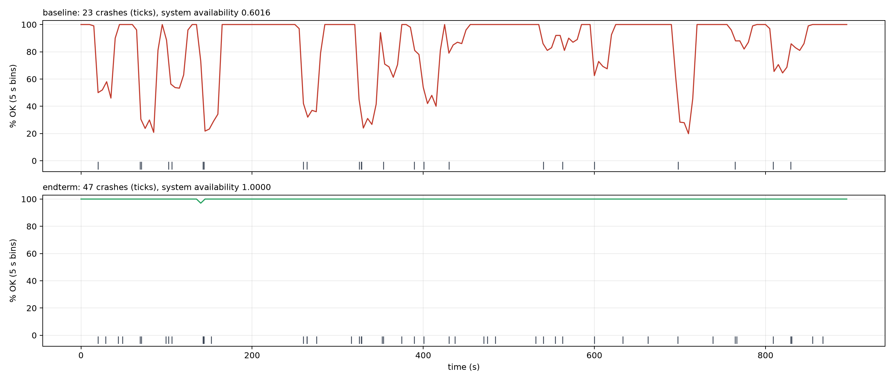
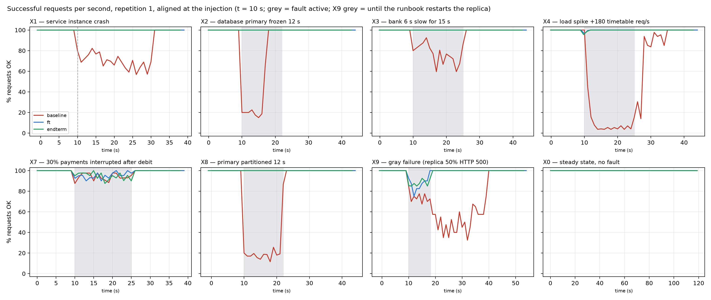

# Resilient University Information System — Final Report

**Integrated Dependability Engineering Capstone · Fault Tolerance and Dependable Computing**

Team: Mukan Idrissov (255567) · Group: CSE-2501M\
Instructor: Azamat Serek\
Repository: <https://github.com/Choppa2077/ft-university> (branch `final`; earlier stages tagged `midterm` and `endterm-submission`)\
Astana IT University, November 2026

---

## Abstract

This report completes a three-stage course project: a small university information system — a
gateway, four services, a replicated SQLite database and an external bank, one container per
instance — built from one code base as a *baseline*, a fault-tolerant build (*ft*) and an improved
build (*endterm*: ft plus seven security controls). Nine service-level objectives were fixed before
the final campaign and each was checked against measured evidence. The campaign ran
126 repetitions, each on a fresh cluster, without a single harness retry:
eight scenarios (a crashed instance, a frozen and a partitioned database primary, a slow bank, a
five-fold load spike, interrupted payments, a gray failure and a fault-free steady state), five
times per build, two security suites, and a 900 s soak test with random crashes per build. The
improved build passed 40/40 fault runs and
all security runs and met every objective. When a component crashed, froze, was cut off or slowed
down, it failed no request, where the baseline failed up to
24.5 % of them; money stayed
consistent in every run, whereas the baseline left up to 148 bank
debits without a payment record and 107 double charges per run.
Under 47 random crashes the improved system had no outage
(availability 1.0000; baseline
0.6016), in line with the
reliability-block-diagram prediction (0.9998 and
0.5812). Two experiments mark the limits of redundancy:
an interrupted payment still shows the student an error although the payment completes, and a
replica that answers half of its requests with errors is not masked at all — only telemetry
revealed it, naming the right replica in 15/15 runs
within 9.2 s. The protection costs
13 instead of 8
containers, 62 % more memory, 36 %
more CPU and 6.4 ms of median payment latency; no alert fired in a
fault-free run. The gateway, the failover monitor and the single host remain single points of
failure.

**Keywords:** dependability, fault tolerance, microservices, database failover, idempotency,
circuit breaker, graceful degradation, observability, gray failure, fault injection, reliability
engineering, service-level objectives, intrusion tolerance.

## Contents

1. Introduction, motivation, and system context
2. Requirements, assumptions, and dependability objectives
3. Fault model, threat model, and failure analysis
4. Reliability engineering calculations
5. System architecture and resilience design
6. Infrastructure and software fault-tolerance implementation
7. Monitoring, observability, and security implementation
8. Verification, validation, and experimental methodology
9. Results and baseline-versus-improved comparison
10. Discussion, limitations, and future work
11. Conclusion
12. References
13. Appendix

---

## 1. Introduction, motivation, and system context

This project grew in four steps. In Assignment 1 we analysed the incident log of a synthetic
university portal on paper: 96.25 % availability over a month, most of the downtime caused by a
database failover that someone had to perform by hand. In Assignment 2 we wrote retry and
checkpoint logic for a payment batch inside one Python process. The **midterm** turned these
ideas into a running system: a small university platform — student registration, tuition
payments, transcripts, timetables — built twice from one code base, a *baseline* with one copy of
everything and a *fault-tolerant* (FT) build with replicas, synchronous database replication with
automatic failover, mirrored storage and the software mechanisms of the course. Its headline
result was about correctness rather than uptime: a 20-second database outage in the baseline left
259 bank debits without a payment record and charged 133 students twice, while the FT build
stayed consistent. The **endterm** moved the same system into containers, added full
observability, seven security controls and a repeated fault-injection suite.

The final project integrates all of this into one engineering argument, which is what this report
is organised around: **requirements → measurable objectives → fault model → reliability analysis
→ mechanisms → telemetry and security → a repeated experiment campaign that checks every objective
against measured evidence.** The system and its code base are the same; the final stage adds:

- **service-level objectives** with indicators, targets and windows, fixed *before* the final
  campaign (Section 2), and a failure-mode-and-effects analysis with single points of failure and
  minimal cut sets for the containerized system (Section 3);
- **reliability metrics measured on containers** — a soak test with random crashes — compared
  with a reliability-block-diagram prediction (Section 4);
- two new experiments: **X0**, a fault-free run that measures the cost of the mechanisms and
  checks for false-positive alerts, and **X9**, a *gray failure* in which a replica answers half of
  its requests with errors while its health checks stay green — something redundancy cannot mask
  and only telemetry can reveal (Sections 8–9);
- for every run: **mechanism-activation counts** (retries, breaker openings, failovers, recovery
  actions), **alert correctness** (did the right alert fire, how fast, and did anything fire that
  should not have), resource use; every experiment repeated **five times per build** on a fresh
  cluster;
- unit tests for the recovery rules, the timeout budgets and the exact configuration difference
  between the builds; a reproducible, Docker-first setup.

**System context.** About 300 synthetic students and staff use four services through one gateway;
an external bank debits tuition. The critical workflow is the **tuition payment**, a multi-step
operation across five components (Figure 1): the payment intent is recorded and replicated
*before* money moves, the bank is called with an idempotency key, and the result is written and
replicated in one transaction. The consequences of failure are not equal: an unavailable
timetable is an annoyance, a failed payment page is a support ticket, but a debit without a
record, a double charge or a wrong transcript is a financial or academic-integrity problem.


## 2. Requirements, assumptions, and dependability objectives

### 2.1 Components and critical functions

| Component | Function | State | Criticality |
|---|---|---|---|
| gateway | single entry point; authentication, authorization, rate limiting, validation; load balancing, retries, breakers, bulkheads, stale cache | in-memory cache | critical path |
| student | profiles, course registration | students, enrollments | high |
| payment | tuition payments through the bank; recovery worker | payments, ledger | **highest (money)** |
| records | transcripts (GPA), end-of-term transcript batch | grades; documents on mirrored storage | high (integrity) |
| timetable | weekly timetable of a group (computed, CPU-heavy) | none | low (may degrade) |
| db-a / db-b | SQLite node, synchronous replication, failover by epoch | all business data | critical |
| monitor | health of every instance every 0.25 s; database failover controller | registry (primary, epoch) | critical for failover |
| bank (external) | debits; a repeated idempotency key returns the original debit | its own ledger | external dependency |
| Prometheus, Alertmanager, Grafana, alert-sink | metrics, alert rules, dashboard, alert delivery log | metrics | observability only |

### 2.2 Terminology

Following Avižienis et al. [1]: a **fault** is the cause (a process is killed, the primary freezes,
the bank answers after 6 s, a replica returns HTTP 500, an attacker forges a token); an **error**
is the resulting wrong internal state (requests in flight lost, no node accepts writes, payment
requests pile up); a **failure** is what the user sees (an HTTP 5xx, a timeout, a double charge, a
wrong transcript, data disclosed to the wrong student). Fault tolerance breaks the chain between
error and failure (masking, failover, retry with idempotency, degradation); observability shortens
the time from error to detection and diagnosis; security controls stop a malicious fault from
becoming an error in the first place.

### 2.3 Requirements

The midterm requirements R1–R6 and the endterm requirements R7–R12 remain in force:
**R1** a single crash fails ≤ 1 % of user requests · **R2** a failure is detected within 1 s and
the user-visible interruption is short · **R3** no acknowledged write is lost · **R4** money is never
inconsistent (no double charge, no debit without a record) · **R5** under ~5× load the core p95 stays
below 1 s · **R6** a corrupted transcript is never shown · **R7** every unauthorized action is denied
and the data is unchanged · **R8** malformed or abusive input is rejected and the service stays up ·
**R9** every lasting incident raises an alert and its detection delay is recorded · **R10** the audit
trail is complete and tamper-evident · **R11** no service runs with a missing or placeholder secret ·
**R12** a network partition causes no split brain and no inconsistency.

### 2.4 Service-level objectives

The requirements are turned into objectives with an indicator (SLI), a target, a measurement
window and a data source. "Core" means the student and payment services, which carry the
workflows that change state (registration, payment).
The targets apply to the improved build (`endterm`); the `baseline` and `ft` builds are measured
against the same targets for comparison. **These targets were fixed before the final campaign was
run** (`docs/final/REQUIREMENTS_AND_SLOS.md`, commit `7e19710`).

| SLO | Indicator (SLI) | Target | Window | Source | Verified by |
|---|---|---|---|---|---|
| SLO-1 steady-state availability | successful / all requests at the client | ≥ 99.9 % | 120 s run | client log | X0 |
| SLO-2 availability under one component fault (R1) | failed / all requests after the injection | ≤ 1 % | each run | client log | X1, X2, X3, X8 |
| SLO-3 latency (R5) | core p95 at the gateway (20 s windows, max over the run) | ≤ 100 ms steady; < 1 s during a 5× spike | each run | Prometheus | X0, X4 |
| SLO-4 detection (R2, R9) | (a) injection → automatic detection by gateway/monitor; (b) injection → first related alert at the pager | (a) ≤ 1 s; (b) ≤ 10 s for incidents lasting ≥ 10 s | per incident | event log, alert-sink | (a) X1, X2, X8; (b) X2, X3, X4, X8, X9 |
| SLO-5 recovery | user-visible interruption = injection → last failed request | ≤ 2 s for instance and database faults | per incident | client log | X1, X2, X8 |
| SLO-6 integrity (R3, R4, R12) | orphan debits, double charges, ledger mismatches, stuck payments, lost acknowledged writes; replica identical | all zero / identical in 100 % of runs | end of run (quiet system) | consistency check | all fault runs |
| SLO-7 security (R7, R8, R10) | refused probes; data checksum before = after; audit chain | 100 %; unchanged; verifies | each run | security harness | X5, X6 |
| SLO-8 long-run availability | share of 1 s windows with every service up, under random crashes (MTTF 240 s per service process, 480 s per database node) | ≥ 99.5 % | 900 s soak | client log | soak |
| SLO-9 alert quality | (a) alerts in a fault-free run; (b) gray failure attributed to the right replica | (a) none; (b) correct, ≤ 15 s | each run | alert-sink, Prometheus | X0, X9 |

The baseline is not expected to meet these targets — it is the "before" measurement. The control
plane (gateway, monitor, the single host) is deliberately outside the objectives: these are known
single points of failure (Section 3.4) and are documented rather than tested by killing them.

### 2.5 Assumptions

- **Fault classes:** crash, timing (frozen or slow component), omission (network partition), value
  (corrupted storage; a replica returning errors), overload, and malicious (unauthorized, forged,
  malformed or abusive requests; a compromised service container). Byzantine replicas and
  common-mode bugs that hit both replicas identically are out of scope.
- **Environment:** one host (Apple M4 Pro; Docker Desktop VM with 12 vCPU and ~7.7 GiB; Docker
  28.5), one container per instance with CPU and memory limits, Python 3.12 in the containers.
  Logical nodes A and B are containers on the same VM.
- **Compressed time:** faults last 12–20 s, alert windows 10 s, scraping and rule evaluation every
  1 s, the baseline's "manual repair" 20 s, soak crash rates far above real ones. Absolute values
  are specific to this setup; comparisons between builds are the point.
- **Clients:** open-loop workload (requests are sent on schedule regardless of earlier ones),
  40 req/s in experiments with a fixed mix (35 % profile reads, 15 % registrations, 20 % payments,
  15 % transcripts, 15 % timetables) and seed; 20 req/s in the soak. A student whose payment fails
  presses "Pay" once more after 1 s; the FT/endterm client reuses the same idempotency key. Client
  timeout 5 s.
- **Control plane** (gateway, monitor, Prometheus/Alertmanager) is not failed in the experiments.
- **Data** is synthetic (300 generated students); secrets are generated locally and never committed.

## 3. Fault model, threat model, and failure analysis

### 3.1 Failure scenarios

| ID | Fault (class) | Error | Failure without protection (baseline) | Where the improved build breaks the chain | Verified by |
|---|---|---|---|---|---|
| F1 | service process crash (crash) | instance gone, requests in flight lost | 5xx for every request routed to it until a manual restart (~20 s) | gateway: refused connection → replica marked down, request retried on the other replica; Docker restart policy | X1, soak |
| F2 | database primary crash (crash) | no node accepts writes | writes fail; debits without records; double charges on retry | monitor promotes the in-sync replica; epoch fences the old primary; checkpoint + idempotency | soak |
| F3 | database primary frozen (timing) | process alive but silent | writes time out; money inconsistent as in F2 | as F2; bounded DB timeouts (1 s per try, 4 s deadline) | X2 |
| F4 | network partition, primary isolated (omission) | both nodes alive, cannot talk; split-brain risk | as F2 | failover + epoch fencing: the old primary's writes are rejected and it steps down | X8 |
| F5 | slow external bank (timing) | payment requests pile up | client times out at 5 s, retries → charged twice | 0.8 s timeout, 2 retries with the same key, breaker, payment accepted as QUEUED (202) | X3 |
| F6 | crash in the middle of a payment | debit exists, row missing or PENDING | money without a record; a retry charges again | PENDING checkpoint; retry with the same key or the recovery worker rolls forward/back | X7 |
| F7 | load spike ~5× (overload) | queues grow, CPU saturated | timeouts everywhere; no recovery after the burst (metastable) | per-service bulkhead sheds load; stale timetable cache; replicas | X4 |
| F8 | gray failure: replica returns HTTP 500 while healthy | one replica wrong, routing believes it healthy | a share of requests fails — in **both** builds | **observability**: per-replica 5xx ratio and `ReplicaErrorRate` name the replica; runbook restarts it | X9 |
| F9 | silent corruption of stored transcripts (value) | wrong bytes on disk | wrong GPA served with HTTP 200 | SHA-256 per document, read from the mirror, repair, scrub | midterm E7; `test_storage` |
| F10 | unauthorized, forged, malformed, abusive requests | requests that must never run | anyone reads or changes anything | JWT, role + object authorization, validation, rate limiting, audit log | X5, X6 |
| F11 | compromised service container (insider) | attacker talks to the database directly | full database access, DDL, forced promotion | per-service DB token, SQLite authorizer, endpoint ACL | X5 (insider) |
| F12 | control-plane failure (gateway, monitor, host) | entry point or failover controller gone | outage / no failover | **not mitigated** — single points of failure (3.4) | documented |

### 3.2 Failure-mode and effects analysis

S = severity of the user-visible failure, O = how often the fault occurs, D = how hard it is to
detect (1 = immediately, 5 = not at all), on a 1–5 scale, RPN = S × O × D (IEC 60812 [14]). **The
ratings are engineering judgement, not measurements**; the measured evidence for each row is the
experiment in Section 3.1 and its result in Section 9.

| ID | Failure mode | S base → impr. | O | D base → impr. | RPN base → impr. | Residual risk in the improved build |
|---|---|---|---|---|---|---|
| F1 | outage after a crash | 3 → 1 | 4 | 1 → 1 | 12 → 4 | both replicas of a service crash within ~1 s of each other |
| F2 | primary loss, money inconsistent | 5 → 2 | 2 | 1 → 1 | 10 → 4 | monitor down at the same time (cut set {monitor, primary}) |
| F3 | database freeze | 5 → 2 | 2 | 2 → 1 | 20 → 4 | ~1 s latency spike during failover |
| F4 | partition, split brain | 5 → 2 | 2 | 2 → 1 | 20 → 4 | single failover controller, no quorum |
| F5 | slow bank, double charges | 4 → 2 | 3 | 2 → 2 | 24 → 12 | payments complete late (eventual consistency) |
| F6 | interrupted payment, orphan debit | 5 → 2 | 2 | 5 → 2 | 50 → 8 | the student still sees an error although the payment completes |
| F7 | overload collapse | 4 → 2 | 3 | 2 → 2 | 24 → 12 | stale or fast-failed timetable answers |
| F8 | gray failure | 3 → 3 | 2 | 4 → 2 | 24 → 12 | errors continue until someone (or the runbook) acts |
| F9 | wrong transcript shown | 5 → 1 | 1 | 5 → 1 | 25 → 1 | both mirror copies share one Docker volume |
| F10 | unauthorized access, abuse | 5 → 1 | 3 | 5 → 2 | 75 → 6 | a stolen valid token |
| F11 | compromised container | 5 → 2 | 1 | 5 → 2 | 25 → 4 | the service's own tables stay writable |
| F12 | control-plane failure | 5 → 5 | 1 | 1 → 1 | 5 → 5 | unchanged — the main remaining weakness |

### 3.3 Threat model

The full model is in `docs/endterm/THREAT_MODEL.md`. **Assets:** academic records and money
(integrity), student data (confidentiality), availability during registration week, the audit
trail, the secrets. **Trust boundaries:** the Internet edge (only the gateway is published, on
loopback), the application network, the internal data and bank networks (no route outside), the
operations network. **Attackers:** an anonymous client, an authenticated student, and a
compromised application container holding its own database credential. A STRIDE analysis lists
fifteen threats (forged or `alg:none` tokens, spoofed identity headers, grade tampering, direct SQL
or DDL from a container, repudiation, IDOR, database dumps, metrics scraping, request floods,
abuse of the fault-injection API, malformed input, idempotency-key replay, password brute force,
forced promotion, missing secrets), each mapped to a control (Section 7.6) and to the experiment
that verifies it (X5, X6 and unit tests). The key insight carried from the endterm: an attacker and
a bug threaten the same asset — integrity — and the same controls defend against both.

### 3.4 Single points of failure and minimal cut sets

Top event: **"a student cannot submit a tuition payment"**.

| Order | Baseline | Improved (`endterm`) |
|---|---|---|
| 1 | {gateway}, {payment}, {database}, {bank}, {host} | {gateway}, {host}, {shared `run` volume} — the bank is no longer a cut set for *submitting* a payment (it is accepted as QUEUED) |
| 2 | — | {payment-a, payment-b}, {db-a, db-b}, {monitor, database primary} |

Remaining single points of failure: the **gateway** (one container; Docker restarts it in about a
second, but nothing is reachable meanwhile — fix: two gateways behind a virtual IP); the **monitor**
(the only failover controller — fix: a three-member consensus coordinator such as etcd/Patroni);
the **single host** (nodes A and B share a VM — fix: two hosts with anti-affinity); the shared
**`run` volume** (registry of the current primary, logs, audit log and both transcript "disks":
mirroring protects against a corrupted file, not against losing the volume); the **bank** (external,
mitigated by idempotent debits, breaker and queueing); and **Prometheus/Alertmanager** (not on the
request path: if they fail, incidents are still handled automatically but no longer reported).

## 4. Reliability engineering calculations

### 4.1 Definitions, formulas and units

For a component observed for a window of length *T* with *n* failures, total down time *D* and up
time *U = T − D* (seconds of compressed time):

- **MTTF** = *U / n* (mean time to failure), **MTTR** = *D / n* (mean time to repair/recover),
- **MTBF** = *T / n* = MTTF + MTTR,
- **availability** *A* = *U / T* = MTTF / MTBF,
- **observed failure rate** λ = *n / U*, reported per hour of up time.

For *k* identical copies the window is *k·T*. For the reliability block diagram (RBD), the five
component kinds (database, student, payment, records, timetable) are in **series** (the system is
up only if every kind is up); in a replicated build each kind is a **parallel** pair:
*A_pair = 1 − (1 − A)²*, and *A_system = Π A_kind*. The gateway, monitor and bank are left out of
both builds because they are not failed (as in the midterm).

### 4.2 Measurement method (soak test)

`experiments/soak_docker.py` runs each build for **900 s** at 20 req/s while application processes
crash at random. Every application-node instance has its own seeded schedule of exponentially
distributed times to failure — mean **240 s** for a service process and **480 s** for a database
node — so node-A instances crash at the same moments in both builds and the replicated build
additionally loses node-B instances. A crash is `kill -9` of every process inside the container;
Docker's restart policy brings it back (baseline: after the emulated 20 s operator delay; improved:
immediately, database nodes after 3 s). As in the midterm, a planned crash is skipped if the
instance is already down. Three levels are measured:

- **component level** — from the monitor's health checks every 0.25 s: down from the first failed
  check until the check that sees the instance ready again;
- **service level** — from the client log: a service is down in a 1 s window if fewer than half of
  its requests succeeded; down windows closer than 2 s are merged into one outage;
- **system level** — up only while all four services are up; plus the share of successful user
  actions (a payment and its retry count once).

**Assumptions:** exponential (memoryless), independent times to failure per instance; repair =
restart; compressed time; no failure of the control plane; the observation window is one soak run
per build, so the small numbers of failures make the estimates rough (a confidence interval for
*n* events is wide); the comparison between builds, which share the crash schedule, is the robust
part.

### 4.3 Results

**baseline** — 900 s, 20 req/s, crashes injected 23 (planned 24)

| Component | Copies | Failures | Downtime s | MTTF s | MTTR s | MTBF s | A | λ (1/h) |
|---|---|---|---|---|---|---|---|---|
| db | 1 | 3 | 62.04 | 279.3 | 20.68 | 300.0 | 0.9311 | 12.89 |
| student | 1 | 5 | 104.82 | 159.0 | 20.96 | 180.0 | 0.8835 | 22.64 |
| payment | 1 | 6 | 125.97 | 129.0 | 21.0 | 150.0 | 0.8600 | 27.91 |
| records | 1 | 3 | 63.14 | 279.0 | 21.05 | 300.0 | 0.9298 | 12.91 |
| timetable | 1 | 5 | 104.91 | 159.0 | 20.98 | 180.0 | 0.8834 | 22.64 |

| Service (user view) | Outages | Downtime s | MTTF s | MTTR s | A (time) | A (requests) |
|---|---|---|---|---|---|---|
| student | 7 | 148 | 107.6 | 21.14 | 0.8357 | 0.8395 |
| payment | 8 | 168 | 91.6 | 21.0 | 0.8135 | 0.6920 |
| records | 5 | 64 | 167.4 | 12.8 | 0.9290 | 0.9199 |
| timetable | 5 | 104 | 159.4 | 20.8 | 0.8846 | 0.8835 |
| system | 15 | 359 | 36.1 | 23.93 | 0.6016 | 0.8235 |

User actions: 18000, failed 2619, success 0.8545. System failure rate 99.82 outages per hour of up time. RBD prediction of system availability: 0.5812 (measured 0.6016).

Two planned crashes of db-a 0.28 s apart (t = 327.69 and 327.966 s) hit the same dying process and count as one failure.

**endterm** — 900 s, 20 req/s, crashes injected 47 (planned 47)

| Component | Copies | Failures | Downtime s | MTTF s | MTTR s | MTBF s | A | λ (1/h) |
|---|---|---|---|---|---|---|---|---|
| db | 2 | 3 | 11.37 | 596.2 | 3.79 | 600.0 | 0.9937 | 6.04 |
| student | 2 | 14 | 14.23 | 127.6 | 1.02 | 128.6 | 0.9921 | 28.22 |
| payment | 2 | 11 | 11.71 | 162.6 | 1.06 | 163.6 | 0.9935 | 22.14 |
| records | 2 | 8 | 7.89 | 224.0 | 0.99 | 225.0 | 0.9956 | 16.07 |
| timetable | 2 | 10 | 9.94 | 179.0 | 0.99 | 180.0 | 0.9945 | 20.11 |

| Service (user view) | Outages | Downtime s | MTTF s | MTTR s | A (time) | A (requests) |
|---|---|---|---|---|---|---|
| student | 0 | 0 | – | – | 1.0000 | 0.9997 |
| payment | 0 | 0 | – | – | 1.0000 | 1.0000 |
| records | 0 | 0 | – | – | 1.0000 | 1.0000 |
| timetable | 0 | 0 | – | – | 1.0000 | 1.0000 |
| system | 0 | 0 | – | – | 1.0000 | 0.9998 |

User actions: 18000, failed 3, success 0.9998. System failure rate 0.0 outages per hour of up time. RBD prediction of system availability: 0.9998 (measured 1.0000).

Two planned crashes of db-a 0.28 s apart (t = 327.673 and 327.957 s) hit the same dying process and count as one failure.

Both student replicas down at once: t = 143.06–143.53 s (0.47 s), 3 failed requests.



**Baseline.** 23 crashes caused
15 system outages, together
359 s of the 900 s: system availability
0.6016, and
2619 of
18000 user actions failed. Every component
outage lasted about the emulated 20 s repair (MTTR ≈ 21 s). The student and payment services were
down longer than their own processes
(148 and
168 s against
104.82 and
125.97 s), because they also stop whenever the
single database is down — the series structure of the block diagram, visible in the data.

**Improved build.** 47 crashes, now on both nodes, caused no
outage: every service and the system were up in every 1 s window, and
3 of
18000 user actions failed (success
0.9998). A service replica was back after
about 1.02 s, a database node after
3.79 s (including its deliberate 3 s delay), while the
other replica served. Even a single copy was available far more of the time than in the baseline
(payment 0.9935 against
0.8600) although it crashed as often,
because a repair takes about a second instead of twenty.

**Prediction versus measurement.** The block diagram built from the measured component
availabilities predicts 0.5812 for the baseline
(measured 0.6016) and
0.9998 for the improved build (measured
1.0000 by time and
0.9998 by requests). For the
baseline the measurement is slightly better than the prediction: several crashes overlapped in
time, and overlapping outages cost the system less than the independence assumption of the
diagram expects; with fifteen outages in one run the difference is within the uncertainty. For the
improved build the diagram predicts about
0.18 s of system downtime in 900 s — the time
during which both replicas of some service are down together. Exactly one such moment occurred: the
schedule crashed `student-a` and, half a second later, `student-b` — the minimal cut set
{student-a, student-b} of Section 3.4, for real. The event log (verbatim, times in seconds since
the start of the soak):

```
t= 142.454  harness    kill -9        student-a
t= 142.507  gateway    UPSTREAM_DOWN  student-a
t= 142.809  monitor    DOWN           student-a
t= 142.999  harness    kill -9        student-b
t= 143.058  gateway    UPSTREAM_DOWN  student-b
t= 143.320  monitor    DOWN           student-b
t= 143.427  student-a  STARTED
t= 143.530  gateway    UPSTREAM_UP    student-a
t= 143.571  monitor    UP             student-a
t= 143.817  harness    kill -9        db-a
t= 144.012  student-b  STARTED
t= 144.077  monitor    DOWN           db-a
t= 144.077  monitor    UP             student-b
t= 144.138  gateway    UPSTREAM_UP    student-b
t= 144.327  db-b       PROMOTED
t= 144.328  monitor    DB_FAILOVER
t= 144.346  payment-a  DB_SWITCHED
t= 144.358  student-b  DB_SWITCHED
t= 144.372  student-a  DB_SWITCHED
t= 144.502  payment-b  DB_SWITCHED
t= 144.607  records-a  DB_SWITCHED
t= 144.639  records-b  DB_SWITCHED
```

Between the gateway marking `student-b` down and `student-a` returning, no student replica existed
for 0.47 s, and the
3 requests that arrived in that gap were
answered with a fast 503 — the only failed requests of the improved soak. That is below the 1 s
resolution of the time-based measure, which is why availability by requests is reported as well.
The same excerpt shows a database failover a moment later: the primary was killed, the replica was
promoted about half a second later, and all six service instances had switched to it within another
third of a second, without a failed request. Two planned crashes of `db-a` only
0.28 s apart reached the same dying process and count as
one failure, in both builds (noted under the tables).

**Worked example (payment, improved build).** Two copies observed for 900 s give a window
*k·T* = 2 × 900 s = 1800 s. With
*n* = 11 failures and
*D* = 11.71 s of down time:
MTTF = (1800 − *D*) / *n* = 162.6 s,
MTTR = *D* / *n* = 1.06 s,
MTBF = MTTF + MTTR = 163.6 s,
*A* = MTTF / MTBF = 0.99349, and
λ = *n* / *U* = 22.14 failures per hour
of up time (compressed time). As a parallel pair, *A_pair* = 1 − (1 − *A*)² =
0.999958; in series with the other four kinds,
*A_system* = 0.999805.

**Illustrative extrapolation — assumptions, not measurements.** The soak compresses time: its crash
rates are thousands of times higher than real ones. Suppose instead that each service process
crashes once every 30 days and each database node
once every 60 days (assumed rates), and that repairs take
what we measured. The series baseline would then be down about
19 minutes a year with the
emulated 20 s repair, and about 27
hours a year (availability
0.9969) with a realistic 30-minute manual
repair. The replicated services, repaired in about a second, would contribute
0.04 ms a year. The availability
of the improved system is then bounded entirely by what the model leaves out — the gateway, the
monitor, the host and correlated failures (Section 3.4) — which is where the future work of
Section 10 begins.

## 5. System architecture and resilience design

### 5.1 Service boundaries and deployment


Every instance is a container built from one image; the container's command selects which
instance it is (`payment-a`, `db-b`, …). The topology is defined once in `ftuni/config.py`, and
`deploy/make_compose.py` generates `docker-compose.yml` from it, so the two cannot drift. The
baseline runs node A only; `ft` and `endterm` run every service and the database twice, on logical
nodes A and B. Discovery is by DNS name on the Docker networks.

| Container | CPU limit | Memory limit | Copies (baseline / improved) |
|---|---|---|---|
| gateway | 1.0 | 384 MB | 1 / 1 |
| monitor | 0.5 | 256 MB | 1 / 1 |
| bank (external, simulated) | 0.5 | 256 MB | 1 / 1 |
| db node | 1.0 | 512 MB | 1 / 2 |
| student, payment, records, timetable (each) | 0.5 | 256 MB | 1 / 2 |
| Prometheus · Alertmanager · Grafana · alert-sink | 1.0 · 0.25 · 0.5 · 0.25 | 512 · 128 · 256 · 128 MB | 1 / 1 |

Total limits of the application containers: baseline 8 containers, 5 CPU, 2.4 GB; improved 13
containers, 8 CPU, 3.9 GB; plus 2 CPU and 1 GB for observability in both. The limits exist so that
the load experiment can saturate a service on a 12-vCPU VM, as it did on the midterm's 2-vCPU box.

### 5.2 Networks and data flows

Four networks enforce who may talk to whom: `app` (gateway ↔ services; the gateway publishes
`127.0.0.1:8000`), `data` (services ↔ database nodes, internal, no route outside), `bank` (payment
↔ bank, internal) and `ops` (Prometheus, Alertmanager, Grafana, alert-sink). Only the gateway and
the monitoring UIs publish ports, and only on loopback. The payment data flow is Figure 1; the
other workflows are simpler: a registration is one replicated insert (idempotent by design), a
transcript is a read of grades plus a checksummed document, a timetable is computed without the
database.

### 5.3 Restart, replicas, health and readiness

Every container has `restart: always` and a `HEALTHCHECK` on `/health/ready`. Liveness means the
process answers; readiness means it can do useful work (a database node is ready if it is the
primary, or a replica holding a complete copy). Service readiness deliberately does **not** depend
on the database: otherwise a database failover would make every service "not ready" at once and
the gateway would take the whole system out of rotation for a problem the database client handles
itself. The gateway probes every replica every 0.3 s (two failures mark it down, one success brings
it back) and also detects failures passively (a refused connection marks a replica down at once);
the monitor probes every instance every 0.25 s. A rolling replacement of one replica at a time
causes no failed request, because the gateway routes around a replica that is down (Section 9, X1).

### 5.4 Behaviour when a dependency fails

| Dependency fails | Improved behaviour | Mechanisms |
|---|---|---|
| one service replica | requests go to the other replica; failed idempotent requests are retried there | passive + active health checks, retry, restart policy |
| a whole service (both replicas) | fast 503, or a stale timetable marked `X-Degraded` | breaker per service, stale cache |
| database primary | the DB client keeps retrying for up to 4 s while the monitor promotes the replica (~0.5–0.7 s) | failover, epoch fencing, client deadline |
| database replica | the primary continues alone and marks the replica lagging; automatic failover is blocked until it is back in sync | lagging state, resync from snapshot |
| bank | after 0.8 s timeouts and 2 retries the breaker opens; payments are accepted as QUEUED (202) and finished later | timeout, retry, breaker, queue, recovery worker |
| timetable overload | the bulkhead (6 concurrent requests) sheds the excess immediately; answers come from the stale cache | bulkhead, stale cache |
| monitor | no effect on requests; no failover while it is down | — (single point of failure) |
| gateway | outage until Docker restarts it | — (single point of failure) |

### 5.5 Resource and load assumptions

Experiments run at 40 req/s, the soak at 20 req/s; the load spike adds 180 timetable req/s for 15 s
(about 5× the normal total). The timetable is CPU-heavy by design (about 24 ms per request on the
midterm machine) and limited to 0.5 CPU per replica, so it saturates under the spike while the
other services keep their CPU.
Everything runs on one VM; absolute throughput numbers are not a capacity claim.

**Why Docker Compose and not Kubernetes.** The whole system must run reproducibly on one laptop
for the instructor, and Compose maps one-to-one onto Kubernetes concepts: `restart: always` →
`restartPolicy`, healthchecks → liveness/readiness probes, DNS names → Services, internal networks
→ NetworkPolicies, Docker secrets → Secrets, two replicas on nodes A and B → a Deployment with
anti-affinity [21]. Running on Kubernetes (or several hosts) is future work (Section 10).

## 6. Infrastructure and software fault-tolerance implementation

### 6.1 Infrastructure-level mechanisms

1. **Replicated service instances with load balancing.** Two replicas of every service on
   different logical nodes; the gateway keeps a pool per service, balances round-robin over
   healthy replicas, and removes a replica on a refused connection within milliseconds.
2. **Database replication with automatic failover and fencing.** Writes go only to the primary; each
   transaction gets a log sequence number and is shipped to the replica and acknowledged *before*
   the commit, so an acknowledged write exists on both nodes. When the primary misses three health
   checks and the replica is in sync, the monitor writes a new epoch and the new primary's name to
   the registry and promotes the replica. The epoch is a fencing token [11]: every write carries the
   highest epoch the client has seen; a node with a lower epoch refuses it, and a primary that tries
   to replicate into a node with a higher epoch rolls back and steps down — no split brain.
3. **Self-healing restart.** Docker's restart policy plus health checks replace the midterm's
   hand-written supervisor. The baseline emulates a manual repair with a 20 s delay in the container
   entrypoint (`ftuni/run.py`).
4. **Mirrored storage with checksums** (RAID-1 idea [3]): every transcript is written to two
   "disks" with its SHA-256; a read verifies it, serves the mirror if needed and repairs the bad copy.
5. **Snapshots for resynchronisation and backup.** A database node that restarts as a replica copies
   a consistent snapshot from the primary and follows the log; the same endpoint (only callable with
   the monitor's or the peer's credential) yields a consistent backup. Replication protects against
   losing hardware, not against a wrong write — that is what an off-host snapshot would add.

### 6.2 Software-level mechanisms

- **Timeouts** on every call across a process boundary: bank 0.8 s; gateway 2.5 s (student),
  4.5 s (payment), 3.0 s (records), 1.5 s (timetable); database 1 s per try with a 4 s deadline;
  the client waits 5 s. The payment chain is nested — three bank attempts plus backoff (≤ 2.7 s)
  fit in the gateway's 4.5 s, which fits in the client's 5 s — and every gateway timeout exceeds the
  time a database failover takes (`tests/test_mechanisms.py`). Not everything is strictly nested,
  though: the database client's 4 s deadline is longer than the gateway's 2.5 s and 3.0 s for
  student and records requests (see Section 10).
- **Bounded retries with full-jitter exponential backoff** [8]: the gateway retries once more on the
  other replica, the payment service retries the bank twice, the database client retries until its
  deadline. Only idempotent requests are retried (GET, or POST with an Idempotency-Key); a POST
  without a key is retried only if the connection was refused, because then it provably never
  arrived.
- **Circuit breakers** [9]: payment → bank (opens after 5 consecutive failures, trial after 3 s) and
  one per service at the gateway (8 failures, trial after 2 s).
- **Idempotency and duplicate-request detection**, three layers: the client's key (reused on its
  retry) makes the payment service return or finish the original payment; the same key makes the bank
  return the original debit; every database write carries a transaction id that the node deduplicates.
  The endterm binds a key to the payer and the amount, so it cannot be replayed for another charge.
- **Checkpointing.** For payments the checkpoint is the PENDING row written and replicated before the
  bank is called. For the end-of-term transcript batch, the job stores its position every 10
  transcripts and holds a 3 s lease, so another replica resumes it from the last checkpoint
  (midterm E5b).
- **Rollback, roll-forward and compensation.** A recovery worker in every payment replica looks at
  payments left PENDING or QUEUED for more than 2 s. The decision is a pure function,
  `recovery_action()` in `ftuni/services/payment.py`, tested for every branch: QUEUED → settle once
  the bank answers; PENDING and the bank has the debit → **roll forward**; PENDING, no debit and
  older than 10 s → **roll back**; anything else → wait. A debit that appears after a rollback is
  refunded (compensation), and a reconciliation loop checks recent failures against the bank.
- **Health checks** (liveness and readiness) — Section 5.3.
- **Graceful degradation:** payments accepted as QUEUED (202) while the bank is down; a stale
  timetable served with `X-Degraded`; a per-service **bulkhead** at the gateway (at most 6
  concurrent timetable requests, 32 records, 48 payment, 64 student requests) that sheds load
  instead of queueing it.

### 6.3 Traceability: mechanism → code → test → experiment

| Mechanism | Code | Test | Experiment evidence (Section 9) |
|---|---|---|---|
| replicas + load balancing | `ftuni/gateway.py` (pools, health loop), `deploy/make_compose.py` | `test_mechanisms::test_only_the_replicated_builds_have_two_copies` | X1 (replica marked down, 0 failed) |
| DB replication, failover, fencing | `ftuni/dbnode.py`, `ftuni/monitor.py`, `ftuni/dbclient.py` | `test_dbnode` (fencing, dedup) | X2, X8, soak (failovers, fencing) |
| self-healing restart | `docker-compose.yml`, `deploy/healthcheck.sh`, `ftuni/run.py` | — | X1, X9, soak (restarts, MTTR) |
| mirrored storage + checksums | `ftuni/storage.py` | `test_storage` | midterm E7 |
| timeouts | `ftuni/config.py` (`Policy`) | `test_mechanisms` (budgets) | X2, X3 |
| retries + backoff | `ftuni/resilience.py`, gateway, payment, dbclient | `test_resilience::test_backoff…` | X1, X2, X3 (retry counts) |
| circuit breaker | `ftuni/resilience.py` | `test_resilience` (3 tests) | X3 (breaker openings) |
| idempotency, duplicates | `ftuni/services/payment.py`, bank, `ftuni/dbnode.py` | `test_dbnode`, `test_integration` (2 tests) | X3, X7 (duplicates caught, 0 double charges) |
| checkpointing | payment PENDING row; `ftuni/services/records.py` (batch lease) | — | X7; midterm E5b |
| rollback / recovery / compensation | `payment.recovery_action`, `recover_one`, `reconcile_failed` | `test_mechanisms` (9 cases) | X7 (roll forward / back), X3 (queue drained) |
| health checks | `ftuni/common.py` | `test_integration` (live cluster) | X1, X2 |
| graceful degradation, bulkhead | gateway `fallback`, bulkheads; payment queue | `test_resilience::test_bulkhead…` | X3 (queued), X4 (shed, stale answers) |

## 7. Monitoring, observability, and security implementation

### 7.1 Metrics

Every container exposes Prometheus metrics (the gateway's only with the operator token), scraped
every second:

| Metric | Meaning |
|---|---|
| `ftuni_http_requests_total{service,route,method,status}` | requests answered, by status (rate, error ratio) |
| `ftuni_http_request_duration_seconds` (histogram) | latency; p95 via `histogram_quantile` |
| `ftuni_gateway_{requests,retries,shed,degraded,unavailable}_total` | gateway mechanism activations |
| `ftuni_gateway_upstream_up`, `ftuni_monitor_target_up` | the gateway's and the monitor's view of every instance |
| `ftuni_breaker_open{target}` | circuit breakers open |
| `ftuni_db_is_primary`, `ftuni_db_epoch`, `ftuni_db_lsn`, `ftuni_db_replication_ok` | database role, fencing epoch, replication state |
| `ftuni_payments_unfinished{status}` | payments PENDING / QUEUED |
| `ftuni_auth_denied_total{reason}`, `ftuni_rate_limited_total`, `ftuni_audit_records_total` | security events |
| `ftuni_events_total{event}` | every structured log event, by type |
| `process_cpu_seconds_total`, `process_resident_memory_bytes` | resource use (trade-off measurements) |

### 7.2 Structured logs and correlation IDs

Every process writes JSON lines (`ts`, `inst`, `ev`, `request_id`, details). The gateway assigns an
`X-Request-ID` to each request (or keeps the client's), forwards it on every hop and returns it; every
log line on the path carries it. One payment followed through all containers by its ID (real output
of a demo run on the `endterm` build; the comments in parentheses are ours):

```
db-a       REQUEST            /query                (idempotency key known?)
db-a       REQUEST            /query
db-b       REQUEST            /replicate            (PENDING row reaches the replica…)
db-a       REQUEST            /tx                   (…before the primary commits it)
db-a       REQUEST            /query
bank       REQUEST            /debit
db-b       REQUEST            /replicate            (COMPLETED + ledger, replicated)
db-a       REQUEST            /tx
payment-a  PAYMENT_COMPLETED  <idempotency key>
payment-a  REQUEST            /payments
gateway    REQUEST            /payments             (outermost hop finishes last)
```

### 7.3 Dashboard

The Grafana dashboard is generated from code (`deploy/grafana/make_dashboard.py`). Rows:
*users' view* (request rate, error ratio and p95 per service at the gateway; degraded, shed and
retried requests; firing alerts), *instances* (Prometheus scrape status, the gateway's view of every
replica, 5xx ratio per replica — where masked failures show up — and CPU per instance), *database
and payments* (role and epoch, replication in sync, unfinished payments and open breakers) and
*security* (refused requests by reason, rate limiting, audit records). Screenshots from the
endterm runs are in Appendix C.

### 7.4 Alert rules

Twelve rules in three groups. Windows are 10 s because the experiments are short; production
values would be minutes, alerting on SLO burn rates [7].

| Rule | Detects | Threshold | Expected response |
|---|---|---|---|
| InstanceDown | instance does not answer scrapes | `up == 0` for 2 s | automatic routing/restart; team checks logs if not back in 30 s |
| UserFacingErrorRate | users get errors | 5xx > 5 % of a service's requests (10 s) for 3 s | page on-call: masking failed |
| ReplicaErrorRate | one replica failing (maybe masked) | 5xx > 20 % of a replica's requests for 3 s | inspect / drain / restart that replica |
| HighLatencyP95 | slow service | p95 > 1 s for 3 s | check load, dependencies, CPU |
| LoadShedding | bulkhead full | > 1 shed req/s for 2 s | scale out, find the traffic source |
| CircuitBreakerOpen | dependency failing | breaker open for 2 s | automatic degradation; check the dependency |
| PaymentsUnfinished | payments stuck | PENDING/QUEUED > 0 for 15 s | recovery worker; check bank and worker |
| DatabaseFailover | primary changed | any failover in the last minute | find why the old primary failed |
| DBReplicationLost | primary without a sync replica | for 5 s | bring the replica back (failover blocked) |
| AuthFailureSpike | credential stuffing, forgery, scanning | > 1 refused auth/s for 2 s | look up actors in the audit log |
| RateLimitSpike | abusive client | > 5 throttled req/s for 2 s | identify the account |
| InvalidInputSpike | fuzzing or broken client | > 1 rejected malformed req/s for 2 s | check validation audit records |

Alertmanager delivers every alert to a webhook, the **alert-sink**, which stores its exact arrival
time; detection delays are measured from these timestamps, not estimated.

### 7.5 Incident detection and diagnosis

Detection happens in two layers. The **automatic layer** (the gateway on a refused connection, the
monitor's probes every 0.25 s, the payment service's breaker) acts within milliseconds to a second
and needs no human. The **alert layer** is for humans and uses windows to avoid paging on blips, so
it is slower by design. Diagnosis follows a fixed path: the alert's labels name the service or
replica → the dashboard row shows which mechanism is active → a request ID from the client or the
logs reconstructs the path across containers. X9 automates the first step as an **on-call runbook**:
it waits for `ReplicaErrorRate`, reads the replica name from the alert's labels and restarts that
replica.

### 7.6 Security controls and intrusion tolerance

Seven controls, each behind a `Policy` flag and present only in the `endterm` build:

1. **Authentication (JWT)** at the gateway, the policy-enforcement point: salted PBKDF2 password
   hashes, short-lived HS256 tokens, algorithm pinned (forged and `alg:none` tokens rejected), issuer
   and expiry required [17]; identity headers from clients are stripped and set by the gateway.
2. **Authorization**, default deny: role-based (a student cannot change grades) and object-level (a
   student sees only their own profile, transcript and payments).
3. **Input validation**: strict schemas (formats, bounds such as positive payment amounts, unknown
   fields rejected), 16 KB body limit, parameterized SQL.
4. **Rate limiting and abuse protection**: per-user token bucket (429) and login lockout after
   repeated failures.
5. **Least-privilege database access**: each service has its own database token, and a SQLite
   authorizer [20] limits it to the tables and operations it needs (the student service may read
   students, courses and enrollments and add enrollments — nothing else); endpoint ACL (only the
   monitor may promote or demote).
6. **Protected operator surface**: `/chaos`, the gateway's `/metrics` and `/upstreams` require the
   operator token; fault injection is reachable only from inside a container.
7. **Tamper-evident audit log**: every login, payment, grade change and denial is written to an
   append-only, hash-chained log; any edited or deleted record breaks the chain.

In addition: secrets are Docker secrets mounted as files, generated locally and never committed;
services refuse to start with a missing or placeholder secret (fail closed, R11); containers run as a
non-root user with a read-only filesystem, all capabilities dropped and `no-new-privileges`.
**Intrusion tolerance** comes from layering: even a fully compromised service container cannot change
grades, read payments, alter the schema or force a promotion, because the database itself refuses.

## 8. Verification, validation, and experimental methodology

### 8.1 Levels of testing

| Level | Content | Count |
|---|---|---|
| unit | breaker, backoff, bulkhead, mirrored storage, DB deduplication and fencing, DB least privilege, JWT/authorization/validation, recovery rules, timeout budgets, exact build differences | 58 |
| integration (live `endterm` cluster) | login required, wrong password, register→pay→transcript, request-ID propagation, idempotent payment charged once, key bound to the body, IDOR blocked, role separation | 10 |
| system / fault injection | experiments X0–X9, three builds | 10 experiments |
| reliability | soak test with random crashes | 2 builds × 900 s |

### 8.2 Baseline and improved configurations

`baseline`: one copy of everything, 30 s timeouts, no retries, no idempotency, no breakers, no
degradation, manual repair after 20 s. `ft`: the midterm's fault-tolerant build. `endterm` (the
improved build): `ft` plus the seven security controls. All three are the same code; a `Policy`
object selects the mechanisms, and `tests/test_mechanisms.py` asserts the exact difference: `ft`
differs from `baseline` in all 17 resilience settings (timeouts, retries, health checks, breaker,
shedding, degradation, failover, DB timeouts, idempotency, bank timeout/retries, recovery worker,
mirrored storage, checkpointing, restart delays) and in nothing else; `endterm` differs from `ft`
in exactly the seven security flags; only the replicated builds have two copies of each component.
Observability is present in all three builds so that they are measured the same way.

### 8.3 Procedure

Every repetition: (1) a **fresh cluster** — `docker compose down -v`, new run volume, `up`, wait
until the gateway sees every replica, Prometheus scrapes every instance, the monitor sees every
instance ready and no alert fires; (2) the open-loop workload at 40 req/s with a fixed seed, so all
builds receive the same requests (in `endterm` the 300 students log in first); (3) the fault at
t = 10 s, injected **through the Docker API** (`kill -9` inside the container, `docker pause`,
`docker network disconnect`) or through the operator-token chaos switch run *inside* the target
container — never through a back door; (4) after the load ends and a settle time, the **consistency
check on a quiet system** (the check is a snapshot; run under load it would count an in-flight
payment as broken); (5) evidence: every request, every structured event from every container, the
alerts as delivered to the pager, Prometheus queries, the audit-chain verification; (6) scoring
against the acceptance criterion. Each fault experiment is repeated **5 times per build**, the
security experiments 3 times. A repetition that fails because of the *harness* (for example, the
cluster does not become ready) is retried on a fresh cluster and logged; system results are never
retried. The environment of the campaign (code commit, image id, Docker version) is recorded in
`results/final/environment.json`.

### 8.4 Experiments

| ID | Brief matrix | Injection | Run | Hypothesis | PASS criterion (as coded) |
|---|---|---|---|---|---|
| X0 | 6, trade-offs | none | 120 s | a few ms and some CPU/memory of overhead; no alert when nothing is wrong | every request succeeds, no alert, consistent |
| X1 | 1 | `kill -9 -1` inside `payment-a` | 40 s | the gateway masks the crash; Docker restarts the replica | 0 failed after injection, consistent |
| X2 | 2 | `docker pause` the primary for 12 s | 45 s | failover within ~1 s; requests wait, none fail | 0 failed, consistent |
| X3 | 3 | bank 6 s late (health included) for 15 s | 45 s | timeouts + breaker + queue: no failures, no double charge | 0 failed, consistent |
| X4 | 5 | +180 timetable req/s for 15 s | 45 s | bulkhead sheds; core p95 < 1 s | core p95 < 1000 ms, consistent |
| X5 | 7 | 17 unauthorized / escalation probes incl. a compromised container | — | all refused, data unchanged, audited | all refused, checksum unchanged, audit verifies |
| X6 | 7 | 10 malformed / abusive probes + a flood | — | rejected (4xx/429), service up | all rejected, flood throttled, checksum unchanged, audit verifies |
| X7 | 4, 8 | 30 % of payments abort right after the bank debit, 15 s | 40 s | users see errors in every build; only the improved builds keep money consistent | consistent |
| X8 | 2, 8 | primary disconnected from the data network for 12 s | 45 s | failover without split brain | consistent |
| X9 | 6 | `student-a` answers 50 % of requests with HTTP 500, health stays green; runbook restarts the replica named by the alert | 55 s | redundancy does not mask it; telemetry names the right replica | alert names `student-a` ≤ 15 s, consistent |

### 8.5 Measurements and definitions

- **Failed requests** — client requests without a 2xx after the injection (a payment and its retry
  are two requests); **failed user actions** — the same with a payment and its retry counted once.
- **Detection (event)** — injection → the first event showing the system noticed (the monitor's DOWN,
  a breaker opening, the first shed request); **detection (alert)** — injection → the first *related*
  alert at the pager.
- **Recovery** — injection → end of the last failed request (0 if nothing failed).
- **Core p95** — p95 latency of the student and payment services (profile reads, registrations,
  payments) at the gateway, from the Prometheus histogram in 20 s windows, the maximum over the run.
  The histogram's buckets (5, 10, 25, 50, 100 ms, …) make values inside a bucket an interpolation;
  for the steady state the exact per-operation latencies from the client log are reported as well.
- **Mechanism activations** — gateway counters from Prometheus (a fresh cluster, so totals = this
  run) and counts of structured events (breaker openings, bank retries, queued payments, roll
  forward / back, compensations, duplicates caught, failovers, client switches, the old primary
  stepping down — demoted by the monitor or self-fenced — resyncs, container restarts).
- **Alert correctness** — an alert is *related* if it concerns the injected component or a direct
  consequence of the fault (the rules per experiment are listed in `docs/final/TEST_PLAN.md`).
  An alert outside these rules is **collateral** if the client log shows the symptom it reports
  (p95 above 1 s or more than 5 % errors for that service in the 13 s before it fired), otherwise a
  **false positive**; in X0 every alert is a false positive. (The collateral class was added after
  the campaign, for the one case it covers — see Section 10.) An incident that lasts at least one
  alert window must raise a related alert (R9); in the replicated builds a single crash is masked
  within about a second and requires none.
- **Consistency** — orphan debits (money without a completed payment), double-charged intents,
  ledger mismatches, stuck payments, lost acknowledged payments and enrollments, and in the
  replicated builds a primary/replica comparison.
- **Resources** — average CPU (cores) and resident memory of the application processes.

### 8.6 Mapping to the brief's minimum experiment matrix

| # | Scenario | Experiments |
|---|---|---|
| 1 | application/service instance failure | X1, soak |
| 2 | database or dependency unavailable | X2, X8 |
| 3 | network delay or timeout | X3 |
| 4 | interrupted multi-step transaction | X7 |
| 5 | high load or traffic spike | X4 |
| 6 | monitoring and alert trigger | X9, X0, alert correctness over all runs |
| 7 | unauthorized or invalid operation | X5, X6 |
| 8 | recovery / rollback or failover verification | X2, X8 (failover), X7 (roll forward / back) |

## 9. Results and baseline-versus-improved comparison

The campaign ran on 14 November 2026: 120 fault-experiment repetitions and
6 security repetitions, every one on a fresh cluster, and
0 harness retries; then one 900 s soak per build. Code commit, image
id and Docker version are in `results/final/environment.json`. All tables in this section are
generated by `experiments/analyze_final.py` from the per-run summaries and inserted into this
report by `docs/final/fill_final.py`; no number in them was typed by hand. Values are the mean ±
standard deviation over five repetitions unless stated otherwise.

### 9.1 Service-level objectives

| SLO | Target | baseline | ft | endterm |
|---|---|---|---|---|
| SLO-1 | min success ratio ≥ 0.999 | 1 → met | 1 → met | 1 → met |
| SLO-2 | max failed ratio ≤ 1 % | 0.2449 → NOT met | 0 → met | 0 → met |
| SLO-3 | steady core p95 ≤ 100 ms and spike core p95 < 1000 ms | 11.7 / 3677 → NOT met | 22.5 / 22.4 → met | 42.6 / 24.7 → met |
| SLO-4a | max ≤ 1 s | 0.821 → met | 0.789 → met | 0.803 → met |
| SLO-4b | every run alerted, max ≤ 10 s | True / 6.181 → met | True / 6.486 → met | True / 7.14 → met |
| SLO-5 | max ≤ 2 s | 21.12 → NOT met | 0 → met | 0 → met |
| SLO-6 | 100 % of runs consistent | 15 / 40 → NOT met | 40 / 40 → met | 40 / 40 → met |
| SLO-7 | all security runs pass | n/a (no authentication) → – | n/a (no authentication) → – | 6 / 6 → met |
| SLO-8 | system availability ≥ 0.995 | 0.6016 → NOT met | None → – | 1 → met |
| SLO-9 | 0 false positives in X0; gray failure attributed correctly within 15 s in every run | 0 / 5 / 5 / 8.736 → met | 0 / 5 / 5 / 7.683 → met | 0 / 5 / 5 / 9.191 → met |

The improved build (`endterm`) meets all nine objectives. The `ft` build meets every objective that
applies to it (it has no authentication, and the soak was run for the baseline and the improved
build only). The baseline misses SLO-2, SLO-3, SLO-5, SLO-6 and SLO-8 — availability, latency under
overload, recovery, integrity and long-run availability — and meets the steady-state and the
detection objectives, because observability is the same in all three builds. Every objective is
backed by every repetition: for example, SLO-2 is the *worst* of the twenty runs of X1, X2, X3 and
X8, not their average.

### 9.2 Fault experiments

*Availability and latency*

| Exp | Scenario | Build | Reps | Success % | Failed req. after inj. | Failed user actions | Recovery s | p95 ms | Core p95 ms |
|---|---|---|---|---|---|---|---|---|---|
| X0 | steady state, no fault | baseline | 5 | 100.00 | 0 | 0 | 0.0 | 22 ± 0 | 10 ± 1 |
| X0 | steady state, no fault | ft | 5 | 100.00 | 0 | 0 | 0.0 | 19 ± 0 | 22 ± 0 |
| X0 | steady state, no fault | endterm | 5 | 100.00 | 0 | 0 | 0.0 | 20 ± 0 | 27 ± 9 |
| X1 | service instance crash | baseline | 5 | 82.60 ± 0.07 | 305 ± 2 | 150 | 21.0 ± 0.1 | 22 ± 1 | 10 ± 1 |
| X1 | service instance crash | ft | 5 | 100.00 | 0 | 0 | 0.0 | 19 ± 0 | 22 ± 0 |
| X1 | service instance crash | endterm | 5 | 100.00 | 0 | 0 | 0.0 | 21 ± 0 | 29 ± 12 |
| X2 | database primary frozen 12 s | baseline | 5 | 86.50 | 249 | 205 | 12.4 ± 0.0 | 5003 ± 0 | 8000 |
| X2 | database primary frozen 12 s | ft | 5 | 100.00 | 0 | 0 | 0.0 | 22 ± 0 | 1586 ± 13 |
| X2 | database primary frozen 12 s | endterm | 5 | 100.00 | 0 | 0 | 0.0 | 46 ± 34 | 1559 ± 23 |
| X3 | bank 6 s slow for 15 s | baseline | 5 | 91.32 ± 0.03 | 166 ± 1 | 59 ± 1 | 20.4 ± 0.0 | 5003 ± 0 | 7200 ± 6 |
| X3 | bank 6 s slow for 15 s | ft | 5 | 100.00 | 0 | 0 | 0.0 | 20 ± 0 | 25 ± 2 |
| X3 | bank 6 s slow for 15 s | endterm | 5 | 100.00 | 0 | 0 | 0.0 | 25 ± 1 | 34 ± 15 |
| X4 | load spike +180 timetable req/s | baseline | 5 | 34.81 ± 0.57 | 2983 ± 28 | 2908 ± 26 | 30.1 ± 0.2 | 5005 ± 0 | 3640 ± 49 |
| X4 | load spike +180 timetable req/s | ft | 5 | 99.74 ± 0.10 | 12 ± 4 | 12 ± 4 | 0.9 ± 0.5 | 96 ± 5 | 22 ± 0 |
| X4 | load spike +180 timetable req/s | endterm | 5 | 99.75 ± 0.04 | 11 ± 2 | 11 ± 2 | 1.2 ± 0.5 | 101 ± 7 | 23 ± 1 |
| X7 | 30% payments interrupted after debit | baseline | 5 | 97.31 ± 0.51 | 44 ± 8 | 9 ± 3 | 15.3 ± 0.1 | 23 ± 0 | 13 ± 1 |
| X7 | 30% payments interrupted after debit | ft | 5 | 97.68 ± 0.32 | 38 ± 5 | 8 ± 1 | 15.5 ± 0.3 | 26 ± 2 | 36 ± 3 |
| X7 | 30% payments interrupted after debit | endterm | 5 | 97.47 ± 0.43 | 41 ± 7 | 7 ± 2 | 16.1 ± 0.7 | 56 ± 3 | 41 ± 15 |
| X8 | primary partitioned 12 s | baseline | 5 | 75.53 ± 0.03 | 460 ± 1 | 382 ± 1 | 12.1 ± 0.0 | 21 ± 0 | 11 ± 2 |
| X8 | primary partitioned 12 s | ft | 5 | 100.00 | 0 | 0 | 0.0 | 20 ± 0 | 281 ± 133 |
| X8 | primary partitioned 12 s | endterm | 5 | 100.00 | 0 | 0 | 0.0 | 23 ± 0 | 267 ± 121 |
| X9 | gray failure (replica 50% HTTP 500) | baseline | 5 | 76.90 ± 0.21 | 508 ± 5 | 508 ± 5 | 29.8 ± 0.5 | 22 ± 0 | 12 ± 3 |
| X9 | gray failure (replica 50% HTTP 500) | ft | 5 | 98.13 ± 0.17 | 41 ± 4 | 41 ± 4 | 7.7 ± 0.5 | 20 ± 0 | 23 ± 0 |
| X9 | gray failure (replica 50% HTTP 500) | endterm | 5 | 97.84 ± 0.20 | 48 ± 5 | 48 ± 5 | 8.5 ± 0.7 | 21 ± 0 | 24 ± 1 |

*Detection and integrity*

| Exp | Build | Detect (event) s | First related alert s | Orphan debits / double charges per run | Consistent | PASS |
|---|---|---|---|---|---|---|
| X0 | baseline | – | – | 0 / 0 | 5/5 | 5/5 |
| X0 | ft | – | – | 0 / 0 | 5/5 | 5/5 |
| X0 | endterm | – | – | 0 / 0 | 5/5 | 5/5 |
| X1 | baseline | 0.40 ± 0.08 | 3.16 ± 0.42 | 0 / 0 | 5/5 | 0/5 |
| X1 | ft | 0.51 ± 0.08 | – | 0 / 0 | 5/5 | 5/5 |
| X1 | endterm | 0.38 ± 0.08 | – | 0 / 0 | 5/5 | 5/5 |
| X2 | baseline | 0.72 ± 0.08 | 4.38 ± 0.32 | 16 / 44 | 0/5 | 0/5 |
| X2 | ft | 0.73 ± 0.04 | 1.87 ± 0.39 | 0 / 0 | 5/5 | 5/5 |
| X2 | endterm | 0.69 ± 0.10 | 1.92 ± 0.38 | 0 / 0 | 5/5 | 5/5 |
| X3 | baseline | – | 4.31 ± 0.37 | 0 / 107 | 0/5 | 0/5 |
| X3 | ft | 1.80 ± 0.00 | 4.26 ± 0.39 | 0 / 0 | 5/5 | 5/5 |
| X3 | endterm | 2.10 ± 0.03 | 4.46 ± 0.42 | 0 / 0 | 5/5 | 5/5 |
| X4 | baseline | – | 5.61 ± 0.33 | 0 / 29 ± 2 | 0/5 | 0/5 |
| X4 | ft | 0.04 ± 0.00 | 4.06 ± 0.50 | 0 / 0 | 5/5 | 5/5 |
| X4 | endterm | 0.05 ± 0.00 | 4.13 ± 0.56 | 0 / 0 | 5/5 | 5/5 |
| X7 | baseline | 0.51 ± 0.03 | 6.56 ± 1.30 | 44 ± 8 / 35 ± 6 | 0/5 | 0/5 |
| X7 | ft | 0.97 ± 0.03 | 6.01 ± 0.57 | 0 / 0 | 5/5 | 5/5 |
| X7 | endterm | 0.99 ± 0.05 | 7.45 ± 1.00 | 0 / 0 | 5/5 | 5/5 |
| X8 | baseline | 0.46 ± 0.08 | 4.00 ± 0.26 | 148 / 78 | 0/5 | 0/5 |
| X8 | ft | 0.48 ± 0.07 | 1.64 ± 0.29 | 0 / 0 | 5/5 | 5/5 |
| X8 | endterm | 0.47 ± 0.09 | 1.82 ± 0.46 | 0 / 0 | 5/5 | 5/5 |
| X9 | baseline | – | 5.69 ± 0.47 | 0 / 0 | 5/5 | 5/5 |
| X9 | ft | – | 5.81 ± 0.63 | 0 / 0 | 5/5 | 5/5 |
| X9 | endterm | – | 6.19 ± 0.68 | 0 / 0 | 5/5 | 5/5 |

In the X2 and X3 baseline rows the core p95 lies in the histogram's top bucket (4–8 s) and means
only "more than 4 s"; the client p95 of about 5 s there is the client's own timeout.



- **X1, instance crash.** The baseline lost
  305 requests per run and was interrupted for
  21.0 s, until the emulated operator restarted the
  process. In `ft` and `endterm` no request failed: the first request routed to the dead replica got
  a refused connection, the gateway marked the replica down at once and sent that request to the
  other replica, and Docker restarted the container; the monitor reported the crash after
  0.38 s.
- **X2 and X8, database primary frozen or partitioned.** The baseline failed
  249 and 460
  requests per run and, worse, left 16 and
  148 bank debits without a payment record and
  44 and
  78 double charges per run — the midterm's
  headline result, reproduced on containers in every repetition. The improved builds failed no
  request: the monitor noticed the silent primary after
  0.69 s (frozen) and
  0.47 s (partitioned), promoted the replica, and the
  database clients retried until it answered. Requests waited instead of failing, so the core p95
  rose to 1559 ms during a freeze (a frozen node holds a
  request until its 1 s timeout) and to 267 ms during a
  partition (a cut connection fails at once). When the old primary came back it was demoted and
  resynchronised; both nodes were identical at the end of every run — no split brain.
- **X3, slow bank.** The baseline failed 166 requests per
  run, and because the client gave up after 5 s while the bank still debited, its retries charged
  107 students twice. The improved builds failed no
  request and charged nobody twice: the bank calls timed out after 0.8 s, the retries (with the same
  idempotency key) timed out too, the breakers opened, about
  121 payments per run were accepted as
  QUEUED (202), and the recovery worker completed every one once the bank was healthy again.
- **X4, load spike.** The baseline collapsed: 34.8 % of
  requests succeeded, the core p95 reached 3640 ms,
  failures went on for 30 s — well past the end of the
  15 s spike, while the backlog drained — and timed-out payments that were retried produced
  29 double charges per run. In the improved builds
  99.75 % succeeded and the core p95 stayed at
  23 ms: the timetable bulkhead shed about
  1523 requests per run and answered
  1511 of them from the stale
  cache. The 11 failed requests per run were all timetable
  requests for a group that had no cached answer yet (fast 503); no core request failed.
- **X7, interrupted payments.** This is the one fault where all three builds look alike to the
  user: 97.3, 97.7
  and 97.5 % of requests succeeded, and
  8.6, 7.6 and
  7.0 user actions per run failed even after the
  student's retry. The abort happens *after* the bank debit, so no build can hide it from the
  request that was running. The difference is in the money: the baseline left
  44 orphan debits and
  35 double charges per run; the improved builds
  none, because the retry with the same idempotency key finished the original payment and the
  recovery worker rolled forward the rest.
- **X9, gray failure.** Section 9.5.
- **X0, steady state.** Every request of every run succeeded in all builds, with no alert and no
  mechanism activation — the reference for the trade-offs in Section 9.6.

### 9.3 Mechanism activations

*Replicas, database and load*

| Exp | Build | GW retries | replica marked down | restarts | DB failovers | old primary stepped down | shed | stale answers |
|---|---|---|---|---|---|---|---|---|
| X0 | baseline | 0.0 | 0.0 | 0.0 | 0.0 | 0.0 | 0.0 | 0.0 |
| X0 | ft | 0.0 | 0.0 | 0.0 | 0.0 | 0.0 | 0.0 | 0.0 |
| X0 | endterm | 0.0 | 0.0 | 0.0 | 0.0 | 0.0 | 0.0 | 0.0 |
| X1 | baseline | 0.0 | 1.0 | 1.0 | 0.0 | 0.0 | 0.0 | 0.0 |
| X1 | ft | 0.8 ± 0.4 | 1.0 | 1.0 | 0.0 | 0.0 | 0.0 | 0.0 |
| X1 | endterm | 0.6 ± 0.5 | 1.0 | 1.0 | 0.0 | 0.0 | 0.0 | 0.0 |
| X2 | baseline | 0.0 | 0.0 | 0.0 | 0.0 | 0.0 | 0.0 | 0.0 |
| X2 | ft | 0.0 | 0.0 | 0.0 | 1.0 | 1.0 | 0.0 | 0.0 |
| X2 | endterm | 0.0 | 0.0 | 0.0 | 1.0 | 1.0 | 0.0 | 0.0 |
| X3 | baseline | 0.0 | 0.0 | 0.0 | 0.0 | 0.0 | 0.0 | 0.0 |
| X3 | ft | 0.0 | 0.0 | 0.0 | 0.0 | 0.0 | 0.0 | 0.0 |
| X3 | endterm | 0.0 | 0.0 | 0.0 | 0.0 | 0.0 | 0.0 | 0.0 |
| X4 | baseline | 0.0 | 0.0 | 0.0 | 0.0 | 0.0 | 0.0 | 0.0 |
| X4 | ft | 0.0 | 0.0 | 0.0 | 0.0 | 0.0 | 1521.8 ± 4.7 | 1510.0 ± 8.7 |
| X4 | endterm | 0.0 | 0.0 | 0.0 | 0.0 | 0.0 | 1522.8 ± 7.7 | 1511.4 ± 6.8 |
| X7 | baseline | 0.0 | 0.0 | 0.0 | 0.0 | 0.0 | 0.0 | 0.0 |
| X7 | ft | 0.0 | 0.0 | 0.0 | 0.0 | 0.0 | 0.0 | 0.0 |
| X7 | endterm | 0.0 | 0.0 | 0.0 | 0.0 | 0.0 | 0.0 | 0.0 |
| X8 | baseline | 0.0 | 0.0 | 0.0 | 0.0 | 0.0 | 0.0 | 0.0 |
| X8 | ft | 0.0 | 0.0 | 0.0 | 1.0 | 1.0 | 0.0 | 0.0 |
| X8 | endterm | 0.0 | 0.0 | 0.0 | 1.0 | 1.0 | 0.0 | 0.0 |
| X9 | baseline | 0.0 | 1.0 | 1.0 | 0.0 | 0.0 | 0.0 | 0.0 |
| X9 | ft | 0.6 ± 0.5 | 1.0 | 1.0 | 0.0 | 0.0 | 0.0 | 0.0 |
| X9 | endterm | 1.2 ± 0.4 | 1.0 | 1.0 | 0.0 | 0.0 | 0.0 | 0.0 |

*Payments*

| Exp | Build | breaker opened | bank retries | queued (202) | roll fwd | roll back | duplicates caught |
|---|---|---|---|---|---|---|---|
| X0 | baseline | 0.0 | 0.0 | 0.0 | 0.0 | 0.0 | 0.0 |
| X0 | ft | 0.0 | 0.0 | 0.0 | 0.0 | 0.0 | 0.0 |
| X0 | endterm | 0.0 | 0.0 | 0.0 | 0.0 | 0.0 | 0.0 |
| X1 | baseline | 0.0 | 0.0 | 0.0 | 0.0 | 0.0 | 0.0 |
| X1 | ft | 0.0 | 0.0 | 0.0 | 0.0 | 0.0 | 0.0 |
| X1 | endterm | 0.0 | 0.0 | 0.0 | 0.0 | 0.0 | 0.0 |
| X2 | baseline | 0.0 | 0.0 | 0.0 | 0.0 | 0.0 | 0.0 |
| X2 | ft | 0.0 | 0.0 | 0.0 | 0.0 | 0.0 | 0.0 |
| X2 | endterm | 0.0 | 0.0 | 0.0 | 0.0 | 0.0 | 0.0 |
| X3 | baseline | 0.0 | 0.0 | 0.0 | 0.0 | 0.0 | 0.0 |
| X3 | ft | 8.0 | 8.0 | 121.0 ± 1.2 | 0.0 | 0.0 | 0.0 |
| X3 | endterm | 8.0 | 8.0 | 121.4 ± 1.8 | 0.0 | 0.0 | 0.0 |
| X4 | baseline | 0.0 | 0.0 | 0.0 | 0.0 | 0.0 | 0.0 |
| X4 | ft | 0.0 | 0.0 | 0.0 | 0.0 | 0.0 | 0.0 |
| X4 | endterm | 0.0 | 0.0 | 0.0 | 0.0 | 0.0 | 0.0 |
| X7 | baseline | 0.0 | 0.0 | 0.0 | 0.0 | 0.0 | 0.0 |
| X7 | ft | 0.0 | 0.0 | 0.0 | 9.0 ± 2.3 | 0.0 | 30.2 ± 4.8 |
| X7 | endterm | 0.0 | 0.0 | 0.0 | 8.8 ± 5.9 | 0.0 | 34.4 ± 5.3 |
| X8 | baseline | 0.0 | 0.0 | 0.0 | 0.0 | 0.0 | 0.0 |
| X8 | ft | 0.0 | 0.0 | 0.0 | 0.0 | 0.0 | 0.0 |
| X8 | endterm | 0.0 | 0.0 | 0.0 | 0.0 | 0.0 | 0.0 |
| X9 | baseline | 0.0 | 0.0 | 0.0 | 0.0 | 0.0 | 0.0 |
| X9 | ft | 0.0 | 0.0 | 0.0 | 0.0 | 0.0 | 0.0 |
| X9 | endterm | 0.0 | 0.0 | 0.0 | 0.0 | 0.0 | 0.0 |

The counters show *which* mechanism produced each result, and that mechanisms act only when they
should. In X0 every counter is zero in every build — no spurious retry, failover or shedding. Each
fault activates exactly the mechanisms designed for it: in X1 the crashed replica is marked down and
restarted once, and the request in flight is retried (0.8
retries per run in `ft`); in X2 and X8 there is exactly one failover per run, the old primary steps
down once, and all 6 database clients
switch to the new primary; in X3 the bank breaker opened
8 times per run — four times in each
payment replica, because every trial call after 3 s found the bank still slow — after
8 bank retries; in X4 the bulkhead shed
the spike and the stale cache answered almost all of it; in X7 the recovery worker rolled forward
8.8 payments per run and the
payment service recognised 34.4
retried requests as duplicates and finished the original payment instead of charging again. No
payment was rolled back and nothing was compensated, because every interrupted payment in X7 had
its debit; those branches are covered by the unit tests of `recovery_action()`. In the baseline the
gateway still notices a dead replica (X1, X9), but with no second replica there is nowhere to send
the request.

### 9.4 Alert correctness and detection

| Exp | Build | Alert required | Runs detected by a related alert | First related alert s | Collateral alerts (symptom confirmed) | False positives | Alerts seen |
|---|---|---|---|---|---|---|---|
| X0 | baseline | no | 0/5 | – | 0 | 0 | – |
| X0 | ft | no | 0/5 | – | 0 | 0 | – |
| X0 | endterm | no | 0/5 | – | 0 | 0 | – |
| X1 | baseline | yes | 5/5 | 3.16 ± 0.42 | 0 | 0 | InstanceDown, UserFacingErrorRate |
| X1 | ft | no | 0/5 | – | 0 | 0 | – |
| X1 | endterm | no | 0/5 | – | 0 | 0 | – |
| X2 | baseline | yes | 5/5 | 4.38 ± 0.32 | 5 (HighLatencyP95{timetable}) | 0 | HighLatencyP95, InstanceDown, UserFacingErrorRate |
| X2 | ft | yes | 5/5 | 1.87 ± 0.39 | 0 | 0 | DBReplicationLost, DatabaseFailover, HighLatencyP95, InstanceDown |
| X2 | endterm | yes | 5/5 | 1.92 ± 0.38 | 0 | 0 | DBReplicationLost, DatabaseFailover, HighLatencyP95, InstanceDown |
| X3 | baseline | yes | 5/5 | 4.31 ± 0.37 | 0 | 0 | HighLatencyP95, InstanceDown |
| X3 | ft | yes | 5/5 | 4.26 ± 0.39 | 0 | 0 | CircuitBreakerOpen, HighLatencyP95, InstanceDown, PaymentsUnfinished |
| X3 | endterm | yes | 5/5 | 4.46 ± 0.42 | 0 | 0 | CircuitBreakerOpen, HighLatencyP95, InstanceDown, PaymentsUnfinished |
| X4 | baseline | yes | 5/5 | 5.61 ± 0.33 | 0 | 0 | HighLatencyP95, UserFacingErrorRate |
| X4 | ft | yes | 5/5 | 4.06 ± 0.50 | 0 | 0 | LoadShedding |
| X4 | endterm | yes | 5/5 | 4.13 ± 0.56 | 0 | 0 | LoadShedding |
| X7 | baseline | yes | 5/5 | 6.56 ± 1.30 | 0 | 0 | ReplicaErrorRate, UserFacingErrorRate |
| X7 | ft | yes | 5/5 | 6.01 ± 0.57 | 0 | 0 | PaymentsUnfinished, ReplicaErrorRate, UserFacingErrorRate |
| X7 | endterm | yes | 5/5 | 7.45 ± 1.00 | 0 | 0 | PaymentsUnfinished, ReplicaErrorRate, UserFacingErrorRate |
| X8 | baseline | yes | 5/5 | 4.00 ± 0.26 | 0 | 0 | InstanceDown, ReplicaErrorRate, UserFacingErrorRate |
| X8 | ft | yes | 5/5 | 1.64 ± 0.29 | 0 | 0 | DBReplicationLost, DatabaseFailover, HighLatencyP95, InstanceDown |
| X8 | endterm | yes | 5/5 | 1.82 ± 0.46 | 0 | 0 | DBReplicationLost, DatabaseFailover, InstanceDown |
| X9 | baseline | yes | 5/5 | 5.69 ± 0.47 | 0 | 0 | InstanceDown, ReplicaErrorRate, UserFacingErrorRate |
| X9 | ft | yes | 5/5 | 5.81 ± 0.63 | 0 | 0 | ReplicaErrorRate, UserFacingErrorRate |
| X9 | endterm | yes | 5/5 | 6.19 ± 0.68 | 0 | 0 | ReplicaErrorRate, UserFacingErrorRate |

Every incident that required an alert raised a related one, in
95 of 95 runs, and no false
positive fired in any of the 120 runs, including the fifteen fault-free
ones. The only alerts outside the expected list were
5 `HighLatencyP95{timetable}` alerts in the X2 baseline runs:
the timetable does not use the database, yet its p95 rose from 25 ms to 1.5 s while the primary was
frozen, because the baseline gateway has no bulkheads and the hung database requests slowed
everything behind them. The alert was true, and in the improved builds it did not fire, because
there the bulkheads kept the timetable isolated. In `ft` and `endterm`, X1 raised no alert, and
correctly so: the crash was masked and the replica was back within about a second, so there was
nothing for a person to do; the restart remains visible on the dashboard and in the restart counter.

The two detection layers behave as designed: the automatic layer reacted within
0.05 s (first shed request, X4) to
2.1 s (bank breaker, X3), the alerts — which wait
for a 10 s rate window and a 2–3 s persistence condition and are then delivered through
Alertmanager — after 1.6 s (X8) to
7.4 s (X7) on average. The slowest run of the
improved build took 7.1 s over the experiments of SLO-4b and
8.4 s in X7, which SLO-4b does not cover;
both are within its 10 s target. Alerts are for people and are allowed to be slower; the
mechanisms do not wait for them.

### 9.5 Gray failure (X9)

In X9, `student-a` answers half of its requests with HTTP 500 while it stays alive, ready and
scraped — the kind of failure that health checks are blind to [13]. No component noticed: the
monitor recorded no DOWN event until the runbook itself restarted the replica, the gateway kept
routing to it, and the
gateway's breaker for the student service did not open, because the failures were interleaved with
successes. The gateway retries only refused connections, timeouts and 502–504 answers, so the
failures went straight to the users. **Redundancy did not mask this fault at all.**

Telemetry did. The first related alert (`UserFacingErrorRate{student}`) fired after
6.2 s; `ReplicaErrorRate`, computed per
replica, named `student-a` in every run of every build
(15/15, no wrong diagnosis), after
7.4 s in `ft` and
8.2 s in `endterm` (at most
9.2 s; SLO-9: ≤ 15 s). The runbook then restarted
the named replica, and the errors ended
8.5 s after the injection. The same runbook had very
different results depending on redundancy: in the improved builds the restart sent all traffic to
the healthy `student-b`, and only 41 and
48 requests failed per run; in the baseline the restart
took down the only student replica for the 20 s repair, so the "fix" turned half the requests
failing into all of them failing, and 508 requests failed
before service returned after 29.8 s.

### 9.6 Trade-offs (X0)

*Latency (ms)*

| Build | p50 ms | p95 ms | p99 ms | Payment p50 / p95 ms | Registration p50 / p95 ms | Core p95 ms (histogram) |
|---|---|---|---|---|---|---|
| baseline | 6.9 ± 0.1 | 22.2 ± 0.3 | 25.7 ± 0.3 | 8.9 / 12.2 | 6.4 / 8.8 | 9.9 ± 1.0 |
| ft | 6.7 ± 0.4 | 19.3 ± 0.4 | 21.8 ± 0.5 | 14.1 / 17.9 | 7.0 / 9.5 | 22.4 ± 0.1 |
| endterm | 7.8 ± 0.2 | 19.8 ± 0.3 | 25.3 ± 1.7 | 15.3 / 19.2 | 8.7 / 11.8 | 27.0 ± 8.7 |

*Resources and noise*

| Build | App containers | CPU (cores, avg) | RSS (MB) | Alerts in a fault-free run |
|---|---|---|---|---|
| baseline | 8 | 0.31 ± 0.00 | 459 ± 1 | 0 |
| ft | 13 | 0.41 ± 0.00 | 745 ± 1 | 0 |
| endterm | 13 | 0.43 ± 0.00 | 745 ± 1 | 0 |

Fault tolerance is not free, and X0 measures the price in the steady state at 40 req/s:

- **Latency of writes.** The median payment takes
  8.9 ms in the baseline,
  14.1 ms in `ft` and
  15.3 ms in `endterm`. Synchronous replication adds
  5.2 ms (a payment is two replicated transactions: the PENDING
  row and the final row with its ledger entry), the security controls another
  1.2 ms (token verification, authorization, an audit record).
  Reads are not slower: the overall p50 and p95 of the replicated builds are about the same or
  lower, because two replicas share the read load and the CPU-heavy timetable.
- **Resources.** 13 application containers instead of
  8, 745 MB of
  memory instead of 459 (+62 %)
  and 0.43 CPU cores instead of
  0.31 (+36 %), mostly the
  second copy of every process.
- **The core p95 from the histogram** looks worse
  (22 and 27 ms
  against 10 ms) than it is: these values are
  interpolations inside the 10–25 ms bucket. The client log gives the exact figures in the payment
  and registration columns.
- **Costs the table does not show:** more code paths (recovery worker, fencing, resynchronisation)
  that must themselves be correct; eventual consistency of queued payments (a student may see
  "queued" for some seconds); stale timetables, marked `X-Degraded`; and an operating burden of
  secrets, alert rules and runbooks.

None of the fifteen fault-free runs raised an alert or activated a mechanism, so the protection does
not add noise either.

### 9.7 Security experiments

| Exp | Build | Reps | Cases refused | Data unchanged | Audit chain ok | Denial audit records | Alerts | PASS |
|---|---|---|---|---|---|---|---|---|
| X5 | endterm | 3 | 17/17 (all reps: yes) | 3/3 | 3/3 | 15 | AuthFailureSpike (3/3 runs) | 3/3 |
| X6 | endterm | 3 | 10/10 (all reps: yes) | 3/3 | 3/3 | 25 | RateLimitSpike (2/3 runs) | 3/3 |

In every X5 run all unauthorized and privilege-escalation probes were refused
(17/17), including the insider cases executed from inside a compromised
service container; in every X6 run all malformed and abusive probes were rejected
(10/10), and the flood of
400 requests in 0.3 s was throttled
(378 answered 429, 22 served, none failed
otherwise). The business data's checksum was unchanged and the hash chain of the audit log verified
after every run, with 15 and
25 denial records per run. `AuthFailureSpike` fired in
every X5 run; `RateLimitSpike` in 2 of the three X6 runs
(Section 10.4). The security controls changed no PASS or SLO verdict, and the `ft` and `endterm`
rows of the fault tables are close throughout. Where the whole-run p95 of `endterm` is clearly
higher (X2, X7), most of the difference is a start-up artefact of the harness (Section 10.4):
without the first 2 s of the workload the X2 p95 is
22 ms in `endterm` and
22 ms in `ft`. What remains are later alerts in
`endterm` (about 1.4 s in X7, 0.8 s
for the X9 diagnosis), at the edge of what five runs can distinguish.

### 9.8 Requirements

| Req. | Evidence (improved build) | Verdict |
|---|---|---|
| R1 single crash fails ≤ 1 % | 0 failed requests in all runs of X1, X2, X3, X8 (SLO-2) | met |
| R2 detection ≤ 1 s, short interruption | automatic detection ≤ 0.80 s; no user-visible interruption in X1, X2, X8 (SLO-4a, SLO-5) | met |
| R3 no acknowledged write lost | consistency check, 40/40 runs (SLO-6) | met |
| R4 money consistent | 0 orphan debits and 0 double charges in every run, including X3, X4 and X7 (SLO-6) | met |
| R5 core p95 < 1 s at 5× load | worst X4 run 24.7 ms (SLO-3) | met |
| R6 corrupted transcript never shown | not re-run in the final campaign; midterm E7 (30/30 corruptions detected and repaired) and `test_storage` | met (earlier evidence) |
| R7 unauthorized actions denied, data unchanged | X5, 3 of 3 runs (SLO-7) | met |
| R8 malformed or abusive input rejected, service up | X6, 3 of 3 runs (SLO-7) | met |
| R9 every lasting incident alerts | 95/95 runs, max 7.1 s (SLO-4b) | met |
| R10 audit trail complete, tamper-evident | chain verified after 6 of 6 security runs; tamper detection shown in the endterm | met |
| R11 no start with a missing secret | `check_secrets` in `ftuni/run.py` (exit 78), shown in the endterm; not re-tested here | met (earlier evidence) |
| R12 partition without split brain | X8: one failover, old primary demoted, replicas identical, 5 of 5 runs per build | met |

## 10. Discussion, limitations, and future work

### 10.1 What the evidence shows

The integration argument of this report holds up against the data. Every requirement became an
objective with a number, every objective was checked by every repetition of the experiments that
target it, and the counters show which mechanism produced each outcome. When a component stops or
slows down — a crash, a frozen or partitioned database, a slow bank — the improved build failed no
request at all, and under overload only timetable requests without a cached answer failed. More
importantly, money and records stayed consistent under every fault, including the faults the
mechanisms cannot hide. The reliability analysis agrees with the
measurement: the block diagram predicts the baseline's poor availability and the improved build's
near-perfect one, and its one assumption that matters — that both replicas are rarely down together —
was observed once and cost three requests.

### 10.2 What redundancy does not fix

**Gray failure.** Replication masks a replica that is *absent*, not one that is *wrong*. In X9 every
mechanism of the improved build was blind; telemetry plus a runbook limited the damage, but users
still saw errors for about 9 seconds. Two changes would mask it automatically: *outlier
ejection* at the gateway (take a replica out of rotation when its error ratio is far above its
peer's, as service meshes do), and retrying idempotent reads on an HTTP 500 at the other replica,
within a retry budget.

**Interrupted payments.** In X7 the improved build keeps the money right, but the student whose
request was interrupted still sees an error, although the payment completes a moment later. The fix
is in the interface rather than in the mechanisms: answer "accepted, being processed" (202 with a
status link), as the build already does for queued payments, instead of an error whenever the debit
may have happened.

### 10.3 Detection by people and by mechanisms

Alerts arrived after 1.6–7.4 s
on average, the mechanisms within 0.05–2.1 s.
That is intended:
pages must not fire on blips, and the 10 s windows are already compressed. In production the windows
would be minutes and alerts would follow SLO burn rates [7]. Detection was not perfect either: ten
malformed probes in under a second never triggered `InvalidInputSpike` (threshold: more than one
per second for 2 s), so low-volume probing is recorded in the audit log and on the dashboard but
does not page anyone.

### 10.4 Findings and corrections during the project

We list these because a dependability report should show how its own evidence was checked.

1. **Endterm report.** The submitted endterm report showed 0/3 PASS for `ft` and `endterm` in its
   fault table, because the table had been filled in before a fix in the analysis; the data said
   3/3. It was corrected in commit `4e4ef59`. Since then the report's numbers are generated from the
   data (`fill_final.py`), not copied.
2. **The consistency check is itself a distributed read.** During the endterm demonstration the
   check, run under live traffic, reported one debit without a payment. It read the payments first
   and the bank's debits second, and a payment that completed in between looked broken; read in the
   opposite order, nothing was wrong. The procedure therefore runs the check on a quiet system
   (Section 8.3); a check under load would need a consistent snapshot.
3. **Timeouts are not strictly nested.** The endterm report claimed they were. The database client's
   4 s deadline is longer than the gateway's 2.5 s (student) and 3.0 s (records), so during a long
   database outage the gateway can give up while the service is still retrying, and a registration
   may complete after the student was told it failed. Registrations are idempotent per student and
   course, and no lost or duplicated registration appeared in any run, but the right fix is deadline
   propagation: the gateway sends its remaining budget and the database client never waits longer.
   The unit tests now assert only the relations that do hold (Section 6.2).
4. **Two corrections of the final analysis**, both made after inspecting the data, both documented,
   neither changing a PASS verdict or an SLO verdict. (a) The mechanism counter counted the old
   primary stepping down only through the fencing events and missed `DEMOTED`, the event with which
   the monitor demotes a returning old primary, so the column read 0 in X2 and X8; the count was
   added from the same event logs (`experiments/backfill_final.py`). (b) The alert classification
   gained the *collateral* class for the baseline's timetable latency alert (Section 9.4,
   `docs/final/TEST_PLAN.md`).
5. **Harness.** No repetition needed a harness retry. The soak schedule placed two crashes of the
   same database node 0.28 s apart, which merged into one failure (Section 4.3). `RateLimitSpike`
   was recorded in only two of the three X6 runs: the harness reads the alert log about 3.5 s after
   the flood, while the rule needs 2 s of persistence plus evaluation and delivery, so the wait was
   too short to observe it reliably — a limitation of the harness, not evidence about the rule.
   Finally, in `endterm` the 300 logins take about
   1.1 s *after* the run's clock has started; the
   open-loop client then sends the overdue requests in one burst, and the fault is injected about a
   second later than in the other builds (t ≈ 11.1 s).
   Detection and recovery are measured from the actual injection and are unaffected, but the burst
   raises the whole-run p95 of the short `endterm` runs (X2:
   46 ms, without the first 2 s
   22 ms) and may set the maximum of the
   steady-state core p95 window. The fix is to start the clock after the logins; the runs were not
   repeated, since no verdict depends on it.

### 10.5 Limitations

- **One host.** Nodes A and B are containers on the same VM; partitions are emulated by
  disconnecting a container from a Docker network; host failure and correlated failures were not
  tested.
- **Compressed time and a laptop.** Absolute numbers (latency, alert delays, availability) are
  specific to this setup; the comparison between builds, which share the workload and the fault
  schedule, is the robust result.
- **Statistics.** Five repetitions per experiment and build, one soak run per build; the soak
  estimates rest on 3–15 failures per component and would need longer runs for tight intervals. The
  `ft` build was not soaked (its fault-tolerance settings are identical to `endterm`'s).
- **Scope.** The control plane was not failed; the workload is synthetic (open loop, fixed mix,
  300 users); the security tests cover the cases of the threat model, not an open-ended
  penetration test; corrupted storage (R6) was tested in the midterm, not again here.
- **Who tests whom.** The same author designed the system, the faults and the checks. Fixing the
  SLOs and PASS criteria before the campaign, and the baseline as a control, reduce but do not
  remove that bias.

### 10.6 Future work

1. **Remove the control-plane single points of failure:** a second gateway behind a virtual IP; a
   three-member consensus-based failover controller (etcd- or Patroni-style) instead of the single
   monitor; two hosts, or Kubernetes with anti-affinity and disruption budgets.
2. **Mask gray failures:** outlier ejection and retries of idempotent reads on HTTP 500 (10.2); X9
   would then become a masking test.
3. **Deadline propagation** from the gateway to the database client (10.4, item 3).
4. **A clearer answer for interrupted payments** (202 with a status link instead of an error).
5. **Off-host backups and a tested restore** — the optional backup-restore experiment, not done
   here.
6. **Production-style alerting:** burn-rate alerts with minute-scale windows; per-actor thresholds
   for invalid input.
7. **Longer soaks** with confidence intervals, and fault injection in continuous integration.

## 11. Conclusion

The project set out to show, with evidence, that a small service-based system can be engineered to
be dependable, and to show where that dependability ends. Starting from twelve requirements, it
fixed nine measurable objectives, analysed the failure modes and cut sets, predicted availability
with a block diagram, implemented the mechanisms of the course and the security controls in one
code base, and checked everything in 126 repetitions against a baseline built
from the same code. The improved build met every objective: no failed request under a crash, a
frozen or partitioned database or a slow bank, consistent money in every run, a core p95 of tens of
milliseconds under a five-fold spike, no outage under 47 random
crashes, no false alert, and every attack refused. Its costs are measured, not assumed:
62 % more memory, 36 % more CPU
and a few milliseconds per write. Two results matter as much as the successes: an
interrupted payment still shows the student an error, and a gray failure passes straight through
redundancy and is caught only by telemetry. The remaining weaknesses — the gateway, the failover
monitor and the single host — are known, documented, and the first item of the future work.

## 12. References

[1] A. Avižienis, J.-C. Laprie, B. Randell and C. Landwehr, "Basic concepts and taxonomy of
dependable and secure computing," *IEEE Transactions on Dependable and Secure Computing*, vol. 1,
no. 1, pp. 11–33, 2004.\
[2] I. Koren and C. M. Krishna, *Fault-Tolerant Systems*, 2nd ed. Morgan Kaufmann, 2020.\
[3] D. A. Patterson, G. Gibson and R. H. Katz, "A case for redundant arrays of inexpensive disks
(RAID)," in *Proc. ACM SIGMOD*, 1988, pp. 109–116.\
[4] J. Gray, "Why do computers stop and what can be done about it?" Tandem Computers, Technical
Report 85.7, 1985.\
[5] M. T. Nygard, *Release It! Design and Deploy Production-Ready Software*, 2nd ed. Pragmatic
Bookshelf, 2018.\
[6] B. Beyer, C. Jones, J. Petoff and N. R. Murphy (eds.), *Site Reliability Engineering: How Google
Runs Production Systems*. O'Reilly, 2016.\
[7] B. Beyer, N. R. Murphy, D. K. Rensin, K. Kawahara and S. Thorne (eds.), *The Site Reliability
Workbook*. O'Reilly, 2018 (chapter "Alerting on SLOs").\
[8] M. Brooker, "Exponential backoff and jitter," AWS Architecture Blog, 2015.\
[9] M. Fowler, "CircuitBreaker," martinfowler.com, 2014.\
[10] B. Leach, "Designing robust and predictable APIs with idempotency," Stripe Blog, 2017.\
[11] M. Kleppmann, *Designing Data-Intensive Applications*. O'Reilly, 2017 (chapters 5 and 8:
replication, fencing tokens).\
[12] N. Bronson, A. Aghayev, A. Charapko and T. Zhu, "Metastable failures in distributed systems,"
in *Proc. HotOS*, 2021.\
[13] P. Huang, C. Guo, L. Zhou, J. R. Lorch, Y. Dang, M. Chintalapati and R. Yao, "Gray failure: The
Achilles' heel of cloud-scale systems," in *Proc. HotOS*, 2017.\
[14] IEC 60812:2018, *Failure modes and effects analysis (FMEA and FMECA)*.\
[15] OWASP, *API Security Top 10* (2023) and *Application Security Verification Standard 4.0*.\
[16] A. Shostack, *Threat Modeling: Designing for Security*. Wiley, 2014 (STRIDE).\
[17] IETF, RFC 7519 *JSON Web Token (JWT)*, and RFC 8725 *JSON Web Token Best Current Practices*.\
[18] Docker Inc., *Docker and Docker Compose documentation* (healthchecks, restart policies,
networks, secrets).\
[19] Prometheus Authors, *Prometheus and Alertmanager documentation*; Grafana Labs, *Grafana
documentation*.\
[20] SQLite, *Write-Ahead Logging* and *the authorizer callback* (`sqlite3_set_authorizer`).\
[21] The Kubernetes Authors, *Kubernetes documentation*: configure liveness, readiness and startup
probes; Deployments; NetworkPolicies.\
[22] Libraries and tools used: FastAPI, Uvicorn, Pydantic, httpx, PyJWT, prometheus_client,
matplotlib, pytest, pandoc.\
[23] M. Idrissov and A. Yeraliyev, Assignments 1 and 2 (reliability metrics, RBD, FMEA, FTA;
software fault-tolerant design); M. Idrissov, Midterm report (October 2026) and Endterm report
(November 2026), Fault Tolerance and Dependable Computing, AITU.

## 13. Appendix

### A. Reproducing the results

Requirements: Docker Desktop with Compose v2, Python 3.11+ on the host, pandoc for the report. From
the repository root, on branch `final`:

```bash
python3 -m venv .venv
source .venv/bin/activate
pip install -r requirements.txt
python deploy/gen_secrets.py
docker build -t ftuni:endterm .
python -m pytest -q tests
python -m experiments.final
python -m experiments.soak_docker
python -m experiments.analyze_final
python docs/final/fill_final.py
bash docs/final/to_docx.sh
```

`experiments.final` takes about two and a half hours and can be stopped and restarted (repetitions that
already have a `summary.json` are skipped); `experiments.soak_docker` takes about 35 minutes. Keep
the machine awake and run no other Docker workload meanwhile. To recompute the tables and this
report from the published data without running anything, unpack the raw logs and run the analysis:

```bash
tar -xzf results/final/raw/requests_all.tar.gz -C results/final
tar -xzf results/final/raw/events_rep1.tar.gz -C results/final
python -m experiments.analyze_final
python docs/final/fill_final.py
```

### B. Configuration difference between the builds

Generated from the `Policy` objects in `ftuni/config.py`; settings that are equal in all three builds
are omitted. `tests/test_mechanisms.py` asserts exactly this difference.

| Setting | Meaning | baseline | ft | endterm |
|---|---|---|---|---|
| `gw_timeout` | gateway timeout per service (s) | * 30 | student 2.5, payment 4.5, records 3, timetable 1.5 | student 2.5, payment 4.5, records 3, timetable 1.5 |
| `gw_retries` | gateway retries on another replica (idempotent requests) | 0 | 2 | 2 |
| `health_checks` | active + passive health checks at the gateway | no | yes | yes |
| `breaker` | circuit breakers (gateway, payment → bank) | no | yes | yes |
| `load_shedding` | bulkheads at the gateway | no | yes | yes |
| `degrade` | stale timetable cache, QUEUED payments | no | yes | yes |
| `db_failover` | automatic database failover (monitor) | no | yes | yes |
| `db_timeout` | database call timeout per try (s) | 10 | 1 | 1 |
| `db_deadline` | database client retry deadline (s) | 0 | 4 | 4 |
| `idempotency` | idempotency keys (client, payment, bank) | no | yes | yes |
| `bank_timeout` | bank call timeout (s) | 30 | 0.8 | 0.8 |
| `bank_retries` | bank retries | 0 | 2 | 2 |
| `recovery_worker` | payment recovery worker | no | yes | yes |
| `mirror_storage` | mirrored transcript storage + checksums | no | yes | yes |
| `checkpointing` | transcript batch checkpoints | no | yes | yes |
| `restart_delay` | repair delay of a service (s; in Docker only the baseline waits, emulating an operator) | 20 | 1 | 1 |
| `db_restart_delay` | repair delay of a database node (s) | 20 | 3 | 3 |
| `auth` | JWT authentication | no | no | yes |
| `validation` | input validation | no | no | yes |
| `rate_limit` | rate limiting, login lockout | no | no | yes |
| `db_acl` | per-service database privileges | no | no | yes |
| `protect_ops` | operator token on /chaos, /metrics, /upstreams | no | no | yes |
| `bind_idempotency` | idempotency key bound to payer and amount | no | no | yes |
| `audit` | hash-chained audit log | no | no | yes |

### C. Dashboard screenshots (endterm runs)


### D. Raw data and evidence

```
results/final/
  environment.json                        commit, image id, Docker version, start time of the campaign
  campaign.log                            console output of the whole campaign
  <X0…X9>/<build>/rep<N>/summary.json     one run: requests, latency, detection, recovery, alerts with
                                          labels and times, mechanism counts, resources, consistency
  <X0…X9>/<build>/aggregate.json          per experiment and build, written by the driver
  soak/<build>/meta.json                  soak parameters and every crash as executed
  raw/requests_all.tar.gz                 every client request of every run and of the soak (requests.csv)
  raw/events_rep1.tar.gz                  every structured event of repetition 1 and of the soak (events.jsonl)
  tables.md, report_data.json             analysis output: the source of every table and number above
  fig_payment_flow.png, fig_timelines.png, fig_soak.png
docs/final/REQUIREMENTS_AND_SLOS.md       objectives, fixed before the campaign
docs/final/FAULT_MODEL.md                 failure scenarios, FMEA, cut sets
docs/final/TEST_PLAN.md                   experiments, PASS criteria, alert expectations (with the amendment)
```

The midterm and endterm results remain in `results/` (`E*`, `soak_*`) and `results/endterm/`.

### E. Contribution and use of AI assistance

This is an individual project (Mukan Idrissov). Assignments 1 and 2, on which it builds, were joint
work with A. Yeraliyev [23].

An AI coding assistant (Claude Code, Anthropic) was used throughout all three stages, under the
author's direction: to write and refactor code and tests, to run the experiment campaigns, to
analyse the data and to draft the reports. The results do not depend on trusting that process:
every table and number in Sections 4 and 9 is generated from the published raw data by the scripts
in the repository and can be recomputed (Appendix A), and the objectives and PASS criteria were
fixed in the repository before the campaign that tested them.
