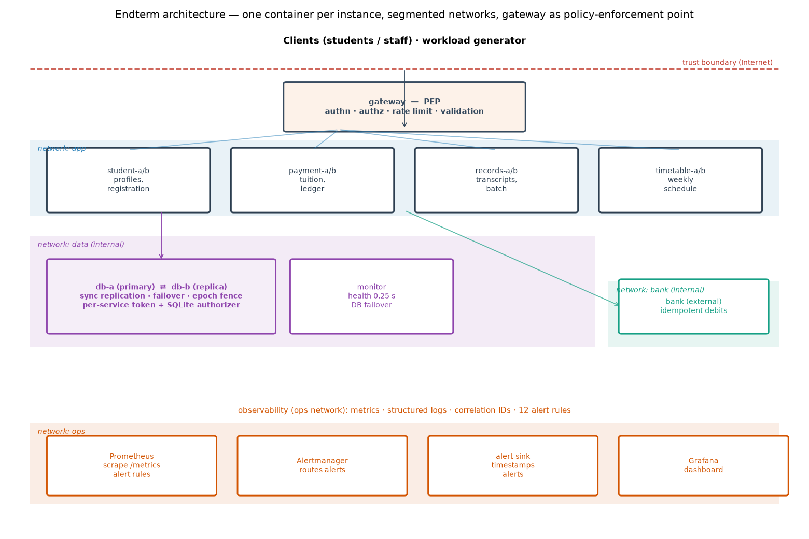

# Resilient University Information System — Final Report

**Integrated Dependability Engineering Capstone · Fault Tolerance and Dependable Computing**

Team: Mukan Idrissov (255567) · Group: CSE-2501M\
Instructor: Azamat Serek\
Repository: <https://github.com/Choppa2077/ft-university> (branch `final`; earlier stages tagged `midterm` and `endterm-submission`)\
Astana IT University, November 2026

---

## Abstract

<!--ABSTRACT-->

**Keywords:** dependability, fault tolerance, microservices, database failover, idempotency,
circuit breaker, graceful degradation, observability, gray failure, fault injection, reliability
engineering, service-level objectives, intrusion tolerance.

## Contents

1. Introduction, motivation, and system context
2. Requirements, assumptions, and dependability objectives
3. Fault model, threat model, and failure analysis
4. Reliability engineering calculations
5. System architecture and resilience design
6. Infrastructure and software fault-tolerance implementation
7. Monitoring, observability, and security implementation
8. Verification, validation, and experimental methodology
9. Results and baseline-versus-improved comparison
10. Discussion, limitations, and future work
11. Conclusion
12. References
13. Appendix

---

## 1. Introduction, motivation, and system context

This project grew in four steps. In Assignment 1 we analysed the incident log of a synthetic
university portal on paper: 96.25 % availability over a month, most of the downtime caused by a
database failover that someone had to perform by hand. In Assignment 2 we wrote retry and
checkpoint logic for a payment batch inside one Python process. The **midterm** turned these
ideas into a running system: a small university platform — student registration, tuition
payments, transcripts, timetables — built twice from one code base, a *baseline* with one copy of
everything and a *fault-tolerant* (FT) build with replicas, synchronous database replication with
automatic failover, mirrored storage and the software mechanisms of the course. Its headline
result was about correctness rather than uptime: a 20-second database outage in the baseline left
259 bank debits without a payment record and charged 133 students twice, while the FT build
stayed consistent. The **endterm** moved the same system into containers, added full
observability, seven security controls and a repeated fault-injection suite.

The final project integrates all of this into one engineering argument, which is what this report
is organised around: **requirements → measurable objectives → fault model → reliability analysis
→ mechanisms → telemetry and security → a repeated experiment campaign that checks every objective
against measured evidence.** The system and its code base are the same; the final stage adds:

- **service-level objectives** with indicators, targets and windows, fixed *before* the final
  campaign (Section 2), and a failure-mode-and-effects analysis with single points of failure and
  minimal cut sets for the containerized system (Section 3);
- **reliability metrics measured on containers** — a soak test with random crashes — compared
  with a reliability-block-diagram prediction (Section 4);
- two new experiments: **X0**, a fault-free run that measures the cost of the mechanisms and
  checks for false-positive alerts, and **X9**, a *gray failure* in which a replica answers half of
  its requests with errors while its health checks stay green — something redundancy cannot mask
  and only telemetry can reveal (Sections 8–9);
- for every run: **mechanism-activation counts** (retries, breaker openings, failovers, recovery
  actions), **alert correctness** (did the right alert fire, how fast, and did anything fire that
  should not have), resource use; every experiment repeated **five times per build** on a fresh
  cluster;
- unit tests for the recovery rules, the timeout budgets and the exact configuration difference
  between the builds; a reproducible, Docker-first setup.

**System context.** About 300 synthetic students and staff use four services through one gateway;
an external bank debits tuition. The critical workflow is the **tuition payment**, a multi-step
operation across five components (Figure 1): the payment intent is recorded and replicated
*before* money moves, the bank is called with an idempotency key, and the result is written and
replicated in one transaction. The consequences of failure are not equal: an unavailable
timetable is an annoyance, a failed payment page is a support ticket, but a debit without a
record, a double charge or a wrong transcript is a financial or academic-integrity problem.


## 2. Requirements, assumptions, and dependability objectives

### 2.1 Components and critical functions

| Component | Function | State | Criticality |
|---|---|---|---|
| gateway | single entry point; authentication, authorization, rate limiting, validation; load balancing, retries, breakers, bulkheads, stale cache | in-memory cache | critical path |
| student | profiles, course registration | students, enrollments | high |
| payment | tuition payments through the bank; recovery worker | payments, ledger | **highest (money)** |
| records | transcripts (GPA), end-of-term transcript batch | grades; documents on mirrored storage | high (integrity) |
| timetable | weekly timetable of a group (computed, CPU-heavy) | none | low (may degrade) |
| db-a / db-b | SQLite node, synchronous replication, failover by epoch | all business data | critical |
| monitor | health of every instance every 0.25 s; database failover controller | registry (primary, epoch) | critical for failover |
| bank (external) | debits; a repeated idempotency key returns the original debit | its own ledger | external dependency |
| Prometheus, Alertmanager, Grafana, alert-sink | metrics, alert rules, dashboard, alert delivery log | metrics | observability only |

### 2.2 Terminology

Following Avižienis et al. [1]: a **fault** is the cause (a process is killed, the primary freezes,
the bank answers after 6 s, a replica returns HTTP 500, an attacker forges a token); an **error**
is the resulting wrong internal state (requests in flight lost, no node accepts writes, payment
requests pile up); a **failure** is what the user sees (an HTTP 5xx, a timeout, a double charge, a
wrong transcript, data disclosed to the wrong student). Fault tolerance breaks the chain between
error and failure (masking, failover, retry with idempotency, degradation); observability shortens
the time from error to detection and diagnosis; security controls stop a malicious fault from
becoming an error in the first place.

### 2.3 Requirements

The midterm requirements R1–R6 and the endterm requirements R7–R12 remain in force:
**R1** a single crash fails ≤ 1 % of user requests · **R2** a failure is detected within 1 s and
the user-visible interruption is short · **R3** no acknowledged write is lost · **R4** money is never
inconsistent (no double charge, no debit without a record) · **R5** under ~5× load the core p95 stays
below 1 s · **R6** a corrupted transcript is never shown · **R7** every unauthorized action is denied
and the data is unchanged · **R8** malformed or abusive input is rejected and the service stays up ·
**R9** every lasting incident raises an alert and its detection delay is recorded · **R10** the audit
trail is complete and tamper-evident · **R11** no service runs with a missing or placeholder secret ·
**R12** a network partition causes no split brain and no inconsistency.

### 2.4 Service-level objectives

The requirements are turned into objectives with an indicator (SLI), a target, a measurement
window and a data source. "Core" means registration and payment, the workflows that change state.
The targets apply to the improved build (`endterm`); the `baseline` and `ft` builds are measured
against the same targets for comparison. **These targets were fixed before the final campaign was
run** (`docs/final/REQUIREMENTS_AND_SLOS.md`, commit `7e19710`).

| SLO | Indicator (SLI) | Target | Window | Source | Verified by |
|---|---|---|---|---|---|
| SLO-1 steady-state availability | successful / all requests at the client | ≥ 99.9 % | 120 s run | client log | X0 |
| SLO-2 availability under one component fault (R1) | failed / all requests after the injection | ≤ 1 % | each run | client log | X1, X2, X3, X8 |
| SLO-3 latency (R5) | core p95 at the gateway (20 s windows, max over the run) | ≤ 100 ms steady; < 1 s during a 5× spike | each run | Prometheus | X0, X4 |
| SLO-4 detection (R2, R9) | (a) injection → automatic detection by gateway/monitor; (b) injection → first related alert at the pager | (a) ≤ 1 s; (b) ≤ 10 s for incidents lasting ≥ 10 s | per incident | event log, alert-sink | (a) X1, X2, X8; (b) X2, X3, X4, X8, X9 |
| SLO-5 recovery | user-visible interruption = injection → last failed request | ≤ 2 s for instance and database faults | per incident | client log | X1, X2, X8 |
| SLO-6 integrity (R3, R4, R12) | orphan debits, double charges, ledger mismatches, stuck payments, lost acknowledged writes; replica identical | all zero / identical in 100 % of runs | end of run (quiet system) | consistency check | all fault runs |
| SLO-7 security (R7, R8, R10) | refused probes; data checksum before = after; audit chain | 100 %; unchanged; verifies | each run | security harness | X5, X6 |
| SLO-8 long-run availability | share of 1 s windows with every service up, under random crashes (MTTF 240 s per service process, 480 s per database node) | ≥ 99.5 % | 900 s soak | client log | soak |
| SLO-9 alert quality | (a) alerts in a fault-free run; (b) gray failure attributed to the right replica | (a) none; (b) correct, ≤ 15 s | each run | alert-sink, Prometheus | X0, X9 |

The baseline is not expected to meet these targets — it is the "before" measurement. The control
plane (gateway, monitor, the single host) is deliberately outside the objectives: these are known
single points of failure (Section 3.4) and are documented rather than tested by killing them.

### 2.5 Assumptions

- **Fault classes:** crash, timing (frozen or slow component), omission (network partition), value
  (corrupted storage; a replica returning errors), overload, and malicious (unauthorized, forged,
  malformed or abusive requests; a compromised service container). Byzantine replicas and
  common-mode bugs that hit both replicas identically are out of scope.
- **Environment:** one host (Apple M4 Pro; Docker Desktop VM with 12 vCPU and ~7.7 GiB; Docker
  28.5), one container per instance with CPU and memory limits, Python 3.12 in the containers.
  Logical nodes A and B are containers on the same VM.
- **Compressed time:** faults last 12–20 s, alert windows 10 s, scraping and rule evaluation every
  1 s, the baseline's "manual repair" 20 s, soak crash rates far above real ones. Absolute values
  are specific to this setup; comparisons between builds are the point.
- **Clients:** open-loop workload (requests are sent on schedule regardless of earlier ones),
  40 req/s in experiments with a fixed mix (35 % profile reads, 15 % registrations, 20 % payments,
  15 % transcripts, 15 % timetables) and seed; 20 req/s in the soak. A student whose payment fails
  presses "Pay" once more after 1 s; the FT/endterm client reuses the same idempotency key. Client
  timeout 5 s.
- **Control plane** (gateway, monitor, Prometheus/Alertmanager) is not failed in the experiments.
- **Data** is synthetic (300 generated students); secrets are generated locally and never committed.

## 3. Fault model, threat model, and failure analysis

### 3.1 Failure scenarios

| ID | Fault (class) | Error | Failure without protection (baseline) | Where the improved build breaks the chain | Verified by |
|---|---|---|---|---|---|
| F1 | service process crash (crash) | instance gone, requests in flight lost | 5xx for every request routed to it until a manual restart (~20 s) | gateway: refused connection → replica marked down, request retried on the other replica; Docker restart policy | X1, soak |
| F2 | database primary crash (crash) | no node accepts writes | writes fail; debits without records; double charges on retry | monitor promotes the in-sync replica; epoch fences the old primary; checkpoint + idempotency | soak |
| F3 | database primary frozen (timing) | process alive but silent | writes time out; money inconsistent as in F2 | as F2; bounded DB timeouts (1 s per try, 4 s deadline) | X2 |
| F4 | network partition, primary isolated (omission) | both nodes alive, cannot talk; split-brain risk | as F2 | failover + epoch fencing: the old primary's writes are rejected and it steps down | X8 |
| F5 | slow external bank (timing) | payment requests pile up | client times out at 5 s, retries → charged twice | 0.8 s timeout, 2 retries with the same key, breaker, payment accepted as QUEUED (202) | X3 |
| F6 | crash in the middle of a payment | debit exists, row missing or PENDING | money without a record; a retry charges again | PENDING checkpoint; retry with the same key or the recovery worker rolls forward/back | X7 |
| F7 | load spike ~5× (overload) | queues grow, CPU saturated | timeouts everywhere; no recovery after the burst (metastable) | per-service bulkhead sheds load; stale timetable cache; replicas | X4 |
| F8 | gray failure: replica returns HTTP 500 while healthy | one replica wrong, routing believes it healthy | a share of requests fails — in **both** builds | **observability**: per-replica 5xx ratio and `ReplicaErrorRate` name the replica; runbook restarts it | X9 |
| F9 | silent corruption of stored transcripts (value) | wrong bytes on disk | wrong GPA served with HTTP 200 | SHA-256 per document, read from the mirror, repair, scrub | midterm E7; `test_storage` |
| F10 | unauthorized, forged, malformed, abusive requests | requests that must never run | anyone reads or changes anything | JWT, role + object authorization, validation, rate limiting, audit log | X5, X6 |
| F11 | compromised service container (insider) | attacker talks to the database directly | full database access, DDL, forced promotion | per-service DB token, SQLite authorizer, endpoint ACL | X5 (insider) |
| F12 | control-plane failure (gateway, monitor, host) | entry point or failover controller gone | outage / no failover | **not mitigated** — single points of failure (3.4) | documented |

### 3.2 Failure-mode and effects analysis

S = severity of the user-visible failure, O = how often the fault occurs, D = how hard it is to
detect (1 = immediately, 5 = not at all), on a 1–5 scale, RPN = S × O × D (IEC 60812 [14]). **The
ratings are engineering judgement, not measurements**; the measured evidence for each row is the
experiment in Section 3.1 and its result in Section 9.

| ID | Failure mode | S base → impr. | O | D base → impr. | RPN base → impr. | Residual risk in the improved build |
|---|---|---|---|---|---|---|
| F1 | outage after a crash | 3 → 1 | 4 | 1 → 1 | 12 → 4 | both replicas of a service crash within ~1 s of each other |
| F2 | primary loss, money inconsistent | 5 → 2 | 2 | 1 → 1 | 10 → 4 | monitor down at the same time (cut set {monitor, primary}) |
| F3 | database freeze | 5 → 2 | 2 | 2 → 1 | 20 → 4 | ~1 s latency spike during failover |
| F4 | partition, split brain | 5 → 2 | 2 | 2 → 1 | 20 → 4 | single failover controller, no quorum |
| F5 | slow bank, double charges | 4 → 2 | 3 | 2 → 2 | 24 → 12 | payments complete late (eventual consistency) |
| F6 | interrupted payment, orphan debit | 5 → 2 | 2 | 5 → 2 | 50 → 8 | the student still sees an error although the payment completes |
| F7 | overload collapse | 4 → 2 | 3 | 2 → 2 | 24 → 12 | stale or fast-failed timetable answers |
| F8 | gray failure | 3 → 3 | 2 | 4 → 2 | 24 → 12 | errors continue until someone (or the runbook) acts |
| F9 | wrong transcript shown | 5 → 1 | 1 | 5 → 1 | 25 → 1 | both mirror copies share one Docker volume |
| F10 | unauthorized access, abuse | 5 → 1 | 3 | 5 → 2 | 75 → 6 | a stolen valid token |
| F11 | compromised container | 5 → 2 | 1 | 5 → 2 | 25 → 4 | the service's own tables stay writable |
| F12 | control-plane failure | 5 → 5 | 1 | 1 → 1 | 5 → 5 | unchanged — the main remaining weakness |

### 3.3 Threat model

The full model is in `docs/endterm/THREAT_MODEL.md`. **Assets:** academic records and money
(integrity), student data (confidentiality), availability during registration week, the audit
trail, the secrets. **Trust boundaries:** the Internet edge (only the gateway is published, on
loopback), the application network, the internal data and bank networks (no route outside), the
operations network. **Attackers:** an anonymous client, an authenticated student, and a
compromised application container holding its own database credential. A STRIDE analysis lists
fifteen threats (forged or `alg:none` tokens, spoofed identity headers, grade tampering, direct SQL
or DDL from a container, repudiation, IDOR, database dumps, metrics scraping, request floods,
abuse of the fault-injection API, malformed input, idempotency-key replay, password brute force,
forced promotion, missing secrets), each mapped to a control (Section 7.6) and to the experiment
that verifies it (X5, X6 and unit tests). The key insight carried from the endterm: an attacker and
a bug threaten the same asset — integrity — and the same controls defend against both.

### 3.4 Single points of failure and minimal cut sets

Top event: **"a student cannot submit a tuition payment"**.

| Order | Baseline | Improved (`endterm`) |
|---|---|---|
| 1 | {gateway}, {payment}, {database}, {bank}, {host} | {gateway}, {host}, {shared `run` volume} — the bank is no longer a cut set for *submitting* a payment (it is accepted as QUEUED) |
| 2 | — | {payment-a, payment-b}, {db-a, db-b}, {monitor, database primary} |

Remaining single points of failure: the **gateway** (one container; Docker restarts it in about a
second, but nothing is reachable meanwhile — fix: two gateways behind a virtual IP); the **monitor**
(the only failover controller — fix: a three-member consensus coordinator such as etcd/Patroni);
the **single host** (nodes A and B share a VM — fix: two hosts with anti-affinity); the shared
**`run` volume** (registry of the current primary, logs, audit log and both transcript "disks":
mirroring protects against a corrupted file, not against losing the volume); the **bank** (external,
mitigated by idempotent debits, breaker and queueing); and **Prometheus/Alertmanager** (not on the
request path: if they fail, incidents are still handled automatically but no longer reported).

## 4. Reliability engineering calculations

### 4.1 Definitions, formulas and units

For a component observed for a window of length *T* with *n* failures, total down time *D* and up
time *U = T − D* (seconds of compressed time):

- **MTTF** = *U / n* (mean time to failure), **MTTR** = *D / n* (mean time to repair/recover),
- **MTBF** = *T / n* = MTTF + MTTR,
- **availability** *A* = *U / T* = MTTF / MTBF,
- **observed failure rate** λ = *n / U*, reported per hour of up time.

For *k* identical copies the window is *k·T*. For the reliability block diagram (RBD), the five
component kinds (database, student, payment, records, timetable) are in **series** (the system is
up only if every kind is up); in a replicated build each kind is a **parallel** pair:
*A_pair = 1 − (1 − A)²*, and *A_system = Π A_kind*. The gateway, monitor and bank are left out of
both builds because they are not failed (as in the midterm).

### 4.2 Measurement method (soak test)

`experiments/soak_docker.py` runs each build for **900 s** at 20 req/s while application processes
crash at random. Every application-node instance has its own seeded schedule of exponentially
distributed times to failure — mean **240 s** for a service process and **480 s** for a database
node — so node-A instances crash at the same moments in both builds and the replicated build
additionally loses node-B instances. A crash is `kill -9` of every process inside the container;
Docker's restart policy brings it back (baseline: after the emulated 20 s operator delay; improved:
immediately, database nodes after 3 s). As in the midterm, a planned crash is skipped if the
instance is already down. Three levels are measured:

- **component level** — from the monitor's health checks every 0.25 s: down from the first failed
  check until the check that sees the instance ready again;
- **service level** — from the client log: a service is down in a 1 s window if fewer than half of
  its requests succeeded; down windows closer than 2 s are merged into one outage;
- **system level** — up only while all four services are up; plus the share of successful user
  actions (a payment and its retry count once).

**Assumptions:** exponential (memoryless), independent times to failure per instance; repair =
restart; compressed time; no failure of the control plane; the observation window is one soak run
per build, so the small numbers of failures make the estimates rough (a confidence interval for
*n* events is wide); the comparison between builds, which share the crash schedule, is the robust
part.

### 4.3 Results

<!--SECTION4_RESULTS-->

## 5. System architecture and resilience design

### 5.1 Service boundaries and deployment



Every instance is a container built from one image; the container's command selects which
instance it is (`payment-a`, `db-b`, …). The topology is defined once in `ftuni/config.py`, and
`deploy/make_compose.py` generates `docker-compose.yml` from it, so the two cannot drift. The
baseline runs node A only; `ft` and `endterm` run every service and the database twice, on logical
nodes A and B. Discovery is by DNS name on the Docker networks.

| Container | CPU limit | Memory limit | Copies (baseline / improved) |
|---|---|---|---|
| gateway | 1.0 | 384 MB | 1 / 1 |
| monitor | 0.5 | 256 MB | 1 / 1 |
| bank (external, simulated) | 0.5 | 256 MB | 1 / 1 |
| db node | 1.0 | 512 MB | 1 / 2 |
| student, payment, records, timetable (each) | 0.5 | 256 MB | 1 / 2 |
| Prometheus · Alertmanager · Grafana · alert-sink | 1.0 · 0.25 · 0.5 · 0.25 | 512 · 128 · 256 · 128 MB | 1 / 1 |

Total limits of the application containers: baseline 8 containers, 5 CPU, 2.4 GB; improved 13
containers, 8 CPU, 3.9 GB; plus 2 CPU and 1 GB for observability in both. The limits exist so that
the load experiment can saturate a service on a 12-vCPU VM, as it did on the midterm's 2-vCPU box.

### 5.2 Networks and data flows

Four networks enforce who may talk to whom: `app` (gateway ↔ services; the gateway publishes
`127.0.0.1:8000`), `data` (services ↔ database nodes, internal, no route outside), `bank` (payment
↔ bank, internal) and `ops` (Prometheus, Alertmanager, Grafana, alert-sink). Only the gateway and
the monitoring UIs publish ports, and only on loopback. The payment data flow is Figure 1; the
other workflows are simpler: a registration is one replicated insert (idempotent by design), a
transcript is a read of grades plus a checksummed document, a timetable is computed without the
database.

### 5.3 Restart, replicas, health and readiness

Every container has `restart: always` and a `HEALTHCHECK` on `/health/ready`. Liveness means the
process answers; readiness means it can do useful work (a database node is ready if it is the
primary, or a replica holding a complete copy). Service readiness deliberately does **not** depend
on the database: otherwise a database failover would make every service "not ready" at once and
the gateway would take the whole system out of rotation for a problem the database client handles
itself. The gateway probes every replica every 0.3 s (two failures mark it down, one success brings
it back) and also detects failures passively (a refused connection marks a replica down at once);
the monitor probes every instance every 0.25 s. A rolling replacement of one replica at a time
causes no failed request, because the gateway routes around a replica that is down (Section 9, X1).

### 5.4 Behaviour when a dependency fails

| Dependency fails | Improved behaviour | Mechanisms |
|---|---|---|
| one service replica | requests go to the other replica; failed idempotent requests are retried there | passive + active health checks, retry, restart policy |
| a whole service (both replicas) | fast 503, or a stale timetable marked `X-Degraded` | breaker per service, stale cache |
| database primary | the DB client keeps retrying for up to 4 s while the monitor promotes the replica (~0.5–0.7 s) | failover, epoch fencing, client deadline |
| database replica | the primary continues alone and marks the replica lagging; automatic failover is blocked until it is back in sync | lagging state, resync from snapshot |
| bank | after 0.8 s timeouts and 2 retries the breaker opens; payments are accepted as QUEUED (202) and finished later | timeout, retry, breaker, queue, recovery worker |
| timetable overload | the bulkhead (6 concurrent requests) sheds the excess immediately; answers come from the stale cache | bulkhead, stale cache |
| monitor | no effect on requests; no failover while it is down | — (single point of failure) |
| gateway | outage until Docker restarts it | — (single point of failure) |

### 5.5 Resource and load assumptions

Experiments run at 40 req/s, the soak at 20 req/s; the load spike adds 180 timetable req/s for 15 s
(about 5× the normal total). The timetable is CPU-heavy by design (about 24 ms per request on the
midterm machine) and limited to 0.5 CPU per replica, so it saturates under the spike while the
other services keep their CPU.
Everything runs on one VM; absolute throughput numbers are not a capacity claim.

**Why Docker Compose and not Kubernetes.** The whole system must run reproducibly on one laptop
for the instructor, and Compose maps one-to-one onto Kubernetes concepts: `restart: always` →
`restartPolicy`, healthchecks → liveness/readiness probes, DNS names → Services, internal networks
→ NetworkPolicies, Docker secrets → Secrets, two replicas on nodes A and B → a Deployment with
anti-affinity [21]. Running on Kubernetes (or several hosts) is future work (Section 10).

## 6. Infrastructure and software fault-tolerance implementation

### 6.1 Infrastructure-level mechanisms

1. **Replicated service instances with load balancing.** Two replicas of every service on
   different logical nodes; the gateway keeps a pool per service, balances round-robin over
   healthy replicas, and removes a replica on a refused connection within milliseconds.
2. **Database replication with automatic failover and fencing.** Writes go only to the primary; each
   transaction gets a log sequence number and is shipped to the replica and acknowledged *before*
   the commit, so an acknowledged write exists on both nodes. When the primary misses three health
   checks and the replica is in sync, the monitor writes a new epoch and the new primary's name to
   the registry and promotes the replica. The epoch is a fencing token [11]: every write carries the
   highest epoch the client has seen; a node with a lower epoch refuses it, and a primary that tries
   to replicate into a node with a higher epoch rolls back and steps down — no split brain.
3. **Self-healing restart.** Docker's restart policy plus health checks replace the midterm's
   hand-written supervisor. The baseline emulates a manual repair with a 20 s delay in the container
   entrypoint (`ftuni/run.py`).
4. **Mirrored storage with checksums** (RAID-1 idea [3]): every transcript is written to two
   "disks" with its SHA-256; a read verifies it, serves the mirror if needed and repairs the bad copy.
5. **Snapshots for resynchronisation and backup.** A database node that restarts as a replica copies
   a consistent snapshot from the primary and follows the log; the same endpoint (only callable with
   the monitor's or the peer's credential) yields a consistent backup. Replication protects against
   losing hardware, not against a wrong write — that is what an off-host snapshot would add.

### 6.2 Software-level mechanisms

- **Timeouts** on every call across a process boundary: bank 0.8 s; gateway 2.5 s (student),
  4.5 s (payment), 3.0 s (records), 1.5 s (timetable); database 1 s per try with a 4 s deadline;
  the client waits 5 s. The payment chain is nested — three bank attempts plus backoff (≤ 2.7 s)
  fit in the gateway's 4.5 s, which fits in the client's 5 s — and every gateway timeout exceeds the
  time a database failover takes (`tests/test_mechanisms.py`). Not everything is strictly nested,
  though: the database client's 4 s deadline is longer than the gateway's 2.5 s and 3.0 s for
  student and records requests (see Section 10).
- **Bounded retries with full-jitter exponential backoff** [8]: the gateway retries once more on the
  other replica, the payment service retries the bank twice, the database client retries until its
  deadline. Only idempotent requests are retried (GET, or POST with an Idempotency-Key); a POST
  without a key is retried only if the connection was refused, because then it provably never
  arrived.
- **Circuit breakers** [9]: payment → bank (opens after 5 consecutive failures, trial after 3 s) and
  one per service at the gateway (8 failures, trial after 2 s).
- **Idempotency and duplicate-request detection**, three layers: the client's key (reused on its
  retry) makes the payment service return or finish the original payment; the same key makes the bank
  return the original debit; every database write carries a transaction id that the node deduplicates.
  The endterm binds a key to the payer and the amount, so it cannot be replayed for another charge.
- **Checkpointing.** For payments the checkpoint is the PENDING row written and replicated before the
  bank is called. For the end-of-term transcript batch, the job stores its position every 10
  transcripts and holds a 3 s lease, so another replica resumes it from the last checkpoint
  (midterm E5b).
- **Rollback, roll-forward and compensation.** A recovery worker in every payment replica looks at
  payments left PENDING or QUEUED for more than 2 s. The decision is a pure function,
  `recovery_action()` in `ftuni/services/payment.py`, tested for every branch: QUEUED → settle once
  the bank answers; PENDING and the bank has the debit → **roll forward**; PENDING, no debit and
  older than 10 s → **roll back**; anything else → wait. A debit that appears after a rollback is
  refunded (compensation), and a reconciliation loop checks recent failures against the bank.
- **Health checks** (liveness and readiness) — Section 5.3.
- **Graceful degradation:** payments accepted as QUEUED (202) while the bank is down; a stale
  timetable served with `X-Degraded`; a per-service **bulkhead** at the gateway (at most 6
  concurrent timetable requests, 32 records, 48 payment, 64 student requests) that sheds load
  instead of queueing it.

### 6.3 Traceability: mechanism → code → test → experiment

| Mechanism | Code | Test | Experiment evidence (Section 9) |
|---|---|---|---|
| replicas + load balancing | `ftuni/gateway.py` (pools, health loop), `deploy/make_compose.py` | `test_mechanisms::test_only_the_replicated_builds_have_two_copies` | X1 (replica marked down, 0 failed) |
| DB replication, failover, fencing | `ftuni/dbnode.py`, `ftuni/monitor.py`, `ftuni/dbclient.py` | `test_dbnode` (fencing, dedup) | X2, X8, soak (failovers, fencing) |
| self-healing restart | `docker-compose.yml`, `deploy/healthcheck.sh`, `ftuni/run.py` | — | X1, X9, soak (restarts, MTTR) |
| mirrored storage + checksums | `ftuni/storage.py` | `test_storage` | midterm E7 |
| timeouts | `ftuni/config.py` (`Policy`) | `test_mechanisms` (budgets) | X2, X3 |
| retries + backoff | `ftuni/resilience.py`, gateway, payment, dbclient | `test_resilience::test_backoff…` | X1, X2, X3 (retry counts) |
| circuit breaker | `ftuni/resilience.py` | `test_resilience` (3 tests) | X3 (breaker openings) |
| idempotency, duplicates | `ftuni/services/payment.py`, bank, `ftuni/dbnode.py` | `test_dbnode`, `test_integration` (2 tests) | X3, X7 (duplicates caught, 0 double charges) |
| checkpointing | payment PENDING row; `ftuni/services/records.py` (batch lease) | — | X7; midterm E5b |
| rollback / recovery / compensation | `payment.recovery_action`, `recover_one`, `reconcile_failed` | `test_mechanisms` (9 cases) | X7 (roll forward / back), X3 (queue drained) |
| health checks | `ftuni/common.py` | `test_integration` (live cluster) | X1, X2 |
| graceful degradation, bulkhead | gateway `fallback`, bulkheads; payment queue | `test_resilience::test_bulkhead…` | X3 (queued), X4 (shed, stale answers) |

## 7. Monitoring, observability, and security implementation

### 7.1 Metrics

Every container exposes Prometheus metrics (the gateway's only with the operator token), scraped
every second:

| Metric | Meaning |
|---|---|
| `ftuni_http_requests_total{service,route,method,status}` | requests answered, by status (rate, error ratio) |
| `ftuni_http_request_duration_seconds` (histogram) | latency; p95 via `histogram_quantile` |
| `ftuni_gateway_{requests,retries,shed,degraded,unavailable}_total` | gateway mechanism activations |
| `ftuni_gateway_upstream_up`, `ftuni_monitor_target_up` | the gateway's and the monitor's view of every instance |
| `ftuni_breaker_open{target}` | circuit breakers open |
| `ftuni_db_is_primary`, `ftuni_db_epoch`, `ftuni_db_lsn`, `ftuni_db_replication_ok` | database role, fencing epoch, replication state |
| `ftuni_payments_unfinished{status}` | payments PENDING / QUEUED |
| `ftuni_auth_denied_total{reason}`, `ftuni_rate_limited_total`, `ftuni_audit_records_total` | security events |
| `ftuni_events_total{event}` | every structured log event, by type |
| `process_cpu_seconds_total`, `process_resident_memory_bytes` | resource use (trade-off measurements) |

### 7.2 Structured logs and correlation IDs

Every process writes JSON lines (`ts`, `inst`, `ev`, `request_id`, details). The gateway assigns an
`X-Request-ID` to each request (or keeps the client's), forwards it on every hop and returns it; every
log line on the path carries it. One payment followed through all containers by its ID (real output
of a demo run on the `endterm` build; the comments in parentheses are ours):

```
db-a       REQUEST            /query                (idempotency key known?)
db-a       REQUEST            /query
db-b       REQUEST            /replicate            (PENDING row reaches the replica…)
db-a       REQUEST            /tx                   (…before the primary commits it)
db-a       REQUEST            /query
bank       REQUEST            /debit
db-b       REQUEST            /replicate            (COMPLETED + ledger, replicated)
db-a       REQUEST            /tx
payment-a  PAYMENT_COMPLETED  <idempotency key>
payment-a  REQUEST            /payments
gateway    REQUEST            /payments             (outermost hop finishes last)
```

### 7.3 Dashboard

The Grafana dashboard is generated from code (`deploy/grafana/make_dashboard.py`). Rows:
*users' view* (request rate, error ratio and p95 per service at the gateway; degraded, shed and
retried requests; firing alerts), *instances* (Prometheus scrape status, the gateway's view of every
replica, 5xx ratio per replica — where masked failures show up — and CPU per instance), *database
and payments* (role and epoch, replication in sync, unfinished payments and open breakers) and
*security* (refused requests by reason, rate limiting, audit records). Screenshots from the
endterm runs are in Appendix C.

### 7.4 Alert rules

Twelve rules in three groups. Windows are 10 s because the experiments are short; production
values would be minutes, alerting on SLO burn rates [7].

| Rule | Detects | Threshold | Expected response |
|---|---|---|---|
| InstanceDown | instance does not answer scrapes | `up == 0` for 2 s | automatic routing/restart; team checks logs if not back in 30 s |
| UserFacingErrorRate | users get errors | 5xx > 5 % of a service's requests (10 s) for 3 s | page on-call: masking failed |
| ReplicaErrorRate | one replica failing (maybe masked) | 5xx > 20 % of a replica's requests for 3 s | inspect / drain / restart that replica |
| HighLatencyP95 | slow service | p95 > 1 s for 3 s | check load, dependencies, CPU |
| LoadShedding | bulkhead full | > 1 shed req/s for 2 s | scale out, find the traffic source |
| CircuitBreakerOpen | dependency failing | breaker open for 2 s | automatic degradation; check the dependency |
| PaymentsUnfinished | payments stuck | PENDING/QUEUED > 0 for 15 s | recovery worker; check bank and worker |
| DatabaseFailover | primary changed | any failover in the last minute | find why the old primary failed |
| DBReplicationLost | primary without a sync replica | for 5 s | bring the replica back (failover blocked) |
| AuthFailureSpike | credential stuffing, forgery, scanning | > 1 refused auth/s for 2 s | look up actors in the audit log |
| RateLimitSpike | abusive client | > 5 throttled req/s for 2 s | identify the account |
| InvalidInputSpike | fuzzing or broken client | > 1 rejected malformed req/s for 2 s | check validation audit records |

Alertmanager delivers every alert to a webhook, the **alert-sink**, which stores its exact arrival
time; detection delays are measured from these timestamps, not estimated.

### 7.5 Incident detection and diagnosis

Detection happens in two layers. The **automatic layer** (the gateway on a refused connection, the
monitor's probes every 0.25 s, the payment service's breaker) acts within milliseconds to a second
and needs no human. The **alert layer** is for humans and uses windows to avoid paging on blips, so
it is slower by design. Diagnosis follows a fixed path: the alert's labels name the service or
replica → the dashboard row shows which mechanism is active → a request ID from the client or the
logs reconstructs the path across containers. X9 automates the first step as an **on-call runbook**:
it waits for `ReplicaErrorRate`, reads the replica name from the alert's labels and restarts that
replica.

### 7.6 Security controls and intrusion tolerance

Seven controls, each behind a `Policy` flag and present only in the `endterm` build:

1. **Authentication (JWT)** at the gateway, the policy-enforcement point: salted PBKDF2 password
   hashes, short-lived HS256 tokens, algorithm pinned (forged and `alg:none` tokens rejected), issuer
   and expiry required [17]; identity headers from clients are stripped and set by the gateway.
2. **Authorization**, default deny: role-based (a student cannot change grades) and object-level (a
   student sees only their own profile, transcript and payments).
3. **Input validation**: strict schemas (formats, bounds such as positive payment amounts, unknown
   fields rejected), 16 KB body limit, parameterized SQL.
4. **Rate limiting and abuse protection**: per-user token bucket (429) and login lockout after
   repeated failures.
5. **Least-privilege database access**: each service has its own database token, and a SQLite
   authorizer [20] limits it to the tables and operations it needs (the student service may read
   students, courses and enrollments and add enrollments — nothing else); endpoint ACL (only the
   monitor may promote or demote).
6. **Protected operator surface**: `/chaos`, the gateway's `/metrics` and `/upstreams` require the
   operator token; fault injection is reachable only from inside a container.
7. **Tamper-evident audit log**: every login, payment, grade change and denial is written to an
   append-only, hash-chained log; any edited or deleted record breaks the chain.

In addition: secrets are Docker secrets mounted as files, generated locally and never committed;
services refuse to start with a missing or placeholder secret (fail closed, R11); containers run as a
non-root user with a read-only filesystem, all capabilities dropped and `no-new-privileges`.
**Intrusion tolerance** comes from layering: even a fully compromised service container cannot change
grades, read payments, alter the schema or force a promotion, because the database itself refuses.

## 8. Verification, validation, and experimental methodology

### 8.1 Levels of testing

| Level | Content | Count |
|---|---|---|
| unit | breaker, backoff, bulkhead, mirrored storage, DB deduplication and fencing, DB least privilege, JWT/authorization/validation, recovery rules, timeout budgets, exact build differences | 58 |
| integration (live `endterm` cluster) | login required, wrong password, register→pay→transcript, request-ID propagation, idempotent payment charged once, key bound to the body, IDOR blocked, role separation | 10 |
| system / fault injection | experiments X0–X9, three builds | 10 experiments |
| reliability | soak test with random crashes | 2 builds × 900 s |

### 8.2 Baseline and improved configurations

`baseline`: one copy of everything, 30 s timeouts, no retries, no idempotency, no breakers, no
degradation, manual repair after 20 s. `ft`: the midterm's fault-tolerant build. `endterm` (the
improved build): `ft` plus the seven security controls. All three are the same code; a `Policy`
object selects the mechanisms, and `tests/test_mechanisms.py` asserts the exact difference: `ft`
differs from `baseline` in all 17 resilience settings (timeouts, retries, health checks, breaker,
shedding, degradation, failover, DB timeouts, idempotency, bank timeout/retries, recovery worker,
mirrored storage, checkpointing, restart delays) and in nothing else; `endterm` differs from `ft`
in exactly the seven security flags; only the replicated builds have two copies of each component.
Observability is present in all three builds so that they are measured the same way.

### 8.3 Procedure

Every repetition: (1) a **fresh cluster** — `docker compose down -v`, new run volume, `up`, wait
until the gateway sees every replica, Prometheus scrapes every instance, the monitor sees every
instance ready and no alert fires; (2) the open-loop workload at 40 req/s with a fixed seed, so all
builds receive the same requests (in `endterm` the 300 students log in first); (3) the fault at
t = 10 s, injected **through the Docker API** (`kill -9` inside the container, `docker pause`,
`docker network disconnect`) or through the operator-token chaos switch run *inside* the target
container — never through a back door; (4) after the load ends and a settle time, the **consistency
check on a quiet system** (the check is a snapshot; run under load it would count an in-flight
payment as broken); (5) evidence: every request, every structured event from every container, the
alerts as delivered to the pager, Prometheus queries, the audit-chain verification; (6) scoring
against the acceptance criterion. Each fault experiment is repeated **5 times per build**, the
security experiments 3 times. A repetition that fails because of the *harness* (for example, the
cluster does not become ready) is retried on a fresh cluster and logged; system results are never
retried. The environment of the campaign (code commit, image id, Docker version) is recorded in
`results/final/environment.json`.

### 8.4 Experiments

| ID | Brief matrix | Injection | Run | Hypothesis | PASS criterion (as coded) |
|---|---|---|---|---|---|
| X0 | 6, trade-offs | none | 120 s | a few ms and some CPU/memory of overhead; no alert when nothing is wrong | every request succeeds, no alert, consistent |
| X1 | 1 | `kill -9 -1` inside `payment-a` | 40 s | the gateway masks the crash; Docker restarts the replica | 0 failed after injection, consistent |
| X2 | 2 | `docker pause` the primary for 12 s | 45 s | failover within ~1 s; requests wait, none fail | 0 failed, consistent |
| X3 | 3 | bank 6 s late (health included) for 15 s | 45 s | timeouts + breaker + queue: no failures, no double charge | 0 failed, consistent |
| X4 | 5 | +180 timetable req/s for 15 s | 45 s | bulkhead sheds; core p95 < 1 s | core p95 < 1000 ms, consistent |
| X5 | 7 | 17 unauthorized / escalation probes incl. a compromised container | — | all refused, data unchanged, audited | all refused, checksum unchanged, audit verifies |
| X6 | 7 | 10 malformed / abusive probes + a flood | — | rejected (4xx/429), service up | all rejected, flood throttled, checksum unchanged, audit verifies |
| X7 | 4, 8 | 30 % of payments abort right after the bank debit, 15 s | 40 s | users see errors in every build; only the improved builds keep money consistent | consistent |
| X8 | 2, 8 | primary disconnected from the data network for 12 s | 45 s | failover without split brain | consistent |
| X9 | 6 | `student-a` answers 50 % of requests with HTTP 500, health stays green; runbook restarts the replica named by the alert | 55 s | redundancy does not mask it; telemetry names the right replica | alert names `student-a` ≤ 15 s, consistent |

### 8.5 Measurements and definitions

- **Failed requests** — client requests without a 2xx after the injection (a payment and its retry
  are two requests); **failed user actions** — the same with a payment and its retry counted once.
- **Detection (event)** — injection → the first event showing the system noticed (the monitor's DOWN,
  a breaker opening, the first shed request); **detection (alert)** — injection → the first *related*
  alert at the pager.
- **Recovery** — injection → end of the last failed request (0 if nothing failed).
- **Core p95** — p95 of registration and payment latency at the gateway (Prometheus histogram, 20 s
  windows), the maximum over the run.
- **Mechanism activations** — gateway counters from Prometheus (a fresh cluster, so totals = this
  run) and counts of structured events (breaker openings, bank retries, queued payments, roll
  forward / back, compensations, duplicates caught, failovers, client switches, fencing, resyncs,
  container restarts).
- **Alert correctness** — an alert is *related* if it concerns the injected component or a direct
  consequence of the fault (the rules per experiment are listed in `docs/final/TEST_PLAN.md`);
  anything else is a **false positive**. An incident that lasts at least one alert window must raise a
  related alert (R9); in the replicated builds a single crash is masked within about a second and
  requires none.
- **Consistency** — orphan debits (money without a completed payment), double-charged intents,
  ledger mismatches, stuck payments, lost acknowledged payments and enrollments, and in the
  replicated builds a primary/replica comparison.
- **Resources** — average CPU (cores) and resident memory of the application processes.

### 8.6 Mapping to the brief's minimum experiment matrix

| # | Scenario | Experiments |
|---|---|---|
| 1 | application/service instance failure | X1, soak |
| 2 | database or dependency unavailable | X2, X8 |
| 3 | network delay or timeout | X3 |
| 4 | interrupted multi-step transaction | X7 |
| 5 | high load or traffic spike | X4 |
| 6 | monitoring and alert trigger | X9, X0, alert correctness over all runs |
| 7 | unauthorized or invalid operation | X5, X6 |
| 8 | recovery / rollback or failover verification | X2, X8 (failover), X7 (roll forward / back) |

<!--RESULTS_SECTIONS-->

## 12. References

[1] A. Avižienis, J.-C. Laprie, B. Randell and C. Landwehr, "Basic concepts and taxonomy of
dependable and secure computing," *IEEE Transactions on Dependable and Secure Computing*, vol. 1,
no. 1, pp. 11–33, 2004.\
[2] I. Koren and C. M. Krishna, *Fault-Tolerant Systems*, 2nd ed. Morgan Kaufmann, 2020.\
[3] D. A. Patterson, G. Gibson and R. H. Katz, "A case for redundant arrays of inexpensive disks
(RAID)," in *Proc. ACM SIGMOD*, 1988, pp. 109–116.\
[4] J. Gray, "Why do computers stop and what can be done about it?" Tandem Computers, Technical
Report 85.7, 1985.\
[5] M. T. Nygard, *Release It! Design and Deploy Production-Ready Software*, 2nd ed. Pragmatic
Bookshelf, 2018.\
[6] B. Beyer, C. Jones, J. Petoff and N. R. Murphy (eds.), *Site Reliability Engineering: How Google
Runs Production Systems*. O'Reilly, 2016.\
[7] B. Beyer, N. R. Murphy, D. K. Rensin, K. Kawahara and S. Thorne (eds.), *The Site Reliability
Workbook*. O'Reilly, 2018 (chapter "Alerting on SLOs").\
[8] M. Brooker, "Exponential backoff and jitter," AWS Architecture Blog, 2015.\
[9] M. Fowler, "CircuitBreaker," martinfowler.com, 2014.\
[10] B. Leach, "Designing robust and predictable APIs with idempotency," Stripe Blog, 2017.\
[11] M. Kleppmann, *Designing Data-Intensive Applications*. O'Reilly, 2017 (chapters 5 and 8:
replication, fencing tokens).\
[12] N. Bronson, A. Aghayev, A. Charapko and T. Zhu, "Metastable failures in distributed systems,"
in *Proc. HotOS*, 2021.\
[13] P. Huang, C. Guo, L. Zhou, J. R. Lorch, Y. Dang, M. Chintalapati and R. Yao, "Gray failure: The
Achilles' heel of cloud-scale systems," in *Proc. HotOS*, 2017.\
[14] IEC 60812:2018, *Failure modes and effects analysis (FMEA and FMECA)*.\
[15] OWASP, *API Security Top 10* (2023) and *Application Security Verification Standard 4.0*.\
[16] A. Shostack, *Threat Modeling: Designing for Security*. Wiley, 2014 (STRIDE).\
[17] IETF, RFC 7519 *JSON Web Token (JWT)*, and RFC 8725 *JSON Web Token Best Current Practices*.\
[18] Docker Inc., *Docker and Docker Compose documentation* (healthchecks, restart policies,
networks, secrets).\
[19] Prometheus Authors, *Prometheus and Alertmanager documentation*; Grafana Labs, *Grafana
documentation*.\
[20] SQLite, *Write-Ahead Logging* and *the authorizer callback* (`sqlite3_set_authorizer`).\
[21] The Kubernetes Authors, *Kubernetes documentation*: configure liveness, readiness and startup
probes; Deployments; NetworkPolicies.\
[22] Libraries and tools used: FastAPI, Uvicorn, Pydantic, httpx, PyJWT, prometheus_client,
matplotlib, pytest, pandoc.\
[23] M. Idrissov and A. Yeraliyev, Assignments 1 and 2 (reliability metrics, RBD, FMEA, FTA;
software fault-tolerant design); M. Idrissov, Midterm report (October 2026) and Endterm report
(November 2026), Fault Tolerance and Dependable Computing, AITU.

<!--APPENDIX-->
