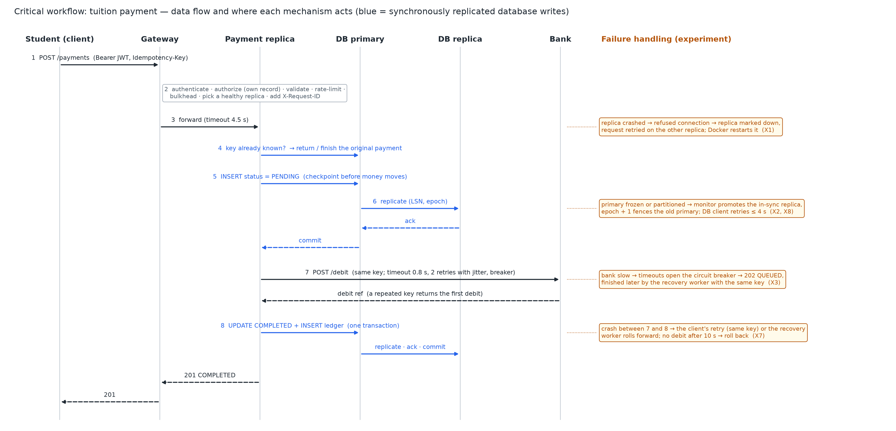
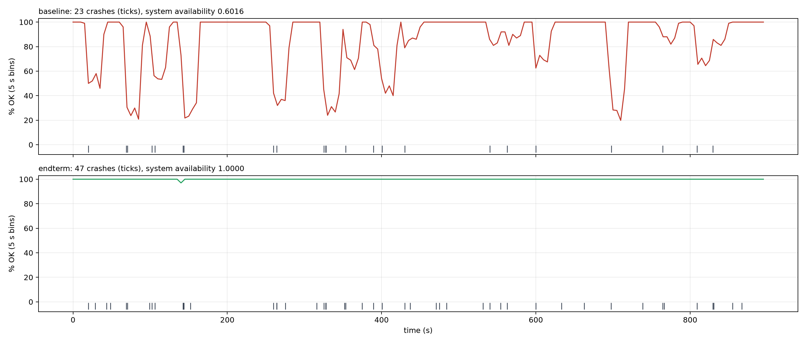
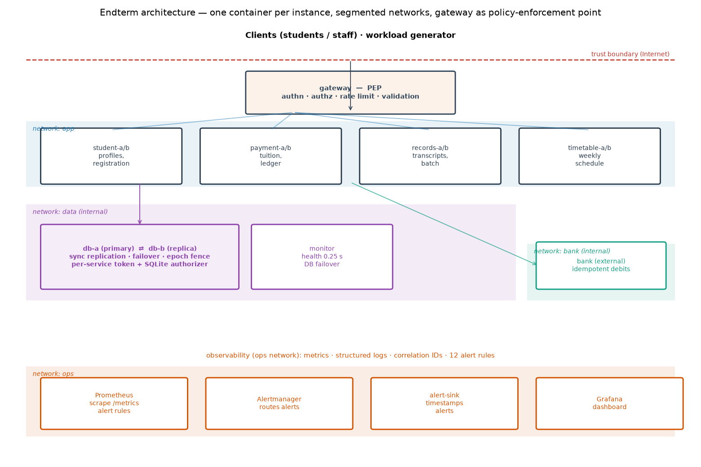
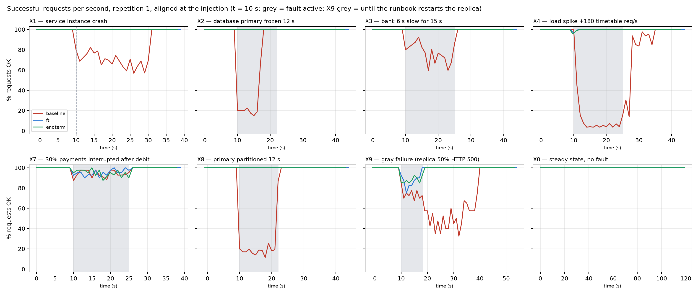
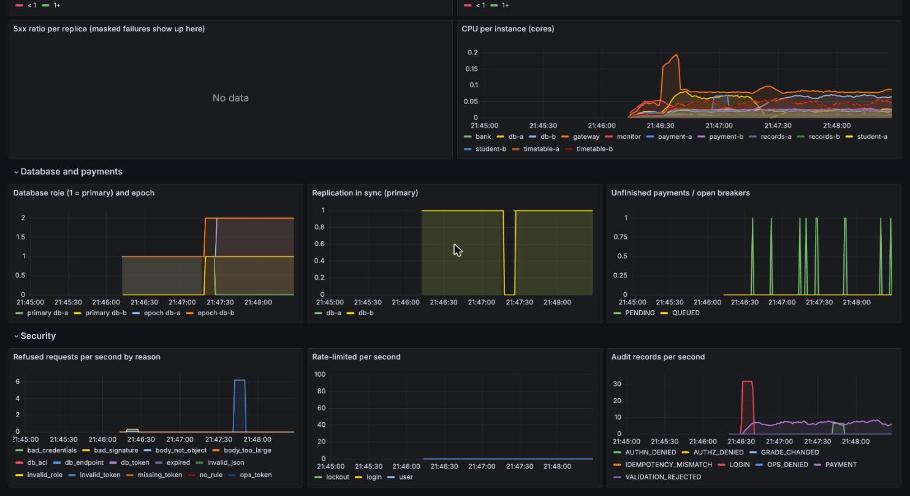

# Resilient University Information System: Final Report

**Integrated Dependability Engineering Capstone · Fault Tolerance and Dependable Computing**

Team: Mukan Idrissov (255567) · Group: CSE-2501M\
Instructor: Azamat Serek\
Repository: <https://github.com/Choppa2077/ft-university> (branch `final`; earlier stages tagged `midterm` and `endterm-submission`)\
Astana IT University, November 2026

---

## Abstract

This report evaluates a small university information system (a gateway, four services, a
replicated SQLite database and an external bank, each instance in its own container) built from one
code base in three configurations: a baseline without fault tolerance, a fault-tolerant build
(ft), and the improved build (endterm), which is ft plus seven security controls. Nine
service-level objectives were fixed before the final campaign. The campaign ran
<!--V:derived.total_runs--> repetitions, each on a fresh cluster, covering eight fault scenarios and
two security suites, plus a 900 s soak test with random crashes for each build. The improved build
passed <!--V:derived.endterm.passed-->/<!--V:derived.endterm.runs--> fault runs and all security runs
and met every objective. When a component crashed, froze, was cut off or slowed down, it failed no
request, while the baseline failed up to <!--V:derived.baseline_max_failed_pct--> % of requests and
left up to <!--V:derived.baseline.max_orphans--> bank debits without a payment record in a single
run. In the soak, system availability was
<!--V:reliability.endterm.services.system.availability_time|.4f--> against
<!--V:reliability.baseline.services.system.availability_time|.4f-->, close to the
reliability-block-diagram prediction. Redundancy did not help in two cases: an interrupted payment
still returns an error to the student, and a replica that returns errors while its health checks
pass was found only through telemetry. The protection costs
<!--V:derived.x0.rss_increase_pct--> % more memory, <!--V:derived.x0.cpu_increase_pct--> % more CPU
and <!--V:derived.x0.pay_p50_delta_ms--> ms of median payment latency.

**Keywords:** fault tolerance, microservices, database failover, idempotency, circuit breaker,
observability, gray failure, fault injection, reliability engineering, service-level objectives.

## Contents

1. Introduction, motivation, and system context
2. Requirements, assumptions, and dependability objectives
3. Fault model, threat model, and failure analysis
4. Reliability engineering calculations
5. System architecture and resilience design
6. Infrastructure and software fault-tolerance implementation
7. Monitoring, observability, and security implementation
8. Verification, validation, and experimental methodology
9. Results and baseline-versus-improved comparison
10. Discussion, limitations, and future work
11. Conclusion
12. References
13. Appendix

---

## 1. Introduction, motivation, and system context

The project grew over the semester. In Assignments 1 and 2 I analysed the incident log of a
synthetic university portal (96.25 % availability over a month, most of it lost to a database
failover done by hand) and wrote retry and checkpoint logic for a payment batch. For the midterm I
built the system itself, twice from one code base: a baseline with one copy of everything, and a
fault-tolerant build with replicas, synchronous database replication with automatic failover and the
software mechanisms of the course. Its main result was about correctness rather than uptime: a 20 s
database outage in the baseline left 259 bank debits without a payment record and charged 133
students twice. For the endterm I moved the system into containers and added monitoring, seven
security controls and a repeated fault-injection suite.

The final stage ties these parts together. It adds service-level objectives that were fixed before
the campaign (Section 2), an FMEA with minimal cut sets (Section 3), reliability metrics measured in
a crash soak and compared with a block-diagram prediction (Section 4), two new experiments (a
fault-free run, X0, and a gray failure, X9), and for every run the number of mechanism activations
and a check of which alerts fired. Every experiment was repeated five times per build on a fresh
cluster.

**System context.** About 300 synthetic students and staff use four services through one gateway,
and an external bank debits tuition. The services are written in Python with FastAPI [22]. The
critical workflow is the tuition payment (Figure 1): the payment intent is recorded and replicated
before any money moves, the bank is called with an idempotency key, and the result is written and
replicated in one transaction. Failures differ in cost. An unavailable timetable is an annoyance and
a failed payment page is a support ticket, but a debit without a record, a double charge or a wrong
transcript is a financial or academic-integrity problem.



## 2. Requirements, assumptions, and dependability objectives

### 2.1 Components and critical functions

| Component | Function | State | Criticality |
|---|---|---|---|
| gateway | single entry point; authentication, authorization, rate limiting, validation; load balancing, retries, breakers, bulkheads, stale cache | in-memory cache | critical path |
| student | profiles, course registration | students, enrollments | high |
| payment | tuition payments through the bank; recovery worker | payments, ledger | **highest (money)** |
| records | transcripts (GPA), end-of-term transcript batch | grades; documents on mirrored storage | high (integrity) |
| timetable | weekly timetable of a group (computed, CPU-heavy) | none | low (may degrade) |
| db-a / db-b | SQLite node, synchronous replication, failover by epoch | all business data | critical |
| monitor | health of every instance every 0.25 s; database failover controller | registry (primary, epoch) | critical for failover |
| bank (external) | debits; a repeated idempotency key returns the original debit | its own ledger | external dependency |
| Prometheus, Alertmanager, Grafana, alert-sink | metrics, alert rules, dashboard, alert delivery log | metrics | observability only |

### 2.2 Terminology

Following Avižienis et al. [1], a fault is the cause (a killed process, a frozen primary, a bank that
answers after 6 s, a forged token), an error is the wrong internal state it produces (lost in-flight
requests, no node accepting writes, payments piling up), and a failure is what the user sees (an
HTTP 5xx, a timeout, a double charge, a wrong transcript). Fault tolerance stops errors from turning
into failures, monitoring shortens the time to notice them, and security controls stop malicious
faults before they cause errors.

### 2.3 Requirements

The midterm requirements R1–R6 and the endterm requirements R7–R12 still apply:

| ID | Requirement |
|---|---|
| R1 | a single crash fails ≤ 1 % of user requests |
| R2 | a failure is detected within 1 s and the interruption seen by users is short |
| R3 | no acknowledged write is lost |
| R4 | money is never inconsistent: no double charge, no debit without a record |
| R5 | under about 5× load the core p95 stays below 1 s |
| R6 | a corrupted transcript is never shown |
| R7 | every unauthorized action is denied and the data stays unchanged |
| R8 | malformed or abusive input is rejected and the service stays up |
| R9 | every lasting incident raises an alert, and its detection delay is recorded |
| R10 | the audit trail is complete and tamper-evident |
| R11 | no service runs with a missing or placeholder secret |
| R12 | a network partition causes no split brain and no inconsistency |

### 2.4 Service-level objectives

Each requirement became an objective with an indicator, a target, a window and a data source, in
the style of the SRE books [6], [7]. "Core" means the student and payment services, which carry the
workflows that change state. The targets apply to the improved build; the baseline and ft are
measured against the same targets for comparison. The targets were committed before the final
campaign ran (`docs/final/REQUIREMENTS_AND_SLOS.md`, commit `7e19710`).

| SLO | Indicator (SLI) | Target | Window | Source | Verified by |
|---|---|---|---|---|---|
| SLO-1 steady-state availability | successful / all requests at the client | ≥ 99.9 % | 120 s run | client log | X0 |
| SLO-2 availability under one component fault (R1) | failed / all requests after the injection | ≤ 1 % | each run | client log | X1, X2, X3, X8 |
| SLO-3 latency (R5) | core p95 at the gateway (20 s windows, max over the run) | ≤ 100 ms steady; < 1 s during a 5× spike | each run | Prometheus | X0, X4 |
| SLO-4 detection (R2, R9) | (a) injection → automatic detection by gateway/monitor; (b) injection → first related alert at the pager | (a) ≤ 1 s; (b) ≤ 10 s for incidents lasting ≥ 10 s | per incident | event log, alert-sink | (a) X1, X2, X8; (b) X2, X3, X4, X8, X9 |
| SLO-5 recovery | user-visible interruption = injection → last failed request | ≤ 2 s for instance and database faults | per incident | client log | X1, X2, X8 |
| SLO-6 integrity (R3, R4, R12) | orphan debits, double charges, ledger mismatches, stuck payments, lost acknowledged writes; replica identical | all zero / identical in 100 % of runs | end of run (quiet system) | consistency check | all fault runs |
| SLO-7 security (R7, R8, R10) | refused probes; data checksum before = after; audit chain | 100 %; unchanged; verifies | each run | security harness | X5, X6 |
| SLO-8 long-run availability | share of 1 s windows with every service up, under random crashes (MTTF 240 s per service process, 480 s per database node) | ≥ 99.5 % | 900 s soak | client log | soak |
| SLO-9 alert quality | (a) alerts in a fault-free run; (b) gray failure attributed to the right replica | (a) none; (b) correct, ≤ 15 s | each run | alert-sink, Prometheus | X0, X9 |

The control plane (gateway, monitor and the host) is outside the objectives. These are known single
points of failure (Section 3.4); they are documented, not tested by killing them.

### 2.5 Assumptions

- **Fault classes:** crash, timing, omission (partition), value (corrupted storage, a replica
  returning errors), overload and malicious requests, including a compromised service container.
  Byzantine replicas and bugs that hit both replicas the same way are out of scope.
- **Environment:** one host (Apple M4 Pro, Docker Desktop VM with 12 vCPU and 7.7 GiB, Docker
  28.5), one container per instance with CPU and memory limits. Nodes A and B share the VM.
- **Compressed time:** faults last 12–20 s, alert windows are 10 s, the baseline's manual repair
  takes 20 s and soak crash rates are far above real ones, so only the comparison between builds
  carries over to a real deployment.
- **Clients:** open-loop workload (requests go out on schedule regardless of earlier ones) at
  40 req/s, fixed mix (35 % profile reads, 15 % registrations, 20 % payments, 15 % transcripts, 15 %
  timetables) and fixed seed; 20 req/s in the soak; timeout 5 s. A student whose payment fails
  retries once after 1 s, reusing the idempotency key in ft and endterm.
- **Data** is synthetic (300 generated students); secrets are generated locally, never committed.

## 3. Fault model, threat model, and failure analysis

### 3.1 Failure scenarios

| ID | Fault (class) | Error | Failure without protection (baseline) | Where the improved build breaks the chain | Verified by |
|---|---|---|---|---|---|
| F1 | service process crash (crash) | instance gone, requests in flight lost | 5xx for every request routed to it until a manual restart (~20 s) | gateway: refused connection → replica marked down, request retried on the other replica; Docker restart policy | X1, soak |
| F2 | database primary crash (crash) | no node accepts writes | writes fail; debits without records; double charges on retry | monitor promotes the in-sync replica; epoch fences the old primary; checkpoint + idempotency | soak |
| F3 | database primary frozen (timing) | process alive but silent | writes time out; money inconsistent as in F2 | as F2; bounded DB timeouts (1 s per try, 4 s deadline) | X2 |
| F4 | network partition, primary isolated (omission) | both nodes alive, cannot talk; split-brain risk | as F2 | failover + epoch fencing: the old primary's writes are rejected and it steps down | X8 |
| F5 | slow external bank (timing) | payment requests pile up | client times out at 5 s, retries → charged twice | 0.8 s timeout, 2 retries with the same key, breaker, payment accepted as QUEUED (202) | X3 |
| F6 | crash in the middle of a payment | debit exists, row missing or PENDING | money without a record; a retry charges again | PENDING checkpoint; retry with the same key or the recovery worker rolls forward/back | X7 |
| F7 | load spike ~5× (overload) | queues grow, CPU saturated | timeouts everywhere; no recovery after the burst (metastable [12]) | per-service bulkhead sheds load; stale timetable cache; replicas | X4 |
| F8 | gray failure: replica returns HTTP 500 while healthy | one replica wrong, routing believes it healthy | a share of requests fails, in **both** builds | **observability**: per-replica 5xx ratio and `ReplicaErrorRate` name the replica; runbook restarts it | X9 |
| F9 | silent corruption of stored transcripts (value) | wrong bytes on disk | wrong GPA served with HTTP 200 | SHA-256 per document, read from the mirror, repair, scrub | midterm E7; `test_storage` |
| F10 | unauthorized, forged, malformed, abusive requests | requests that must never run | anyone reads or changes anything | JWT, role + object authorization, validation, rate limiting, audit log | X5, X6 |
| F11 | compromised service container (insider) | attacker talks to the database directly | full database access, DDL, forced promotion | per-service DB token, SQLite authorizer, endpoint ACL | X5 (insider) |
| F12 | control-plane failure (gateway, monitor, host) | entry point or failover controller gone | outage / no failover | **not mitigated**: single points of failure (3.4) | documented |

### 3.2 Failure-mode and effects analysis

S is the severity of the user-visible failure, O how often the fault occurs and D how hard it is to
detect (1 = at once, 5 = not at all), each on a 1–5 scale, and RPN = S × O × D (IEC 60812 [14]). The
ratings are my engineering judgement, not measurements. The measured evidence for each row is the
experiment listed in Section 3.1.

| ID | Failure mode | S base → impr. | O | D base → impr. | RPN base → impr. | Residual risk in the improved build |
|---|---|---|---|---|---|---|
| F1 | outage after a crash | 3 → 1 | 4 | 1 → 1 | 12 → 4 | both replicas of a service crash within ~1 s of each other |
| F2 | primary loss, money inconsistent | 5 → 2 | 2 | 1 → 1 | 10 → 4 | monitor down at the same time (cut set {monitor, primary}) |
| F3 | database freeze | 5 → 2 | 2 | 2 → 1 | 20 → 4 | ~1 s latency spike during failover |
| F4 | partition, split brain | 5 → 2 | 2 | 2 → 1 | 20 → 4 | single failover controller, no quorum |
| F5 | slow bank, double charges | 4 → 2 | 3 | 2 → 2 | 24 → 12 | payments complete late (eventual consistency) |
| F6 | interrupted payment, orphan debit | 5 → 2 | 2 | 5 → 2 | 50 → 8 | the student still sees an error although the payment completes |
| F7 | overload collapse | 4 → 2 | 3 | 2 → 2 | 24 → 12 | stale or fast-failed timetable answers |
| F8 | gray failure | 3 → 3 | 2 | 4 → 2 | 24 → 12 | errors continue until someone (or the runbook) acts |
| F9 | wrong transcript shown | 5 → 1 | 1 | 5 → 1 | 25 → 1 | both mirror copies share one Docker volume |
| F10 | unauthorized access, abuse | 5 → 1 | 3 | 5 → 2 | 75 → 6 | a stolen valid token |
| F11 | compromised container | 5 → 2 | 1 | 5 → 2 | 25 → 4 | the service's own tables stay writable |
| F12 | control-plane failure | 5 → 5 | 1 | 1 → 1 | 5 → 5 | unchanged; the main remaining weakness |

### 3.3 Threat model

The full model is in `docs/endterm/THREAT_MODEL.md`. The assets are academic records and money
(integrity), student data (confidentiality), availability during registration week, the audit
trail and the secrets. The attackers considered are an anonymous client, a logged-in student and a
compromised service container that holds its own database credential. A STRIDE pass [16] over the
trust boundaries (the Internet edge, the application network, the internal data and bank networks,
the operations network) produced fifteen threats, among them forged or `alg:none` tokens, IDOR,
grade tampering, direct SQL or DDL from a container, request floods, idempotency-key replay,
password brute force and missing secrets. Each threat is mapped to a control (Section 7.6) and to a
test (X5, X6 or a unit test); the list follows the OWASP API Security Top 10 where it applies [15].
An attacker and a bug threaten the same asset, integrity, and the same controls defend against both.

### 3.4 Single points of failure and minimal cut sets

Top event: "a student cannot submit a tuition payment".

| Order | Baseline | Improved (`endterm`) |
|---|---|---|
| 1 | {gateway}, {payment}, {database}, {bank}, {host} | {gateway}, {host}, {shared `run` volume}; the bank is no longer a cut set for *submitting* a payment (it is accepted as QUEUED) |
| 2 | – | {payment-a, payment-b}, {db-a, db-b}, {monitor, database primary} |

The remaining single points of failure are the gateway (one container; Docker restarts it in about
a second, but nothing is reachable meanwhile), the monitor (the only failover controller), the
single host, the shared `run` volume (the primary registry, the logs, the audit log and both
transcript "disks") and the bank, which is external and is mitigated by idempotent debits, the
breaker and queueing. Prometheus and Alertmanager are not on the request path: if they fail,
incidents are still handled automatically but no longer reported. Section 10.6 lists the fixes.

## 4. Reliability engineering calculations

### 4.1 Definitions, formulas and units

For a component observed for a window of length *T* with *n* failures, total down time *D* and up
time *U = T − D* (seconds of compressed time), using the standard definitions [2]:

- **MTTF** = *U / n* (mean time to failure), **MTTR** = *D / n* (mean time to repair/recover),
- **MTBF** = *T / n* = MTTF + MTTR,
- **availability** *A* = *U / T* = MTTF / MTBF,
- **observed failure rate** λ = *n / U*, reported per hour of up time.

For *k* identical copies the window is *k·T*. In the reliability block diagram (RBD) the five
component kinds (database, student, payment, records, timetable) are in **series**: the system is
up only if every kind is up. In a replicated build each kind is a **parallel** pair, so
*A_pair = 1 − (1 − A)²* and *A_system = Π A_kind*. The gateway, the monitor and the bank are left
out of both builds because they are not failed (as in the midterm).

### 4.2 Measurement method (soak test)

`experiments/soak_docker.py` runs each build for 900 s at 20 req/s while application processes
crash at random. Every instance has its own seeded schedule of exponential times to failure (mean
240 s for a service process, 480 s for a database node), so node-A instances crash at the same
moments in both builds and the replicated build also loses node-B instances. A crash is `kill -9`
of every process in the container; Docker restarts it after the emulated 20 s operator delay in
the baseline and at once in the improved build (database nodes after 3 s). Components are measured
from the monitor's health checks every 0.25 s, services from the client log (down in a 1 s window
if fewer than half of its requests succeeded; gaps under 2 s merged), and the system is up only
while all four services are up.

The assumptions are independent exponential failures, repair by restart and no control-plane
failures. One soak per build with 3–15 failures per component gives rough estimates; the
comparison between the builds, which share the crash schedule, is the reliable part.

### 4.3 Results

<!--TABLE:RELIABILITY-->



**Baseline.** <!--V:reliability.baseline.kills_done--> crashes caused
<!--V:reliability.baseline.services.system.outages--> system outages, together
<!--V:reliability.baseline.services.system.downtime_s--> s of the 900 s, so system availability was
<!--V:reliability.baseline.services.system.availability_time|.4f-->, and
<!--V:reliability.baseline.services.user_level.failed--> of
<!--V:reliability.baseline.services.user_level.requests--> user actions failed. Every component
outage lasted about the emulated 20 s repair (MTTR ≈ 21 s). The student and payment services were down longer
than their own processes (<!--V:reliability.baseline.services.student.downtime_s--> and
<!--V:reliability.baseline.services.payment.downtime_s--> s against
<!--V:reliability.baseline.components.student.downtime_s--> and
<!--V:reliability.baseline.components.payment.downtime_s--> s) because they also stop whenever the
single database is down. This is the series structure of the block diagram, visible in the data.

**Improved build.** <!--V:reliability.endterm.kills_done--> crashes, now on both nodes, caused no
outage, and <!--V:reliability.endterm.services.user_level.failed--> of
<!--V:reliability.endterm.services.user_level.requests--> user actions failed. A service replica was
back after about <!--V:reliability.endterm.components.student.MTTR_s--> s and a database node after
<!--V:reliability.endterm.components.db.MTTR_s--> s while the other copy served. Even a single copy
was up more of the time than in the baseline (payment
<!--V:reliability.endterm.components.payment.availability|.4f--> against
<!--V:reliability.baseline.components.payment.availability|.4f-->), because a repair takes a second
instead of twenty.

**Prediction versus measurement.** The block diagram, built from the measured component
availabilities, predicts <!--V:reliability.baseline.predicted.system|.4f--> for the baseline
(measured <!--V:reliability.baseline.services.system.availability_time|.4f-->) and
<!--V:reliability.endterm.predicted.system|.4f--> for the improved build (measured
<!--V:reliability.endterm.services.system.availability_time|.4f--> by time,
<!--V:reliability.endterm.services.system.availability_requests|.4f--> by requests). The baseline did
slightly better than predicted because some outages overlapped. For the improved build the diagram
expects about <!--V:derived.soak_expected_system_down_s.endterm|.2f--> s in 900 s with both replicas
of some service down together, and this happened once: the schedule killed `student-a` and, half a
second later, `student-b`, the minimal cut set {student-a, student-b} of Section 3.4 (event log,
seconds since the start of the soak):

<!--TABLE:DOUBLEFAULT-->

For <!--V:reliability.endterm.double_faults.0.duration_s--> s no student replica was running, and
the <!--V:reliability.endterm.double_faults.0.failed_requests--> requests that arrived got a fast
503, the only failures of the improved soak. Right after it the log shows a database failover in
which all six service instances switched to the new primary without a failed request.

**Worked example (payment, improved build).** Two copies observed for 900 s give a window
*k·T* = <!--V:reliability.endterm.components.payment.replicas--> × 900 s = 1800 s. With
*n* = <!--V:reliability.endterm.components.payment.failures--> failures and
*D* = <!--V:reliability.endterm.components.payment.downtime_s--> s of down time:
MTTF = (1800 − *D*) / *n* = <!--V:reliability.endterm.components.payment.MTTF_s--> s,
MTTR = *D* / *n* = <!--V:reliability.endterm.components.payment.MTTR_s--> s,
MTBF = MTTF + MTTR = <!--V:reliability.endterm.components.payment.MTBF_s--> s,
*A* = MTTF / MTBF = <!--V:reliability.endterm.components.payment.availability|.5f-->, and
λ = *n* / *U* = <!--V:reliability.endterm.components.payment.failure_rate_per_h--> failures per hour
of up time (compressed time). As a parallel pair, *A_pair* = 1 − (1 − *A*)² =
<!--V:reliability.endterm.predicted.blocks.payment|.6f-->; in series with the other four kinds,
*A_system* = <!--V:reliability.endterm.predicted.system|.6f-->.

**Illustrative extrapolation (assumed rates, not measurements).** With realistic crash rates, one
per <!--V:extrapolation.assumed_mttf_days.service|.0f--> days per service process and one per
<!--V:extrapolation.assumed_mttf_days.db|.0f--> days per database node, and the repair times
measured here, the baseline would be down about
<!--V:extrapolation.baseline_measured_repair.downtime_min_per_year|.0f--> minutes a year with the
20 s repair and about <!--V:extrapolation.baseline_manual_repair.downtime_h_per_year|.0f--> hours a
year (availability <!--V:extrapolation.baseline_manual_repair.availability|.4f-->) with a 30-minute
manual repair. The replicated services would add
<!--V:extrapolation.endterm_measured_repair.downtime_ms_per_year|.2f--> ms a year, so the improved
system would be limited by what the model leaves out: the gateway, the monitor, the host and
correlated failures.

## 5. System architecture and resilience design

### 5.1 Service boundaries and deployment



Every instance is a container built from the same image; the container's command selects which
instance it is (`payment-a`, `db-b`, …). The topology is defined once in `ftuni/config.py`, and
`deploy/make_compose.py` generates `docker-compose.yml` from it, so the two cannot drift apart. The
baseline runs node A only; ft and endterm run every service and the database twice, on logical
nodes A and B. Services find each other by DNS name.

| Container | CPU limit | Memory limit | Copies (baseline / improved) |
|---|---|---|---|
| gateway | 1.0 | 384 MB | 1 / 1 |
| monitor | 0.5 | 256 MB | 1 / 1 |
| bank (external, simulated) | 0.5 | 256 MB | 1 / 1 |
| db node | 1.0 | 512 MB | 1 / 2 |
| student, payment, records, timetable (each) | 0.5 | 256 MB | 1 / 2 |
| Prometheus · Alertmanager · Grafana · alert-sink | 1.0 · 0.25 · 0.5 · 0.25 | 512 · 128 · 256 · 128 MB | 1 / 1 |

In total the baseline has 8 application containers (5 CPU, 2.4 GB) and the improved build 13
(8 CPU, 3.9 GB); monitoring adds 2 CPU and 1 GB to both. The limits let the load experiment
saturate a service on a 12-vCPU VM.

### 5.2 Networks and data flows

Four Docker networks limit who can talk to whom: `app` (gateway and services; the gateway publishes
`127.0.0.1:8000`), `data` (services and database nodes, internal), `bank` (payment and bank,
internal) and `ops` (monitoring). Only the gateway and the monitoring UIs publish ports, and only on
loopback. The payment flow is shown in Figure 1. A registration is one replicated insert that is
idempotent by design, a transcript is a read of grades plus a checksummed document, and a timetable
is computed without the database.

### 5.3 Restart, replicas, health and readiness

Every container has `restart: always` and a `HEALTHCHECK` on `/health/ready` [18]. Liveness means
the process answers; readiness means it can do useful work (a database node is ready if it is the
primary, or a replica with a complete copy). Service readiness deliberately does not depend on the
database. Otherwise a database failover would make every service "not ready" at the same moment,
and the gateway would take the whole system out of rotation for a problem that the database client
already handles. The gateway probes every replica every 0.3 s (two failures mark it down, one
success brings it back) and also marks a replica down at once when a connection is refused. The
monitor probes every instance every 0.25 s.

### 5.4 Behaviour when a dependency fails

| Dependency fails | Improved behaviour | Mechanisms |
|---|---|---|
| one service replica | requests go to the other replica; failed idempotent requests are retried there | passive + active health checks, retry, restart policy |
| a whole service (both replicas) | fast 503, or a stale timetable marked `X-Degraded` | breaker per service, stale cache |
| database primary | the DB client keeps retrying for up to 4 s while the monitor promotes the replica (~0.5–0.7 s) | failover, epoch fencing, client deadline |
| database replica | the primary continues alone and marks the replica lagging; automatic failover is blocked until it is back in sync | lagging state, resync from snapshot |
| bank | after 0.8 s timeouts and 2 retries the breaker opens; payments are accepted as QUEUED (202) and finished later | timeout, retry, breaker, queue, recovery worker |
| timetable overload | the bulkhead (6 concurrent requests) sheds the excess immediately; answers come from the stale cache | bulkhead, stale cache |
| monitor | no effect on requests; no failover while it is down | none (single point of failure) |
| gateway | outage until Docker restarts it | none (single point of failure) |

### 5.5 Resource and load assumptions

Experiments run at 40 req/s and the soak at 20 req/s. The load spike adds 180 timetable requests per
second for 15 s, about five times the normal total. The timetable is CPU-heavy by design and limited
to 0.5 CPU per replica, so it saturates under the spike while the other services keep their CPU.
Everything runs on one VM, so the throughput numbers are not a capacity claim.

I chose Docker Compose over Kubernetes so that the whole system runs on one laptop for the
instructor. The concepts map directly: `restart: always` to `restartPolicy`, health checks to
liveness and readiness probes, DNS names to Services, internal networks to NetworkPolicies, Docker
secrets to Secrets, and two replicas on nodes A and B to a Deployment with anti-affinity [21].

## 6. Infrastructure and software fault-tolerance implementation

### 6.1 Infrastructure-level mechanisms

1. **Replicated services with load balancing.** Every service has two replicas on different logical
   nodes. The gateway balances round-robin over the healthy replicas and drops a replica within
   milliseconds when a connection to it is refused.
2. **Database replication with automatic failover and fencing.** Writes go only to the primary,
   which ships each transaction to the replica and waits for the acknowledgement before it commits,
   so an acknowledged write exists on both nodes. When the primary misses three health checks and
   the replica is in sync, the monitor writes a new epoch and the new primary's name to the registry
   and promotes the replica. The epoch is a fencing token [11]: a node refuses a write with an older
   epoch, and an old primary that meets a newer epoch rolls back and steps down, so there is no split
   brain.
3. **Self-healing restart.** Docker's restart policy plus health checks replace the midterm's
   hand-written supervisor; restarting is the classic fix for transient software faults [4]. The
   baseline emulates a manual repair with a 20 s delay in the container entrypoint (`ftuni/run.py`).
4. **Mirrored storage with checksums**, the RAID-1 idea [3]: every transcript is written to two
   "disks" with its SHA-256. A read verifies it, serves the mirror if needed and repairs the bad copy.
5. **Snapshots for resynchronisation and backup.** A database node that restarts as a replica copies
   a consistent snapshot from the primary and then follows the log. The same endpoint, callable only
   with the monitor's or the peer's credential, gives a consistent backup.

### 6.2 Software-level mechanisms

- **Timeouts** on every remote call [5]: bank 0.8 s; gateway 2.5 s (student), 4.5 s (payment),
  3.0 s (records), 1.5 s (timetable); database 1 s per try with a 4 s deadline; client 5 s. Three
  bank attempts with backoff (≤ 2.7 s) fit into the gateway's 4.5 s, which fits into the client's
  5 s (`tests/test_mechanisms.py`). The database deadline is not nested inside the gateway's student
  and records timeouts (Section 10.4).
- **Bounded retries with full-jitter exponential backoff** [8]: the gateway retries once on the
  other replica, the payment service retries the bank twice, the database client retries until its
  deadline. Only idempotent requests are retried (GET, or POST with an Idempotency-Key); a POST
  without a key only when the connection was refused, because then it never arrived.
- **Circuit breakers** [9]: payment → bank (opens after 5 consecutive failures, trial after 3 s)
  and one per service at the gateway (8 failures, trial after 2 s).
- **Idempotency and duplicate detection** [10] in three layers: the client's key lets the payment
  service return or finish the original payment, the same key makes the bank return the original
  debit, and the database node deduplicates every write by its transaction id. In endterm a key is
  bound to the payer and amount, so it cannot be replayed for another charge.
- **Checkpointing:** the PENDING row, written and replicated before the bank is called; the
  transcript batch saves its position every 10 transcripts under a 3 s lease (midterm E5b).
- **Rollback, roll-forward and compensation:** a recovery worker in every payment replica checks
  payments left PENDING or QUEUED for over 2 s. The decision is a pure, unit-tested function,
  `recovery_action()` in `ftuni/services/payment.py`: QUEUED is settled once the bank answers,
  PENDING with a debit is rolled forward, PENDING without a debit after 10 s is rolled back, anything
  else waits. A debit that appears after a rollback is refunded.
- **Health checks:** Section 5.3.
- **Graceful degradation:** payments accepted as QUEUED (202) while the bank is down, stale
  timetables marked `X-Degraded`, and per-service bulkheads at the gateway (6 concurrent timetable,
  32 records, 48 payment, 64 student requests) that shed load instead of queueing it.

### 6.3 Traceability: mechanism → code → test → experiment

| Mechanism | Code | Test | Experiment evidence (Section 9) |
|---|---|---|---|
| replicas + load balancing | `ftuni/gateway.py` (pools, health loop), `deploy/make_compose.py` | `test_mechanisms::test_only_the_replicated_builds_have_two_copies` | X1 (replica marked down, 0 failed) |
| DB replication, failover, fencing | `ftuni/dbnode.py`, `ftuni/monitor.py`, `ftuni/dbclient.py` | `test_dbnode` (fencing, dedup) | X2, X8, soak (failovers, fencing) |
| self-healing restart | `docker-compose.yml`, `deploy/healthcheck.sh`, `ftuni/run.py` | – | X1, X9, soak (restarts, MTTR) |
| mirrored storage + checksums | `ftuni/storage.py` | `test_storage` | midterm E7 |
| timeouts | `ftuni/config.py` (`Policy`) | `test_mechanisms` (budgets) | X2, X3 |
| retries + backoff | `ftuni/resilience.py`, gateway, payment, dbclient | `test_resilience::test_backoff…` | X1, X2, X3 (retry counts) |
| circuit breaker | `ftuni/resilience.py` | `test_resilience` (3 tests) | X3 (breaker openings) |
| idempotency, duplicates | `ftuni/services/payment.py`, bank, `ftuni/dbnode.py` | `test_dbnode`, `test_integration` (2 tests) | X3, X7 (duplicates caught, 0 double charges) |
| checkpointing | payment PENDING row; `ftuni/services/records.py` (batch lease) | – | X7; midterm E5b |
| rollback / recovery / compensation | `payment.recovery_action`, `recover_one`, `reconcile_failed` | `test_mechanisms` (9 cases) | X7 (roll forward / back), X3 (queue drained) |
| health checks | `ftuni/common.py` | `test_integration` (live cluster) | X1, X2 |
| graceful degradation, bulkhead | gateway `fallback`, bulkheads; payment queue | `test_resilience::test_bulkhead…` | X3 (queued), X4 (shed, stale answers) |

## 7. Monitoring, observability, and security implementation

### 7.1 Metrics

Every container exposes Prometheus metrics [19], scraped every second (the gateway's only with the
operator token):

| Metric | Meaning |
|---|---|
| `ftuni_http_requests_total{service,route,method,status}` | requests answered, by status (rate, error ratio) |
| `ftuni_http_request_duration_seconds` (histogram) | latency; p95 via `histogram_quantile` |
| `ftuni_gateway_{requests,retries,shed,degraded,unavailable}_total` | gateway mechanism activations |
| `ftuni_gateway_upstream_up`, `ftuni_monitor_target_up` | the gateway's and the monitor's view of every instance |
| `ftuni_breaker_open{target}` | circuit breakers open |
| `ftuni_db_is_primary`, `ftuni_db_epoch`, `ftuni_db_lsn`, `ftuni_db_replication_ok` | database role, fencing epoch, replication state |
| `ftuni_payments_unfinished{status}` | payments PENDING / QUEUED |
| `ftuni_auth_denied_total{reason}`, `ftuni_rate_limited_total`, `ftuni_audit_records_total` | security events |
| `ftuni_events_total{event}` | every structured log event, by type |
| `process_cpu_seconds_total`, `process_resident_memory_bytes` | resource use (trade-off measurements) |

### 7.2 Structured logs and correlation IDs

Every process writes JSON lines with `ts`, `inst`, `ev`, `request_id` and details. The gateway
assigns an `X-Request-ID` to each request (or keeps the client's), forwards it on every hop and
returns it, so every log line on the path carries it. Here is one payment followed through all
containers by its ID, from a demo run on the endterm build (my comments in parentheses):

```
db-a       REQUEST            /query                (idempotency key known?)
db-a       REQUEST            /query
db-b       REQUEST            /replicate            (PENDING row reaches the replica…)
db-a       REQUEST            /tx                   (…before the primary commits it)
db-a       REQUEST            /query
bank       REQUEST            /debit
db-b       REQUEST            /replicate            (COMPLETED + ledger, replicated)
db-a       REQUEST            /tx
payment-a  PAYMENT_COMPLETED  <idempotency key>
payment-a  REQUEST            /payments
gateway    REQUEST            /payments             (outermost hop finishes last)
```

### 7.3 Dashboard

The Grafana dashboard is generated from code (`deploy/grafana/make_dashboard.py`). Its rows show
the users' view (request rate, error ratio and p95 per service, degraded, shed and retried requests,
firing alerts), the instances (scrape status, the gateway's view of every replica, the 5xx ratio per
replica, CPU), the database and payments (role, epoch, replication, unfinished payments, open
breakers) and security events. Screenshots are in Appendix C.

### 7.4 Alert rules

There are twelve rules in three groups. The windows are 10 s because the experiments are short; in
production they would be minutes long and based on SLO burn rates [7].

| Rule | Detects | Threshold | Expected response |
|---|---|---|---|
| InstanceDown | instance does not answer scrapes | `up == 0` for 2 s | automatic routing/restart; team checks logs if not back in 30 s |
| UserFacingErrorRate | users get errors | 5xx > 5 % of a service's requests (10 s) for 3 s | page on-call: masking failed |
| ReplicaErrorRate | one replica failing (maybe masked) | 5xx > 20 % of a replica's requests for 3 s | inspect / drain / restart that replica |
| HighLatencyP95 | slow service | p95 > 1 s for 3 s | check load, dependencies, CPU |
| LoadShedding | bulkhead full | > 1 shed req/s for 2 s | scale out, find the traffic source |
| CircuitBreakerOpen | dependency failing | breaker open for 2 s | automatic degradation; check the dependency |
| PaymentsUnfinished | payments stuck | PENDING/QUEUED > 0 for 15 s | recovery worker; check bank and worker |
| DatabaseFailover | primary changed | any failover in the last minute | find why the old primary failed |
| DBReplicationLost | primary without a sync replica | for 5 s | bring the replica back (failover blocked) |
| AuthFailureSpike | credential stuffing, forgery, scanning | > 1 refused auth/s for 2 s | look up actors in the audit log |
| RateLimitSpike | abusive client | > 5 throttled req/s for 2 s | identify the account |
| InvalidInputSpike | fuzzing or broken client | > 1 rejected malformed req/s for 2 s | check validation audit records |

Alertmanager sends every alert to a webhook, the alert-sink, which records the exact arrival time.
The alert delays in Section 9 are measured from these timestamps.

### 7.5 Incident detection and diagnosis

Detection has two layers. The automatic layer (the gateway on a refused connection, the monitor's
probes, the payment service's breaker) reacts within a second and needs no human. Alerts are for
people; they use windows so that short blips do not page anyone, and so they are slower. Diagnosis
goes from the alert's labels, which name the service or replica, to the dashboard row that shows
which mechanism is active, and then to the logs by request ID. In X9 a small on-call runbook script
does the first step: it waits for `ReplicaErrorRate`, reads the replica name from the alert's labels
and restarts that replica.

### 7.6 Security controls and intrusion tolerance

Seven controls, each behind a `Policy` flag and enabled only in the endterm build:

1. **Authentication** with JWT at the gateway: salted PBKDF2 password hashes and short-lived HS256
   tokens with the algorithm pinned, so forged and `alg:none` tokens are rejected [17]. Identity
   headers sent by clients are removed and set by the gateway.
2. **Authorization**, deny by default: by role (a student cannot change grades) and by object (a
   student sees only their own profile, transcript and payments).
3. **Input validation:** strict schemas (formats, bounds such as positive payment amounts, unknown
   fields rejected), a 16 KB body limit and parameterized SQL.
4. **Rate limiting:** a token bucket per user (HTTP 429) and a login lockout after repeated failures.
5. **Least-privilege database access:** each service has its own database token, and a SQLite
   authorizer [20] limits it to the tables and operations it needs. Only the monitor may promote or
   demote a node.
6. **Protected operator surface:** `/chaos` and the gateway's `/metrics` and `/upstreams` require
   the operator token, and fault injection is reachable only from inside a container.
7. **Tamper-evident audit log:** every login, payment, grade change and denial is appended to a
   hash-chained log, so an edited or deleted record breaks the chain.

Secrets are Docker secrets generated locally, and a service with a missing or placeholder secret
refuses to start (R11). Containers run as a non-root user with a read-only filesystem and no extra
capabilities. Layering gives some intrusion tolerance: even a fully compromised service container
cannot change grades, read payments, alter the schema or force a promotion, because the database
itself refuses.

## 8. Verification, validation, and experimental methodology

### 8.1 Levels of testing

| Level | Content | Count |
|---|---|---|
| unit | breaker, backoff, bulkhead, mirrored storage, DB deduplication and fencing, DB least privilege, JWT/authorization/validation, recovery rules, timeout budgets, exact build differences | 58 |
| integration (live `endterm` cluster) | login required, wrong password, register→pay→transcript, request-ID propagation, idempotent payment charged once, key bound to the body, IDOR blocked, role separation | 10 |
| system / fault injection | experiments X0–X9, three builds | 10 experiments |
| reliability | soak test with random crashes | 2 builds × 900 s |

### 8.2 Baseline and improved configurations

The baseline has one copy of everything, 30 s timeouts, no retries, no idempotency, no breakers, no
degradation and a manual repair after 20 s. `ft` is the midterm's fault-tolerant build, and
`endterm`, the improved build, is `ft` plus the seven security controls. All three run the same
code: a `Policy` object selects the mechanisms, and `tests/test_mechanisms.py` checks the exact
difference. `ft` differs from the baseline in all 17 resilience settings and in nothing else, and
`endterm` differs from `ft` only in the seven security flags (Appendix B). Monitoring is the same in
all three builds, so they are measured the same way.

### 8.3 Procedure

Each repetition: (1) start a fresh cluster and wait until every replica is routed, scraped and
ready and no alert is firing; (2) run the open-loop workload at 40 req/s with a fixed seed, so all
builds get the same requests (in endterm the 300 students log in first); (3) inject the fault at
t = 10 s through the Docker API (`kill -9`, `docker pause`, `docker network disconnect`) or the
operator-token chaos switch inside the target container; (4) after the load ends, run the
consistency check on a quiet system, since under load it would count an in-flight payment as
broken; (5) collect every request, every structured event, the delivered alerts and the audit-chain
check, and score the run against its PASS criterion. Fault experiments run five times per build,
security experiments three times. A run that failed because of the harness would be retried on a
fresh cluster; none was needed. The environment (commit, image id, Docker version) is recorded in
`results/final/environment.json`.

### 8.4 Experiments

| ID | Brief matrix | Injection | Run | Hypothesis | PASS criterion (as coded) |
|---|---|---|---|---|---|
| X0 | 6, trade-offs | none | 120 s | a few ms and some CPU/memory of overhead; no alert when nothing is wrong | every request succeeds, no alert, consistent |
| X1 | 1 | `kill -9 -1` inside `payment-a` | 40 s | the gateway masks the crash; Docker restarts the replica | 0 failed after injection, consistent |
| X2 | 2 | `docker pause` the primary for 12 s | 45 s | failover within ~1 s; requests wait, none fail | 0 failed, consistent |
| X3 | 3 | bank 6 s late (health included) for 15 s | 45 s | timeouts + breaker + queue: no failures, no double charge | 0 failed, consistent |
| X4 | 5 | +180 timetable req/s for 15 s | 45 s | bulkhead sheds; core p95 < 1 s | core p95 < 1000 ms, consistent |
| X5 | 7 | 17 unauthorized / escalation probes incl. a compromised container | – | all refused, data unchanged, audited | all refused, checksum unchanged, audit verifies |
| X6 | 7 | 10 malformed / abusive probes + a flood | – | rejected (4xx/429), service up | all rejected, flood throttled, checksum unchanged, audit verifies |
| X7 | 4, 8 | 30 % of payments abort right after the bank debit, 15 s | 40 s | users see errors in every build; only the improved builds keep money consistent | consistent |
| X8 | 2, 8 | primary disconnected from the data network for 12 s | 45 s | failover without split brain | consistent |
| X9 | 6 | `student-a` answers 50 % of requests with HTTP 500, health stays green; runbook restarts the replica named by the alert | 55 s | redundancy does not mask it; telemetry names the right replica | alert names `student-a` ≤ 15 s, consistent |

### 8.5 Measurements and definitions

- **Failed requests:** client requests without a 2xx after the injection; **failed user actions**
  count a payment and its retry once.
- **Detection:** injection → first event showing the system noticed (the monitor's DOWN, a breaker
  opening, the first shed request); **alert detection:** injection → first related alert.
- **Recovery:** injection → end of the last failed request (0 if nothing failed).
- **Core p95:** p95 of the student and payment services at the gateway, from the Prometheus
  histogram in 20 s windows, maximum over the run. Bucket boundaries (5, 10, 25, 50, 100 ms, …) make
  it an interpolation, so X0 also reports exact latencies from the client log.
- **Mechanism activations:** gateway counters and counts of structured events (breaker openings,
  bank retries, queued payments, roll-forwards, duplicates, failovers, restarts).
- **Alert correctness:** an alert is related if it concerns the injected component or a direct
  consequence (rules per experiment in `docs/final/TEST_PLAN.md`). Any other alert is collateral if
  the client log shows its symptom and a false positive otherwise; the collateral class was added
  after the campaign for one case (Section 10.4).
- **Consistency:** orphan debits, double charges, ledger mismatches, stuck payments, lost
  acknowledged writes and, in the replicated builds, a primary/replica comparison.

### 8.6 Mapping to the brief's minimum experiment matrix

| # | Scenario | Experiments |
|---|---|---|
| 1 | application/service instance failure | X1, soak |
| 2 | database or dependency unavailable | X2, X8 |
| 3 | network delay or timeout | X3 |
| 4 | interrupted multi-step transaction | X7 |
| 5 | high load or traffic spike | X4 |
| 6 | monitoring and alert trigger | X9, X0, alert correctness over all runs |
| 7 | unauthorized or invalid operation | X5, X6 |
| 8 | recovery / rollback or failover verification | X2, X8 (failover), X7 (roll forward / back) |

## 9. Results and baseline-versus-improved comparison

The campaign ran on 14 November 2026: <!--V:derived.fault_runs--> fault repetitions and
<!--V:derived.security_runs--> security repetitions, each on a fresh cluster, with
<!--V:derived.harness_retries--> harness retries, followed by one 900 s soak per build. All tables in
this section are generated by `experiments/analyze_final.py` from the per-run results and inserted
by `docs/final/fill_final.py`, so no number in them was typed by hand. Values are the mean ±
standard deviation over five repetitions unless stated otherwise.

### 9.1 Service-level objectives

<!--TABLE:SLOS-->

The improved build meets all nine objectives, and `ft` meets every objective that applies to it (it
has no authentication and was not soaked). The baseline misses SLO-2, SLO-3, SLO-5, SLO-6 and SLO-8
(availability, latency under overload, recovery, integrity and long-run availability). It meets the
detection objectives because monitoring is the same in all builds. Each verdict uses the worst run,
not the average.

### 9.2 Fault experiments

<!--TABLE:RESULTS-->

In the X2 and X3 baseline rows the core p95 is in the histogram's top bucket (4–8 s) and only means
"more than 4 s"; the client p95 of about 5 s there is the client's own timeout.



- **X1, instance crash.** The baseline lost <!--V:faults.X1.baseline.failed.mean|.0f--> requests per
  run and was down for <!--V:faults.X1.baseline.recovery_s.mean|.1f--> s until the emulated operator
  restarted the process. In ft and endterm no request failed: on a refused connection the gateway
  marked the replica down and sent the request to the other one, and Docker restarted the container.
- **X2 and X8, database primary frozen or partitioned.** The baseline failed
  <!--V:faults.X2.baseline.failed.mean|.0f--> and <!--V:faults.X8.baseline.failed.mean|.0f-->
  requests per run and left <!--V:faults.X2.baseline.orphan_debits.mean|.0f--> and
  <!--V:faults.X8.baseline.orphan_debits.mean|.0f--> debits without a payment record and
  <!--V:faults.X2.baseline.double_charged.mean|.0f--> and
  <!--V:faults.X8.baseline.double_charged.mean|.0f--> double charges, the midterm's result
  reproduced on containers. The improved builds failed nothing: the monitor detected the primary
  after <!--V:faults.X2.endterm.detect_event_s.mean|.2f--> s (frozen) or
  <!--V:faults.X8.endterm.detect_event_s.mean|.2f--> s (partitioned) and promoted the replica while
  the database clients kept retrying. Requests waited instead of failing, so the core p95 rose to
  <!--V:faults.X2.endterm.core_p95_ms.mean|.0f--> ms in a freeze and
  <!--V:faults.X8.endterm.core_p95_ms.mean|.0f--> ms in a partition. The old primary was demoted and
  resynchronised, and both nodes ended every run identical.
- **X3, slow bank.** The baseline failed <!--V:faults.X3.baseline.failed.mean|.0f--> requests per
  run, and since the client gave up after 5 s while the bank still debited, its retries charged
  <!--V:faults.X3.baseline.double_charged.mean|.0f--> students twice. The improved builds failed
  nothing and charged nobody twice: bank calls timed out after 0.8 s, the breaker opened, about
  <!--V:faults.X3.endterm.mechanisms.payments_queued.mean|.0f--> payments per run were queued, and
  the recovery worker completed them when the bank recovered.
- **X4, load spike.** The baseline collapsed: <!--V:faults.X4.baseline.success_pct.mean|.1f--> %
  success, core p95 <!--V:faults.X4.baseline.core_p95_ms.mean|.0f--> ms, and failures for
  <!--V:faults.X4.baseline.recovery_s.mean|.0f--> s, well past the 15 s spike, while the backlog
  drained [12]; retried payments caused <!--V:faults.X4.baseline.double_charged.mean|.0f--> double
  charges per run. The improved builds kept <!--V:faults.X4.endterm.success_pct.mean|.2f--> %
  success and a core p95 of <!--V:faults.X4.endterm.core_p95_ms.mean|.0f--> ms: the bulkhead shed
  about <!--V:faults.X4.endterm.mechanisms.gateway_shed.mean|.0f--> timetable requests per run and
  the stale cache answered almost all of them. The few failures were timetable requests with nothing
  cached yet; no core request failed.
- **X7, interrupted payments.** All three builds look alike to the user
  (<!--V:faults.X7.baseline.success_pct.mean|.1f-->, <!--V:faults.X7.ft.success_pct.mean|.1f--> and
  <!--V:faults.X7.endterm.success_pct.mean|.1f--> % success), because the abort comes after the bank
  debit. The difference is the money: the baseline left
  <!--V:faults.X7.baseline.orphan_debits.mean|.0f--> orphan debits and
  <!--V:faults.X7.baseline.double_charged.mean|.0f--> double charges per run, the improved builds
  none, because the retry with the same key finished the original payment and the recovery worker
  rolled forward the rest.
- **X9, gray failure:** Section 9.5. **X0, steady state:** every request succeeded in all builds,
  with no alert and no mechanism activation.

### 9.3 Mechanism activations

The full matrix (every counter, build and experiment) is in `results/final/tables.md`; this table
lists only the counters that were not zero.

<!--TABLE:MECH_COMPACT-->

Each fault activated the mechanisms built for it and nothing else, and in X0 every counter was
zero. In X3 the bank breaker opened
<!--V:faults.X3.endterm.mechanisms.breaker_opened.mean|.0f--> times per run, four times in each
payment replica, because every trial call after 3 s still found the bank slow. In X7 the payment
service recognised the student's retries as duplicates and finished the original payment instead
of charging again. No payment was rolled back, since every interrupted payment in X7 had its debit;
the rollback branch is covered by the unit tests of `recovery_action()`. In X9 the replica was
marked down and restarted only when the runbook restarted it; no mechanism reacted to the errors
themselves. The baseline gateway also marks a dead replica down, but there is no second replica to
send the request to.

### 9.4 Alert correctness and detection

<!--TABLE:ALERTS_COMPACT-->

Every incident that needed an alert raised a related one
(<!--V:derived.alerts_detected_runs--> of <!--V:derived.alerts_required_runs--> runs), and no false
positive fired in any of the <!--V:derived.fault_runs--> runs, including the fifteen fault-free
ones. The only other alerts were <!--V:derived.baseline.collateral--> `HighLatencyP95{timetable}`
alerts in the X2 baseline runs. The timetable does not use the database, but its p95 rose from 25 ms
to 1.5 s while the primary was frozen, because the baseline gateway has no bulkheads and the stuck
database requests slowed everything behind them. The alert was true, so it counts as collateral; in
the improved builds the bulkheads kept the timetable isolated. In ft and endterm X1 raised no alert,
which is correct: the crash was masked and the replica was back within a second, so there was
nothing for a person to do.

The automatic layer reacted within <!--V:faults.X4.endterm.detect_event_s.mean|.2f--> s (first shed
request, X4) to <!--V:faults.X3.endterm.detect_event_s.mean|.1f--> s (bank breaker, X3). Alerts wait
for a 10 s rate window and a 2–3 s persistence condition and arrived after
<!--V:faults.X8.ft.first_related_alert_s.mean|.1f--> s (X8) to
<!--V:faults.X7.endterm.first_related_alert_s.mean|.1f--> s (X7) on average. The slowest run of the
improved build took <!--V:slos.endterm.SLO-4b.value.1|.1f--> s over the experiments of SLO-4b and
<!--V:faults.X7.endterm.first_related_alert_s.max|.1f--> s in X7, both within the 10 s target.

### 9.5 Gray failure (X9)

In X9 `student-a` answers half of its requests with HTTP 500 while it stays alive, ready and
scraped, a failure that health checks cannot see [13]. Nothing in the system reacted: the monitor
saw no DOWN event, the gateway kept routing to the replica, and the gateway breaker stayed closed
because failures alternated with successes. The gateway does not retry an HTTP 500, so the errors
went straight to the users. Redundancy did not mask this fault.

Telemetry found it. `UserFacingErrorRate{student}` fired after
<!--V:faults.X9.endterm.first_related_alert_s.mean|.1f--> s, and the per-replica `ReplicaErrorRate`
named `student-a` in <!--V:derived.x9_correct-->/<!--V:derived.x9_runs--> runs across all builds,
after <!--V:faults.X9.endterm.diagnosed_after_s.mean|.1f--> s on average in endterm (at most
<!--V:faults.X9.endterm.diagnosed_after_s.max|.1f--> s; SLO-9 allows 15 s). The runbook then
restarted that replica. With redundancy this ended the incident: traffic moved to `student-b`, and
endterm lost <!--V:faults.X9.endterm.failed.mean|.0f--> requests per run in total. In the baseline
the same restart took down the only student replica for the 20 s repair, and
<!--V:faults.X9.baseline.failed.mean|.0f--> requests failed before the service returned.

### 9.6 Trade-offs (X0)

<!--TABLE:TRADEOFFS-->

X0 measures the price of the protection with no fault at 40 req/s:

- **Write latency.** The median payment takes
  <!--V:faults.X0.baseline.op_latency_ms.pay.p50--> ms in the baseline,
  <!--V:faults.X0.ft.op_latency_ms.pay.p50--> ms in ft and
  <!--V:faults.X0.endterm.op_latency_ms.pay.p50--> ms in endterm: synchronous replication adds
  <!--V:derived.x0.pay_p50_repl_delta_ms--> ms (a payment is two replicated transactions) and the
  security controls <!--V:derived.x0.pay_p50_sec_delta_ms--> ms. Reads are not slower, because two
  replicas share the read load.
- **Resources.** <!--V:faults.X0.endterm.app_containers--> containers instead of
  <!--V:faults.X0.baseline.app_containers-->, +<!--V:derived.x0.rss_increase_pct--> % memory and
  +<!--V:derived.x0.cpu_increase_pct--> % CPU, mostly for the second copy of every process.
- **Histogram p95.** The higher core p95 of the replicated builds is partly an artefact: the values
  are interpolated inside the 10–25 ms bucket. The client-log columns are exact.
- **Costs not in the table:** more code that must itself be correct (recovery worker, fencing,
  resynchronisation), queued payments that complete late, stale timetables, and secrets, alert rules
  and runbooks to maintain.

None of the fifteen fault-free runs raised an alert or activated a mechanism.

### 9.7 Security experiments

<!--TABLE:SECURITY-->

Every probe was refused in every run: X5 <!--V:security.X5.cases-->, including the insider probes
run from inside a compromised service container, and X6 <!--V:security.X6.cases-->. The flood of
<!--V:security.X6.flood.sent--> requests in <!--V:security.X6.flood.seconds--> s was throttled
(<!--V:security.X6.flood.429--> answered 429, <!--V:security.X6.flood.200--> served, no other
failures). The data checksum was unchanged and the audit chain verified after every run.
`AuthFailureSpike` fired in every X5 run and `RateLimitSpike` in
<!--V:security.X6.alert_runs.RateLimitSpike--> of the three X6 runs (Section 10.4). The security
controls changed no PASS or SLO verdict. The higher whole-run p95 of endterm in X2 and X7 is mostly
a start-up artefact of the harness (Section 10.4): without the first 2 s the X2 p95 is
<!--V:faults.X2.endterm.p95_after_startup_ms.mean|.0f--> ms in endterm and
<!--V:faults.X2.ft.p95_after_startup_ms.mean|.0f--> ms in ft.

### 9.8 Requirements

| Req. | Evidence (improved build) | Verdict |
|---|---|---|
| R1 single crash fails ≤ 1 % | 0 failed requests in all runs of X1, X2, X3, X8 (SLO-2) | met |
| R2 detection ≤ 1 s, short interruption | automatic detection ≤ <!--V:slos.endterm.SLO-4a.value|.2f--> s; no user-visible interruption in X1, X2, X8 (SLO-4a, SLO-5) | met |
| R3 no acknowledged write lost | consistency check, <!--V:derived.endterm.consistent-->/<!--V:derived.endterm.runs--> runs (SLO-6) | met |
| R4 money consistent | 0 orphan debits and 0 double charges in every run, including X3, X4 and X7 (SLO-6) | met |
| R5 core p95 < 1 s at 5× load | worst X4 run <!--V:slos.endterm.SLO-3.value.1--> ms (SLO-3) | met |
| R6 corrupted transcript never shown | not re-run in the final campaign; midterm E7 (30/30 corruptions detected and repaired) and `test_storage` | met (earlier evidence) |
| R7 unauthorized actions denied, data unchanged | X5, 3 of 3 runs (SLO-7) | met |
| R8 malformed or abusive input rejected, service up | X6, 3 of 3 runs (SLO-7) | met |
| R9 every lasting incident alerts | <!--V:derived.alerts_detected_runs-->/<!--V:derived.alerts_required_runs--> runs, max <!--V:slos.endterm.SLO-4b.value.1|.1f--> s (SLO-4b) | met |
| R10 audit trail complete, tamper-evident | chain verified after 6 of 6 security runs; tamper detection shown in the endterm | met |
| R11 no start with a missing secret | `check_secrets` in `ftuni/run.py` (exit 78), shown in the endterm; not re-tested here | met (earlier evidence) |
| R12 partition without split brain | X8: one failover, old primary demoted, replicas identical, 5 of 5 runs per build | met |

## 10. Discussion, limitations, and future work

### 10.1 What the evidence shows

Every requirement became an objective with a number, every objective was checked in every
repetition of the experiments that target it, and the mechanism counters show which mechanism
produced each result. When a component crashed, froze, was cut off or slowed down, the improved
build failed no request, and under overload only uncached timetable requests failed. Money and
records stayed consistent under every fault, including the faults that could not be hidden from the
user. The block diagram agrees with the soak. Its main assumption, that both replicas of a service
are rarely down together, was violated once and cost
<!--V:reliability.endterm.double_faults.0.failed_requests--> requests.

### 10.2 What redundancy does not fix

**Gray failure.** Replication masks a replica that is gone, not one that gives wrong answers. In X9
every mechanism of the improved build was blind; telemetry and a runbook limited the damage, but
users still saw errors for about <!--V:faults.X9.endterm.recovery_s.mean|.0f--> seconds. Two changes
would mask it automatically: outlier ejection at the gateway, which takes a replica out of rotation
when its error ratio is far above its peer's, as service meshes do, and retrying idempotent reads on
HTTP 500 at the other replica within a retry budget.

**Interrupted payments.** In X7 the improved build keeps the money right, but the student whose
request was interrupted still sees an error, although the payment completes a moment later. The fix
belongs in the API rather than in the mechanisms: answer "accepted, being processed" (202 with a
status link), as the build already does for queued payments.

### 10.3 Detection by people and by mechanisms

Alerts took several seconds, while the mechanisms reacted within a second. This is intended, since
a page should not fire on a blip and the 10 s windows are already compressed. Detection had one
gap: ten malformed probes in under a second never triggered `InvalidInputSpike` (more than one per
second for 2 s), so slow probing is recorded in the audit log and on the dashboard but pages nobody.

### 10.4 Findings and corrections during the project

A dependability report should show how its own evidence was checked, so I list these here.

1. **Endterm report.** Its fault table showed 0/3 PASS for ft and endterm because it was filled in
   before a fix in the analysis; the data said 3/3. Corrected in commit `4e4ef59`; since then the
   report's numbers are generated from the data.
2. **The consistency check is itself a distributed read.** Run under live traffic in the endterm
   demo, it once reported a debit without a payment: it read payments first and bank debits second,
   and a payment that completed in between looked broken. It now runs on a quiet system.
3. **Timeouts are not strictly nested,** although the endterm report claimed so. The database
   client's 4 s deadline exceeds the gateway's 2.5 s (student) and 3.0 s (records), so a registration
   can complete after the student was told it failed. Registrations are idempotent and none was lost
   or duplicated in any run, but the proper fix is to pass the gateway's remaining budget down to the
   database client.
4. **Two corrections to the final analysis,** made after looking at the data, neither changing a
   verdict: the counter of the old primary stepping down missed the monitor's `DEMOTED` event and was
   recomputed from the same logs (`experiments/backfill_final.py`), and the alert classification
   gained the collateral class (Section 9.4, amendment in `docs/final/TEST_PLAN.md`).
5. **Harness.** In endterm the 300 logins take about
   <!--V:faults.X2.endterm.startup_delay_s.mean|.1f--> s after the run clock starts, so the overdue
   requests go out in one burst and the fault comes about a second later
   (t ≈ <!--V:faults.X2.endterm.t_inject_rel.mean|.1f--> s). Detection and recovery are measured from
   the actual injection, but the burst raises the whole-run p95 of short endterm runs (X2:
   <!--V:faults.X2.endterm.p95_ms.mean|.0f--> ms, <!--V:faults.X2.endterm.p95_after_startup_ms.mean|.0f-->
   ms without the first 2 s). `RateLimitSpike` was not recorded in every X6 run because the harness
   reads the alert log too soon after the flood. No verdict depends on either, so the runs were not
   repeated.

### 10.5 Limitations

- **One host.** Nodes A and B are containers on the same VM, partitions are emulated by
  disconnecting a container from a Docker network, and host or correlated failures were not tested.
- **Compressed time on a laptop.** Absolute numbers (latency, alert delays, availability) belong to
  this setup. The comparison between builds, which share the workload and the fault schedule, is the
  robust result.
- **Statistics.** Five repetitions per experiment and build and one soak per build, with 3–15
  failures per component, so the soak estimates are rough. The ft build was not soaked; its
  fault-tolerance settings are the same as endterm's.
- **Scope.** The control plane was not failed, the workload is synthetic, the security tests cover
  the threat model rather than an open-ended penetration test, and corrupted storage (R6) was tested
  in the midterm only.
- **Who tests whom.** I designed the system, the faults and the checks myself. Fixing the SLOs and
  PASS criteria before the campaign and keeping the baseline as a control reduce this bias but do
  not remove it.

### 10.6 Future work

1. Remove the control-plane single points of failure: a second gateway behind a virtual IP, a
   consensus-based failover controller (etcd or Patroni style) instead of the single monitor, and
   two hosts, or Kubernetes with anti-affinity.
2. Mask gray failures with outlier ejection and retries of idempotent reads on HTTP 500.
3. Pass deadlines from the gateway down to the database client.
4. Answer interrupted payments with 202 and a status link instead of an error.
5. Off-host backups with a tested restore.
6. Burn-rate alerts with minute-scale windows, longer soaks with confidence intervals, and fault
   injection in continuous integration.

## 11. Conclusion

The goal was to show with measurements that a small service-based system can be made dependable,
and where that stops. From twelve requirements I derived nine measurable objectives, analysed the
failure modes and cut sets, predicted availability with a block diagram, implemented the course
mechanisms and seven security controls in one code base, and tested everything in
<!--V:derived.total_runs--> repetitions against a baseline built from the same code. The improved
build met every objective: no failed request under a crash, a frozen or partitioned database or a
slow bank, consistent money in every run, no outage under
<!--V:reliability.endterm.kills_done--> random crashes, no false alert, and every attack refused.
It costs <!--V:derived.x0.rss_increase_pct--> % more memory, <!--V:derived.x0.cpu_increase_pct--> %
more CPU and a few milliseconds per write. Two results show the limits: an interrupted payment
still shows the student an error, and a gray failure passes through redundancy and is caught only
by telemetry. The gateway, the failover monitor and the single host remain single points of
failure.

## 12. References

[1] A. Avižienis, J.-C. Laprie, B. Randell and C. Landwehr, "Basic concepts and taxonomy of
dependable and secure computing," *IEEE Transactions on Dependable and Secure Computing*, vol. 1,
no. 1, pp. 11–33, 2004.\
[2] I. Koren and C. M. Krishna, *Fault-Tolerant Systems*, 2nd ed. Morgan Kaufmann, 2020.\
[3] D. A. Patterson, G. Gibson and R. H. Katz, "A case for redundant arrays of inexpensive disks
(RAID)," in *Proc. ACM SIGMOD*, 1988, pp. 109–116.\
[4] J. Gray, "Why do computers stop and what can be done about it?" Tandem Computers, Technical
Report 85.7, 1985.\
[5] M. T. Nygard, *Release It! Design and Deploy Production-Ready Software*, 2nd ed. Pragmatic
Bookshelf, 2018.\
[6] B. Beyer, C. Jones, J. Petoff and N. R. Murphy (eds.), *Site Reliability Engineering: How Google
Runs Production Systems*. O'Reilly, 2016.\
[7] B. Beyer, N. R. Murphy, D. K. Rensin, K. Kawahara and S. Thorne (eds.), *The Site Reliability
Workbook*. O'Reilly, 2018 (chapter "Alerting on SLOs").\
[8] M. Brooker, "Exponential backoff and jitter," AWS Architecture Blog, 2015.\
[9] M. Fowler, "CircuitBreaker," martinfowler.com, 2014.\
[10] B. Leach, "Designing robust and predictable APIs with idempotency," Stripe Blog, 2017.\
[11] M. Kleppmann, *Designing Data-Intensive Applications*. O'Reilly, 2017 (chapters 5 and 8:
replication, fencing tokens).\
[12] N. Bronson, A. Aghayev, A. Charapko and T. Zhu, "Metastable failures in distributed systems,"
in *Proc. HotOS*, 2021.\
[13] P. Huang, C. Guo, L. Zhou, J. R. Lorch, Y. Dang, M. Chintalapati and R. Yao, "Gray failure: The
Achilles' heel of cloud-scale systems," in *Proc. HotOS*, 2017.\
[14] IEC 60812:2018, *Failure modes and effects analysis (FMEA and FMECA)*.\
[15] OWASP, *API Security Top 10* (2023) and *Application Security Verification Standard 4.0*.\
[16] A. Shostack, *Threat Modeling: Designing for Security*. Wiley, 2014 (STRIDE).\
[17] IETF, RFC 7519 *JSON Web Token (JWT)*, and RFC 8725 *JSON Web Token Best Current Practices*.\
[18] Docker Inc., *Docker and Docker Compose documentation* (healthchecks, restart policies,
networks, secrets).\
[19] Prometheus Authors, *Prometheus and Alertmanager documentation*; Grafana Labs, *Grafana
documentation*.\
[20] SQLite, *Write-Ahead Logging* and *the authorizer callback* (`sqlite3_set_authorizer`).\
[21] The Kubernetes Authors, *Kubernetes documentation*: configure liveness, readiness and startup
probes; Deployments; NetworkPolicies.\
[22] Libraries and tools used: FastAPI, Uvicorn, Pydantic, httpx, PyJWT, prometheus_client,
matplotlib, pytest, pandoc.\
[23] M. Idrissov, Assignments 1 and 2 (reliability metrics, RBD, FMEA, FTA; software
fault-tolerant design), Midterm report (October 2026) and Endterm report (November 2026), Fault
Tolerance and Dependable Computing, AITU.

## 13. Appendix

### A. Reproducing the results

Requirements: Docker Desktop with Compose v2, Python 3.11+ on the host, pandoc for the report. From
the repository root, on branch `final`:

```bash
python3 -m venv .venv
source .venv/bin/activate
pip install -r requirements.txt
python deploy/gen_secrets.py
docker build -t ftuni:endterm .
python -m pytest -q tests
python -m experiments.final
python -m experiments.soak_docker
python -m experiments.analyze_final
python docs/final/fill_final.py
bash docs/final/to_docx.sh
```

`experiments.final` takes about two and a half hours and can be stopped and restarted (repetitions
that already have a `summary.json` are skipped); `experiments.soak_docker` takes about 35 minutes.
Keep the machine awake and run no other Docker workload meanwhile. To recompute the tables and this
report from the published data without running anything, unpack the raw logs and run the analysis:

```bash
tar -xzf results/final/raw/requests_all.tar.gz -C results/final
tar -xzf results/final/raw/events_rep1.tar.gz -C results/final
python -m experiments.analyze_final
python docs/final/fill_final.py
```

### B. Configuration difference between the builds

Generated from the `Policy` objects in `ftuni/config.py`; settings that are equal in all three builds
are omitted. `tests/test_mechanisms.py` asserts exactly this difference.

<!--TABLE:CONFIG-->

### C. Dashboard screenshots (endterm runs)




### D. Raw data and evidence

```
results/final/
  environment.json                        commit, image id, Docker version, start time of the campaign
  campaign.log                            console output of the whole campaign
  <X0…X9>/<build>/rep<N>/summary.json     one run: requests, latency, detection, recovery, alerts with
                                          labels and times, mechanism counts, resources, consistency
  <X0…X9>/<build>/aggregate.json          per experiment and build, written by the driver
  soak/<build>/meta.json                  soak parameters and every crash as executed
  raw/requests_all.tar.gz                 every client request of every run and of the soak (requests.csv)
  raw/events_rep1.tar.gz                  every structured event of repetition 1 and of the soak (events.jsonl)
  tables.md, report_data.json             analysis output: the source of every table and number above
  fig_payment_flow.png, fig_timelines.png, fig_soak.png
docs/final/REQUIREMENTS_AND_SLOS.md       objectives, fixed before the campaign
docs/final/FAULT_MODEL.md                 failure scenarios, FMEA, cut sets
docs/final/TEST_PLAN.md                   experiments, PASS criteria, alert expectations (with the amendment)
```

The midterm and endterm results remain in `results/` (`E*`, `soak_*`) and `results/endterm/`.

### E. Contribution and use of AI assistance

This is an individual project by Mukan Idrissov. It builds on Assignments 1 and 2 and on the midterm
and endterm stages of the course [23].

An AI coding assistant (Claude Code, Anthropic) was used throughout all three stages, under the
author's direction: to write and refactor code and tests, to run the experiment campaigns, to
analyse the data and to draft the reports. The results do not depend on trusting that process:
every table and number in Sections 4 and 9 is generated from the published raw data by the scripts
in the repository and can be recomputed (Appendix A), and the objectives and PASS criteria were
fixed in the repository before the campaign that tested them.
